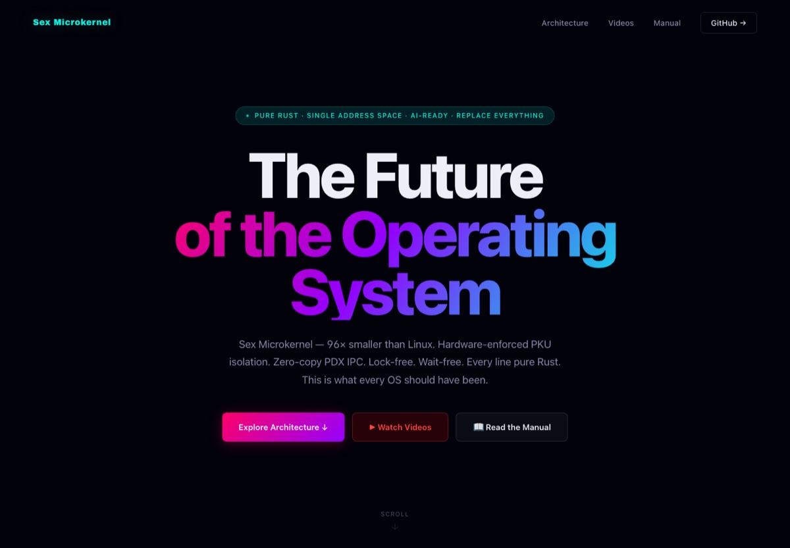

# SexOS

### A single-address-space Rust microkernel

[Website](https://sexos.dev) · [Architecture](ARCHITECTURE.md) · [Manual](docs/handoff_html/index.html) · [YouTube](https://youtube.com/playlist?list=PLtv6PF9o7eC59PC5cn49Wia-8ogZ6AxUn) · [Releases](https://github.com/xirtus/sexos/releases)



SexOS is an experimental operating system built around a **single global virtual address space** instead of per-process page tables. Memory is globally addressable; authority is capability-controlled through `sex-pdx`; Intel PKU is used as an optional hardware enforcement accelerator. The kernel is written in Rust, and the userland is a set of protection-domain servers.

It is not a Linux distribution, not a drop-in replacement for Linux, and not production-ready. It is a testbed for a different OS model: one address space, explicit capabilities, deterministic epochs, and a very small kernel.

## What is in the box

- **GLOBAL_VAS** — one virtual address space for kernel, servers, and processes.
- **sex-pdx** — the capability and communication substrate. All inter-domain access is capability-mediated; there is no ambient authority.
- **PKU enforcement** — protection keys accelerate domain boundaries; the authority model still comes from `sex-pdx`.
- **BOOT_DAG** — static, boot-time capability genesis; immutable once the epoch engine starts.
- **Deterministic execution model** — state is a function of `(epoch_id, input_stream, capability_graph)`; transitions are snapshot → transform → swap → commit.
- **User-space servers** — `silk-shell`, `sexdisplay`, `silkbar`, `sexfiles`, `sexinput`, `sexusb`, `sexnet`, `sexstore`, `linen`, `quil`, and apps such as `sexdrive`, `kaleidoscope`, and `spindle`. `sext` is an active bounded demand pager using capability-backed frames and authenticated fault recovery.
- **Boot path** — Limine, x86_64 UEFI/BIOS, QEMU; ARM64 port phases 2–6 are in the tree.

The full invariants and server model are in [ARCHITECTURE.md](ARCHITECTURE.md). The generated manual is in [docs/handoff_html/index.html](docs/handoff_html/index.html).

## Status

**Experimental.** The x86_64 image boots under QEMU and reaches the `silkbar` event loop. The ARM64 port is in progress. Syscall/ABI surfaces are unstable, there is no production security audit, and hardware coverage is narrow.

The architecture defines the required model. The scheduler now tracks task custody through park, wake and stack release. Runtime memory queries resolve fixed boot-granted regions; capability tables seal before task admission, and drivers use bounded DMA backing. The [scheduler and memory report](docs/handoff/SCHEDULER_OWNERSHIP_AND_MEMORY_AUTHORITY_2026_10_28.md) records the implementation and evidence.

The [multi-client sext paging report](docs/handoff/SEXT_MULTI_CLIENT_PAGING_AND_SAFE_RECLAMATION_2026_10_28.md) covers two boot-authorized clients sharing eight frames, independent quotas, authenticated release, safe frame reuse and real read/write fault recovery. Boot still reserves backing and page-table infrastructure. Reclamation supports cooperative release and task-exit cleanup after custody release on the BSP. The [app resources and desktop report](docs/handoff/APP_RESOURCES_AND_DESKTOP_2026_10_29.md) extends cleanup to Quil, Spindle and Kaleidoscope: native Close, five service acknowledgements, surface retirement, private ELF/user-stack detach and Sext zero/reuse. Linen refresh continues handling input and native app content follows its frame. General relaunch beyond the finite BOOT reserve, autonomous eviction, hostile-code isolation, physical SMP scheduling and complete epoch replay remain unfinished. The [architectural truth report](docs/handoff/SEXOS_ARCHITECTURAL_TRUTH_2026_10_28.md) records the wider obligations and the scope of the executable checks.

The [launcher follow-up](docs/handoff/INCARNATION_AUTHORITY_AND_LAUNCHER_2026_10_29.md) adds exact BOOT incarnation checks and readable running/closing/closed states. The [BOOT-reserved relaunch follow-up](docs/handoff/BOOT_RESERVED_RELAUNCH_2026_10_29.md) provisions one fresh Quil successor with immutable activation authority; both terminal identities remain preserved, and the launcher reports reserve exhaustion after the second instance closes.

What works today:

- x86_64 QEMU boot from the prebuilt ISO.
- Kernel bring-up, paging/PKU setup, PDX call path, scheduler/yield path, serial console.
- `silkbar` cadence/event loop and the display/input path in the QEMU configuration below.
- A build pipeline sealed to `scripts/entrypoint_build.sh`.

What does not work / is not claimed:

- General-purpose desktop use, Linux binary compatibility, or a stable user ABI.
- Production security or isolation guarantees.
- Broad hardware support.
- Independently reproduced performance comparisons against Linux.

## Quick start (prebuilt ISO)

Download the latest experimental ISO from [Releases](https://github.com/xirtus/sexos/releases), verify it, and boot it:

```
SHA-256 (v0.1.0): 187acaf5fb4664f25751acbcf991f8c8c37c9fc9e1acc4fe3d39f2f90542b801
```


```bash
# v0.1.0 asset name
qemu-system-x86_64 \
  -M q35 -m 512M -cpu max,+pku \
  -cdrom sexos-v0.1.0.iso \
  -serial stdio -display none -no-reboot
```

You should see the boot log and the `silkbar` loop. Press `Ctrl-C` to stop QEMU.

For a graphical QEMU window, put the ISO in the repo root as `sexos-v0.1.0.iso` (or set `SEXOS_ISO=/path/to.iso`):

```bash
./dev.sh run
```

On Apple Silicon macOS, `bash boot_mac.sh` uses TCG emulation and the local ISO.

## Build from source

Requirements: a Linux build environment (CI uses Ubuntu), Rust nightly with the `x86_64-unknown-none` target, Python 3.9 or newer, `ripgrep`, `sha256sum`, and QEMU for running. The build is intentionally sealed to one entrypoint:

```bash
make full
```

Direct `make iso` and `make run-sasos` are hard-fail stubs; use the entrypoint. See `scripts/entrypoint_build.sh`, `sexos_build_spec.toml`, and `sexos_contract.toml` for the pinned contract.

## Architecture in one page

```
GLOBAL_VAS  →  addressing only
sex-pdx     →  authority: every access decision
PKU         →  hardware enforcement accelerator (optional)
BOOT_DAG    →  capability genesis (immutable after lock)
```

No domain interaction happens outside `sex-pdx`. No capability exists without `BOOT_DAG` sanction. PKU never makes an authority decision; it only enforces one. The kernel traps, forwards, and resumes — it is a transition arbiter, not a memory authority. `sext` owns demand paging and mapping in ring 3.

If you want the longer version, read [ARCHITECTURE.md](ARCHITECTURE.md), then the [manual](docs/handoff_html/index.html).

## Performance claims

The website lists strong comparative claims (for example, “96× smaller than Linux” and “3.5× faster IPC”). Those are project claims, not independently verified results. A reproducible benchmark page with hardware, kernel configuration, workload, raw numbers, and caveats is not yet in this repository. Treat the numbers as hypotheses until that page exists.

## Repository layout

```
kernel/          kernel and arch ports
servers/         sex-pdx servers and shell/display/input stack
crates/          shared crates (sex-pdx, graphics, models)
apps/            user-space apps
docs/            handoff notes, manual, architecture material
scripts/         build and QEMU entrypoints
website/         sexos.dev source
ARCHITECTURE.md  canonical system invariants
```

## Docs and media

- [Architecture](ARCHITECTURE.md)
- [Manual](docs/handoff_html/index.html)
- [Website source](website/index.html) — live at https://sexos.dev
- [YouTube playlist](https://youtube.com/playlist?list=PLtv6PF9o7eC59PC5cn49Wia-8ogZ6AxUn)
- [Handoff notes](docs/handoff/) — implementation history and open lanes
- [Reliability roadmap and execution report](docs/handoff/SEXOS_RELIABILITY_ROADMAP_2026_10_28.md) — current evidence, fixes, and next steps
- [Architectural truth report](docs/handoff/SEXOS_ARCHITECTURAL_TRUTH_2026_10_28.md) and [executable obligations](spec/README.md) — source-bound invariants, adversarial regressions, and open proof gaps

## License

GPL-3.0. See [LICENSE](LICENSE).

## Contributing and security

- Read [CONTRIBUTING.md](CONTRIBUTING.md) before opening a PR.
- Report security issues privately via GitHub Security Advisories; see [SECURITY.md](SECURITY.md).
- The architecture invariants in [ARCHITECTURE.md](ARCHITECTURE.md) are not suggestions. PRs that bypass `sex-pdx`, add ambient authority, or reintroduce per-process page tables will be rejected.
