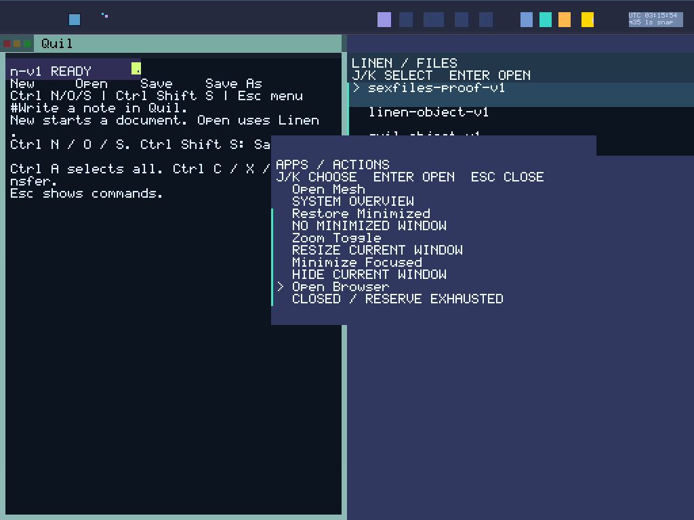

# Round 157: BOOT-reserved Browser relaunch

Browser now has a finite BOOT-reserved chain, 15 → 30 → 31. The launcher appends
“Open Browser” at command 10, preserving commands 0–9 and the separate WebStub.
It focuses the exact live incarnation, waits for the predecessor’s terminal
cleanup, and invokes the exact next activation grant. It verifies the committed
receipt and identical replay. After 31 closes, the UI reports reserve exhaustion;
it cannot manufacture another subject or grant.

| Browser | Surface | Lifecycle / activation | Net entropy / clock / trust |
|---|---:|---|---|
| 15 | 300 | 40 / original | 60 / 61 / 62 |
| 30 | 343 | 154 / 156 | 70 / 71 / 72 |
| 31 | 344 | 158 / 160 | 73 / 74 / 75 |

These numbers describe BOOT’s catalog. Task identity comes from independently
registered task objects and held typed INFO observations. BOOT reserves the
successors, Net/Bell routes, lifecycle/activation edges, private images and
source grants before sealing. Late readback verifies the actual grants. The
original five authority records retain their byte format; the expanded inventory
has 13 source/TLS authority records. Runtime code mints no authority.

The shared GLOBAL_VAS, typed sex-pdx authority and PKU enforcement remain intact.
This adds no process address space or Unix interface. The architecture file is
unchanged (SHA-256 `4085f8fa65234205c5fdab070fe36765d767a46edc001410bf2ed5bfb27a98d7`).

The actual budget is 19 app reservations and 31 sealed mains out of 32. Shell
retains 34 lifecycle entries; its independent golden and rejection controls cover
that exact roster. Document clients increase from 9 to 11. Display reserves three
separate bitmap stores (55,992 bytes), retaining each incarnation’s pixels,
sequence floor, receipts and terminal tombstone. The denial-only Net outbox has
57 bounded fences (19 per kind), below its existing 4 KiB storage bound. Successor
paging probes remain disabled; this round adds no successor paging authority.

BOOT auditing no longer equates task numbers with domain numbers. It captures the
predecessor main task independently from the registry and checks its domain
context pointer and pinned app observation before comparing activation grants.
Host controls use deliberately unequal task numbers. Native numbers happen to
match domain numbers; native unequal allocation is not claimed.

Source evidence validates the complete source-bound catalog, all planned BOOT
source grants, versioned typed readbacks and Net bindings before selecting a
consumer. Global kernel clock ordinals include SilkBar; Net’s clock high-water
remains shared across its consumers and survives old-incarnation retirement.
Entropy sparse counters and each consumer’s positive seed RELEASE remain distinct.
Trust profile/root/version fields come from actual typed INFO, not expected values
printed as observations.

## Evidence

Final source: `eb774be90836418d056923b9863f04286792c2f3`.
ABI: 66 inputs, `12d218c65235f1600843213a8cdce2cb5f93c0476db09080903171099fe0720f`.
ISO: `468ed18fd69801dc17e0678437317fa8d57027917dd5ef71e55807d0e3691e91`.
Kernel: `93c692bc680a7231355f836520435caba97b8e40749416b151587c15a09252b3`.

All 43 frozen host checks pass without source drift: 3,070 logged Rust case
executions plus 22 separately captured nested cases = 3,092. All ten final boots and the cross-boot BOOT/source audit pass. Both desktop
profiles complete the eight-Quil/eight-Spindle chains and fresh read-only replay;
compact has 39 captures/two rehearsal cycles, wide has 39. Four connected
warm/cold boots add 34 qualified captures. The separate parent-bound cold check
recovers last-writer Spindle29 history; it has no standalone artifact replay.

- The final frozen image passes its 35-second boot. Both compact e1000 and wide
  e1000e Browser workflows pass and fresh read-only replay passes. Each exercises
  all three incarnations, actual local TLS preparation through the selected
  trust/UTC/seed grants, positive seed RELEASE, input, Close, five cumulative
  cleanup roles, private retirement and zeroed retired storage and its pool-ready receipt before the next activation.
  Successors use independently BOOT-reserved storage.
  All three startup Echo flows are independently joined to PCAP and ownership.
  Local preparation does not authenticate a peer or establish public web trust.
- The two exhausted-launcher captures pass whole-glyph checks. Six Browser PPMs
  are retained as raw images, explicitly **not pixel-qualified**. They are not
  counted as proven Browser glyphs.
- 1,085 frozen Python cases pass. Exact Git/frozen/manifest comparison passes for
  582 production and 626 runner files: 1,208 unique blobs / 11,863,985 bytes.
  Nine ISO-extracted ELFs contain 330,084 decoded instructions with zero scan
  matches for FP/vector instructions. This is a static audit, not runtime
  register/cache erasure proof.

The first native attempt reached all three incarnations but was rejected by an
incorrect verifier assumption: it counted only 8,192 queue bytes. The actual
source-bound Pipe includes 56 metadata bytes. The corrected checker derives
8,248 from the backend’s constants and compile-time size assertion; it rejects
the old assumption. The failed attempt stays unqualified and is retained as a
counterexample. A separate 34-entry lifecycle golden replaced the stale 32-entry
host fixture. The broader desktop attempt also caught old palette navigation that wrapped from
0 to 9. Source-bound navigation now derives the actual command count and each
transition; native and replay probes retain action/viewport checks. The failed
desktop prefix stays unqualified. These fixes do not weaken production authority
checks.

[Raw evidence archive](assets/sexos-browser-reserve-2026-11-01-raw.tar.gz):
13,042,212 bytes, SHA-256
`1486f567d39274b0c288142e8dd462ffa2c38ded6c0e5448d2da0315ae9526df`.
All 1,618 members were reopened and checked against their per-file size/SHA
manifest. The archive includes the final frozen source/image, raw traces,
source/scalar/host controls, captures, compressed terminal disks and replay
results, with rejected B/D artifacts separately marked unqualified.

There are 114 pixel-qualified registry/launcher captures plus six raw Browser
frames (120 retained registry/Browser captures total). The auxiliary cold PPM is
separate. Raw Browser frames are not promoted by source or serial observations.

Inventory remains **2 Open / 28 Partial / System Proven false**. This is a finite
three-incarnation Browser reserve, not unlimited relaunch or daily-driver alpha
acceptance. Prior sustained typography evidence does not qualify this new image.

## Next

158: qualify Browser status glyphs for each exact held incarnation in small tiles
and across resize, with wrong target/task/surface controls. Add identity-stamped
layout and positive Applied correlation, and make the clipped TLS panel fit the
actual tile before changing its oracle. The six raw images in
this round must not be promoted by renaming identities.

Then stress pending-operation Close/reopen and source lease expiry across the
whole chain, followed by a sustained unified desktop session and fresh cold data
recovery. Review the remaining 31/32 main-task headroom before expanding reserves;
retain BOOT-only genesis and explicit finite exhaustion.
