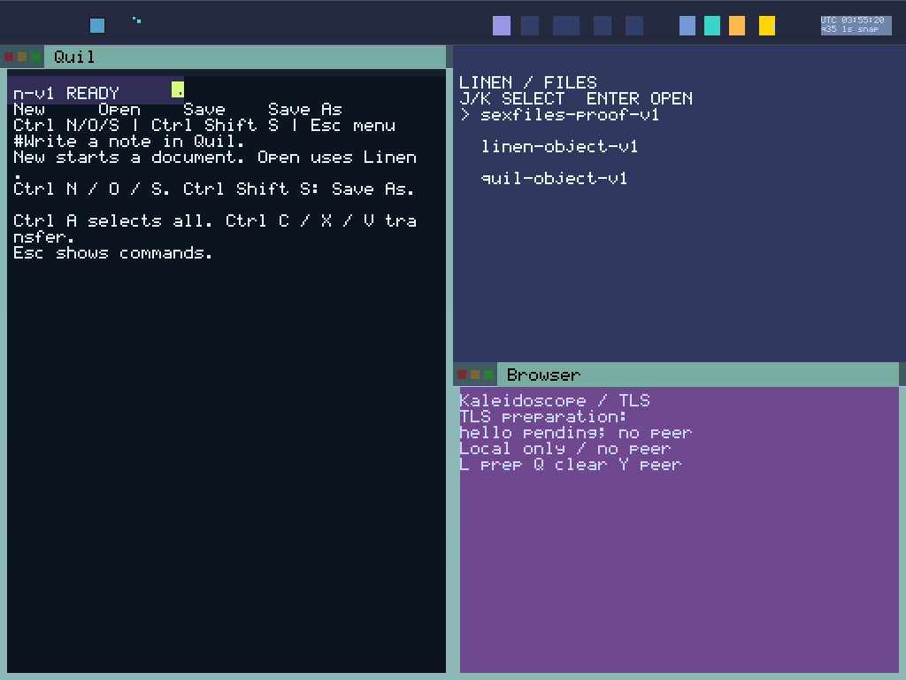

# Round 158: viewport-aware Browser TLS panels

Browser’s local TLS panel now fits the actual tile. It replaces the overview’s
large padding with a bounded status/help frame. Normal compact, wide and expanded
views show the complete state, “Local only / no peer,” and the L/Q/Y controls.
Very small views get an explicit “Enlarge tile” fallback; verifying that fallback
does not qualify it as a complete status panel. This is local preparation UI, not
an authenticated peer or public-web trust claim.

The composer uses shared integer text metrics, at most 512 padded bytes, 63
columns and 24 rows. It accounts for the bottom frame rim. Status text must fit in full; otherwise
the explicit fallback is used. Existing overview and other panel paths stay
separate; the legacy pure composer API remains available to its host tests.

A queued TLS frame retains the exact BOOT-held recipient identity, viewport,
full text hash/length, columns/rows, state and completeness. Layout diagnostics
are emitted only after successful queue acceptance. Positive Applied diagnostics
use the retained receipt metadata and actual decoded paint sequence, rather than
current UI state. Coalescing, Full retries, old acknowledgements and viewport
changes cannot relabel an older frame as the latest one.

Display’s Browser text path now requires the existing held Browser binding,
exact incoming caller task/surface and cached LIVE state before decoding or
mutating text staging. Successful commits emit a parallel, identity-stamped
record with actual task and validated decimal wire hash. The old text marker is
preserved. This narrows the Browser text path; it does not claim that every other
text/fill path has task-level admission.

The pixel oracle first validates the complete source-bound BOOT inventory and
both global source streams. It then selects an immutable recipient context,
deriving task from held observations and surface from the reviewed source plan.
It consumes the whole trace with an explicit capture window; it neither rewrites
identities nor filters away other consumers’ global records. Exact viewport,
accepted layout, successful Display commit and matching positive Applied are
required before independently reconstructed panel glyphs can pass.

Capture qualification is anchored before screendump. A post-capture prefix fence
rejects relevant viewport, frame, state or focus changes during capture. Replay
requires each exact-surface Zoom receipt and physical Enter gesture, fresh
viewport/paint, a changed expanded extent and the restored original tile. Valid
callee-before-caller-return logs remain accepted. Service-source checks establish
Shell PD3 and Display PD1; they do not establish those services’ sender task IDs.

No new wire protocol, runtime capability creation, process address space or R9
transport is introduced. GLOBAL_VAS supplies addresses; BOOT creates authority,
typed sex-pdx authorizes and PKU enforces. Architecture SHA-256 remains
`4085f8fa65234205c5fdab070fe36765d767a46edc001410bf2ed5bfb27a98d7`.

## Evidence

Final source: `21ef94205cee56c2cdc5494b78557413d59245ec`.
ABI remains 66 inputs,
`12d218c65235f1600843213a8cdce2cb5f93c0476db09080903171099fe0720f`.
ISO: `5370efe8e449a5f4154060c495c6322cbef3a6f9bf493de3ae33f0d014401897`.
Kernel: `93c692bc680a7231355f836520435caba97b8e40749416b151587c15a09252b3`.

All 43 frozen host checks pass without source drift: 3,077 logged Rust
executions plus 27 separately captured nested cases = 3,104. All ten final boots and the BOOT/source audit pass. Both desktop profiles
complete the eight-Quil/eight-Spindle chains and fresh replay. The four connected
warm/cold boots pass; the separate parent-bound last-writer29 cold recovery passes
without claiming a standalone auxiliary artifact replay.

- Both compact e1000 and wide e1000e native Browser chains pass, with fresh
  read-only replay. All 15→30→31 incarnations have complete status pixels in the
  initial tile, after Zoom and after restore: 18 TLS captures plus two exhausted
  launcher captures. Each workflow retains exact source/seed RELEASE, startup
  Echo PCAP, Close, five service ACKs, retirement and zeroed-pool checks before
  the next activation. The successor storage is independently BOOT-reserved.
- 1,098 frozen Python cases pass. Durable panel tests cover unequal task IDs,
  1x/2x text, tiny fallback, wrong identity/hash/paint, missing positive ACK,
  Full/coalescing, old viewports, invalid unselected global records, pixel
  corruption and sender-return ordering. Public UI-frame hash exceptions remain
  restricted to exact held identity and validated schema; private seed/TLS
  material remains forbidden in metadata.
- The actual composer/queued metadata/Outbox/Display Stage tests run 20 cases,
  with freshly extracted Main helpers. Missing-bottom-rim and wrong-queued-
  viewport variants compile and then fail their exact runtime tests. Display
  binding checks add wrong-task/stale/foreign controls before staging.
- All 1,209 frozen blobs (582 production + 627 runner, 11,916,440 bytes) match
  pinned Git content and manifests. Nine ISO ELFs contain 331,077 decoded
  instructions with zero FP/vector scan matches. Static scanning does not prove
  runtime register/cache erasure.

The first native attempt verified the initial small panel, then stopped because
the checker omitted Shell’s `reason=ok` success suffix. That incomplete attempt
stays unqualified. The corrected exact receipt check preserves the recipient,
phase, hardware gesture and viewport/paint requirements; fresh captures replace
neither old images nor old source bindings.

[Raw evidence archive](assets/sexos-browser-panels-2026-11-01-raw.tar.gz):
12,550,321 bytes, SHA-256
`09160fef10cc6d53a6d116e72145be3d3b725adc450e1251426701c33de9154f`.
All 1,594 members were reopened and verified against per-file size/SHA records.
The archive retains the frozen source/image, host/source/scalar controls, raw
captures/traces, compressed terminal disks and replay outputs. The incomplete
first attempt is separately marked UNQUALIFIED; round157 counterexamples remain
in [their prior report/archive](BROWSER_BOOT_RESERVE_2026_11_01.md).

There are 132 qualified registry/native captures: 112 desktop/connected, 18 TLS
panels and two launcher captures. No raw Browser frames are counted as qualified;
the auxiliary parent-bound cold PPM remains separate.

Inventory remains **2 Open / 28 Partial / System Proven false**. This round does
not retroactively qualify the six raw Browser images from round 157, claim public
TLS trust, add successor paging, or establish sustained daily-driver acceptance.

## Next

159: stress pending-operation cancellation, resize and Close/reopen across the
reserved chain. Preserve original source lease deadlines, exact cleanup and
bounded input/Close behavior under Full or delayed service receipts.

Then run a sustained unified desktop/cold-recovery session on the current image,
and address the 31/32 main-task headroom before expanding finite app reserves.
BOOT remains the only capability genesis.
