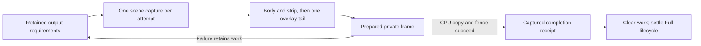
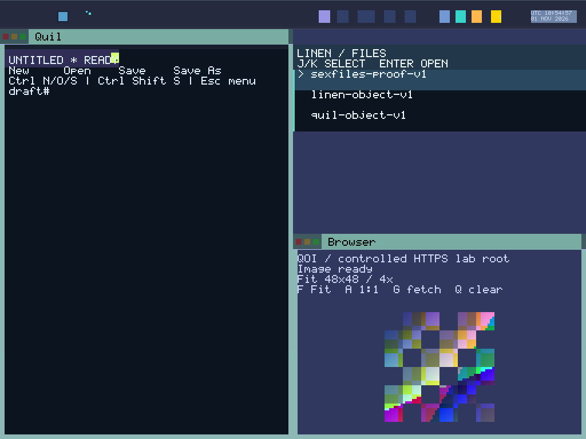

# One captured scene and publication per desktop update batch

Round 168 qualifies **11 boots and 70 captures** on source `ca82b950b1609cb8fac06ac468e77326f8b170a5`. All **46 frozen host checks** and **1,132 Python tests** pass. Content, cursor and clock work from one drain now share a captured scene, private target, overlay tail and CPU publication. Failed attempts retain their output obligations for retry.

The bounded plan joins Full, Area, Damage and Cursor requirements in that order, with independent strip work. Full covers the strip; invalid/empty damage cannot erase a cursor request. Damage unions use the actual clipped rectangle helper, and a geometry change conservatively retains Full while the BOOT backing still rejects an unauthorized shape. These joins describe required output against the latest admitted source state. They neither reorder producer operations nor establish a causal input stream.

The primary-framebuffer notification queues Full work instead of painting during intake. Lifecycle completion consumes a captured Full receipt instead of issuing another render. Only successful publication clears pending requirements or advances clock suppression and the deferred live-frame marker. Idle iterations attempt no capture/preparation/publication while continuing receipt retries and yielding. A failed attempt can join newer requirements and capture their latest source state on retry; it does not roll back raw producer admission.

One scene lease now covers the entire preparation, publication and post-publication effects. Primitive body/strip passes borrow it and never recapture globals, reset accumulated presentation bits or redraw overlays. A partial batch restores the old cursor once, paints body then strip, paints Atlas/menu when required, and captures/draws the cursor once at the end. Full animation advances once before capture, inside rollback custody. Reentry rejects before taking an exclusive frame-store reference. Lease and temporary cursor copies release before the caller can settle lifecycle cleanup.

The new completion carries the published plan and visibility bits. Partial receipts cannot settle prepared cleanup; Full completion uses its captured bits rather than rereading a later global mask. Failed or absent completion leaves cleanup pending, while an already committed ACK can retry without another render. Existing cursor-underlay erasure and both private-frame scrubs remain mandatory before removal-frame custody release.

The actual batch module passes eight cases, including 864 request permutations, and three compiled defects reject lost union, premature clear and dropped strip work. The frame gate passes 38 cases across SDK layout, store, VA allocation, batch planning and nine extracted Main pipeline cases. Six Main mutants plus three batch mutants, four ownership compiler controls and six source controls reject. Actual Main tests count capture/preparation/publication, preserve snapshots despite live mutation, exercise failed second passes/CPU preflight, no-work, no-front Full promotion, geometry and retained retry. Host raster/overlay/output doubles keep their declared scope.

All 46 prior compositor cases remain, with three added combined cases: Area+Strip full-image reference, Damage+Strip changed/untouched pixel checks, and Cursor+Strip body preservation. The independent reference is unchanged. Scene/cleanup coverage grows from 11 to 12 cases, preserving six compiled controls and two source controls while adding captured-receipt visibility. Five actual cursor cases and their controls remain. Retained stdout logs contain 3,183 successful Rust test executions with repeated SDK fixtures; frame-gate case totals are separately recorded and are not an exhaustive unique-test count.

Four clock runs qualify 16 clock/full-chip captures, connected session/cold recovery qualifies 34, and Browser 15→30→31 reserve/Close/panel/exhaustion qualifies 20. Both compact/e1000 and wide/e1000e profiles pass fresh frozen CLI replay; clock runs additionally pass complete pixel replay APIs. The explicit BOOT audit verifies all 11 logs. These functional regressions do not turn serial batch counters into complete epoch replay evidence.

| Measured item | Current evidence |
| --- | --- |
| Private physical frame reservation | 8 MiB per boot at either profile, unchanged |
| Mapped two-frame bytes | Compact 6,291,456; wide 8,192,000, unchanged |
| Static scene / frame-store metadata | 59,584 / 88 bytes, unchanged |
| Display ELF | 286,720 bytes; 1,016 larger than Round 167 |
| BOOT heap after seal | 11,851,408 used / 256,584,048 free, unchanged |
| Recorded app-private backing | 2,465 pages / 10,096,640 bytes, unchanged |

Actual local prologue reservations are `_start` 4,696 bytes, `raster_batch` 2,344 and `render_prepared` 1,304, each plus 48 register-push bytes. Primitive passes are inlined into the batch; these measurements exclude transitive callees, interrupts and dynamic paths. Physical free frames remain unmeasured, and these observations cannot be summed as disjoint total RAM. The checked code path eliminates duplicate preparation/publication for combined updates; no latency, throughput or tear-free benchmark is claimed.

The initial assembled compositor attempt passed all 49 pixel cases but stopped at an external bitmap test's obsolete lifecycle-function signature (16/17). That exact failed log, proof and helper remain UNQUALIFIED. Updating the integration assertion preserves ownership and completion ordering; the final frozen registered gate passes all dependent checks. No sealed build or native guest failed or restarted for that diagnostic.

All **1,224 frozen source files / 12,217,001 bytes** match pinned Git blobs and manifest membership. Of 585 prior production files, 584 are unchanged, Main changes and paint_batch.rs adds one. Kernel `26bace17d464d1ea04667a6ff1dc47514d76be472342ca4ed396000f62a20f89` and the ordered 67-input ABI `3b98b23398b7a309a74d5d10526e9234fa372ff448c79f51aa4f4b9f44fdc36a` remain byte-identical to Round 167. ISO SHA-256 is `64f8d6810d1f9931aef0c1dc91029e3f39315ee9721599de044d8397fd07194f`. Nine service/app ELF scans inspect 324,791 decoded instructions with zero matched FP/vector operations and retain the CPU store fence. Static scans establish no runtime register/cache erasure.

[Raw evidence](assets/sexos-display-batches-2026-11-01-raw.tar.gz): **11,243,461 bytes**, SHA-256 `7a3fd1f24c662b3f033e3d58331b2b0aa522e41d6395a4961b3681d0db9e185c`. Both the packager and Root independently reopen and size/SHA-verify all **1,576 members**. Frozen source/image/kernel, host proofs, native raw actions/captures/serial/PCAP/disks, executed helpers, fresh replays, budgets and separate diagnostics are retained. Earlier native acceptance keeps its own image binding.

The PNG preserves every RGB byte of the qualified compact connected `image-fit.ppm`; it adds no capture or boot.

Next, implement bounded custody for typed text/bitmap completion effects, including the text newer-Begin/pending-reply case. Keep admission diagnostics explicitly `pixels=unconfirmed`; hidden, empty and unchanged updates need a settlement obligation rather than an invented visibility claim. Raw intake still mutates source state before output commit, so complete transactional input/effect ownership, unified causal capture, interrupted-output recovery, hardware latch/vblank and system replay remain required under [the Display plan](DISPLAY_EPOCH_IMPLEMENTATION_PLAN_2026_11_01.md). EPOCH_COMMIT and DETERMINISTIC_REPLAY remain Open; 28 other obligations remain Partial, and System Proven is false. GLOBAL_VAS, BOOT-only capability genesis, sex-pdx authority and PKU enforcement remain mandatory. No Alpha/1,800-second, all-app reserve exhaustion, hardware/SMP, hard realtime, physical erasure or general daily-driver qualification is added. Active 80–200 continues: 89/121 accepted; 169–200 remain 32 substantive rounds.
