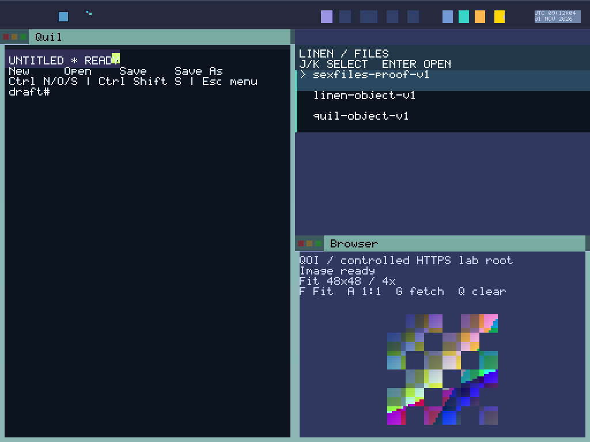

# Display-owned immutable composition inputs

Round 166 qualifies the new scene ownership across **11 boots and 70 captures**. All **44 frozen host checks** and **1,132 Python tests** pass. Host logs contain 3,174 successful Rust test executions, including SDK cases reused across fixtures. The source commit is `c947cccd53c7a4b7513b93c1c480eda502ea1fa6`.

Display now captures admitted surfaces (text, selection, fills and cursor surface), grouping, committed Browser bitmap pixels, the bar, appearance tokens, focus, dimensions, animation value and 50 backdrop rows into fixed owned backing. Full, strip, area, damage, cursor and renderer-proof paths hold one non-copyable scene lease through their final overlays. Pixel composition reads these captured inputs. The snapshot contains no producer/framebuffer pointers, transfer staging or capability authority.

Missing startup stores produce empty images; malformed installed associations fail the entire capture and scrub its old destination. Pending or poisoned bitmap transfers retain their previous committed image. Captured owner/task bindings describe data and do not replace live intake authentication. Nested capture rejects before constructing an exclusive reference. Drop scrubs the owned payload, and both cleanup paths refuse a retained scene. Prepared cleanup also volatile-erases cursor save-under before the removal render and custody release. Failed rendering keeps cleanup prepared. Host unwind coverage does not imply guest panic recovery.

The actual scene/lease/cleanup fixture passes 11 cases, two source controls and six compiled runtime defect controls. The compositor preserves its 44 existing tests and independent reference, adding two pixel-isolation regressions. Shader and service/output doubles retain their declared host scope. Bitmap snapshots pass 17 current-catalog and 17 future-metadata cases, with five rejected compiled controls; those fixtures establish no future BOOT grants. Captured blur rows equal the actual legacy implementation at six tested heights. Legacy blur scratch allocation/computation remains, so no speedup or memory-saving claim is made.

| Measured budget | Current evidence |
| --- | --- |
| Target `RENDER_SCENE` static object | 59,584 bytes in the ISO's Display ELF |
| Display ELF | 290,888 bytes; 61,336 more than Round 165 |
| `_start` local prologue reservation | 5,096 bytes; previously 5,288 |
| `render` local prologue reservation | 2,312 bytes; previously 2,376 |
| BOOT heap after seal | 11,851,216 used; 256,584,240 free of 268,435,456 bytes |
| Recorded app-private backing | 2,465 pages / 10,096,640 bytes |

Both measured prologues also push 48 bytes of registers. These figures exclude transitive callees, interrupts and dynamic paths. The snapshot is populated in place. Physical free frames remain unmeasured; app-private pages exclude Display storage and cannot be summed with these figures as disjoint total machine memory.

Four clock runs qualify 16 clock/full-chip captures, including normal and invalid-year RTC states at both sizes. Connected session/cold-recovery runs qualify 34 captures. Two Browser reserve runs qualify 20 captures through the held 15→30→31 chain, Close, image panels and exhaustion. Every workflow passes a fresh frozen CLI replay; separate full clock replay APIs validate its complete pixel proofs. The explicit BOOT audit verifies all 11 logs, including the sealed build.

The original suite coordinator stopped after the successful compact Browser guest because its result uses `frames`, while the coordinator expected `captures`. Its original helper, failed log and terminal progress remain as UNQUALIFIED diagnostics. A separate resume helper strictly replayed the existing compact Browser evidence, then ran only the four unstarted wide workflows. No compact guest was restarted or counted twice. Earlier stale bitmap fixture/source assertions and an initial incomplete typecheck setup remain separate preflight diagnostics; the final frozen checks pass.

The ISO SHA-256 is `4cc9ff4a6d1851fbc09bbe2c982e03b71a116cb94636873d1681c890af5bad58`. Kernel `4bef299f42a0a2f89dc2bda76ee717623f9a213341939268be908168006e1f7c` matches Round 165 byte for byte. All 1,214 frozen source files (12,105,849 bytes) match the pinned Git blobs and manifest memberships. Of 582 prior production files, 578 are unchanged, four Display modules change, and scene.rs adds one. All 66 ABI inputs retain `ff1d1346b449ed2efe6e5cffbc9c545b27d4d351979ad890fac43ffaa9725ba8`. The nine ISO ELF scans inspect 324,383 decoded instructions with zero matched FP/vector operations; runtime register/cache erasure remains outside this static scan.

[Raw evidence](assets/sexos-display-scene-2026-11-01-raw.tar.gz): **11,172,503 bytes**, SHA-256 `6a9dd38f6fb90b8636f3825876a8b7155769ab4a3875145b684f3515ae4cc6ca`. Both the packager and Root independently reopen and size/SHA-verify all **1,569 members**. The archive includes frozen source/image/kernel, host logs, executed auditors, native captures/actions/serial/PCAP/disks, fresh replay proofs, budgets and retained diagnostics. Earlier acceptance keeps its original image binding.

The PNG preserves every RGB byte of the qualified compact connected `image-fit.ppm` capture; it adds no capture or boot.

This establishes logical composition-data isolation. Intake still mutates live stores, and framebuffer writes and cursor save-under remain output state. Transactional input/transform/swap/commit, coordinated effect release, causal cross-channel inputs, private frame publication, interrupted-output recovery, hardware latching and full-system replay remain required under [the implementation plan](DISPLAY_EPOCH_IMPLEMENTATION_PLAN_2026_11_01.md). EPOCH_COMMIT and DETERMINISTIC_REPLAY remain Open; the other 28 obligations remain Partial, and System Proven is false. GLOBAL_VAS, immutable BOOT capability genesis, typed sex-pdx authority and PKU enforcement remain unchanged.

Next, implement BOOT-sanctioned frame backing sized from the actual display geometry, then route rendering through one prepared-output publication boundary. Preserve exact incarnation ownership, bounded failure handling and cleanup custody throughout. No current-image Alpha, 1,800-second/sustained, complete app-reserve exhaustion, hardware, SMP, hard realtime or general daily-driver qualification is added. The active 80–200 plan continues: 87/121 rounds accepted, with 167–200 (34 substantive rounds) remaining.
