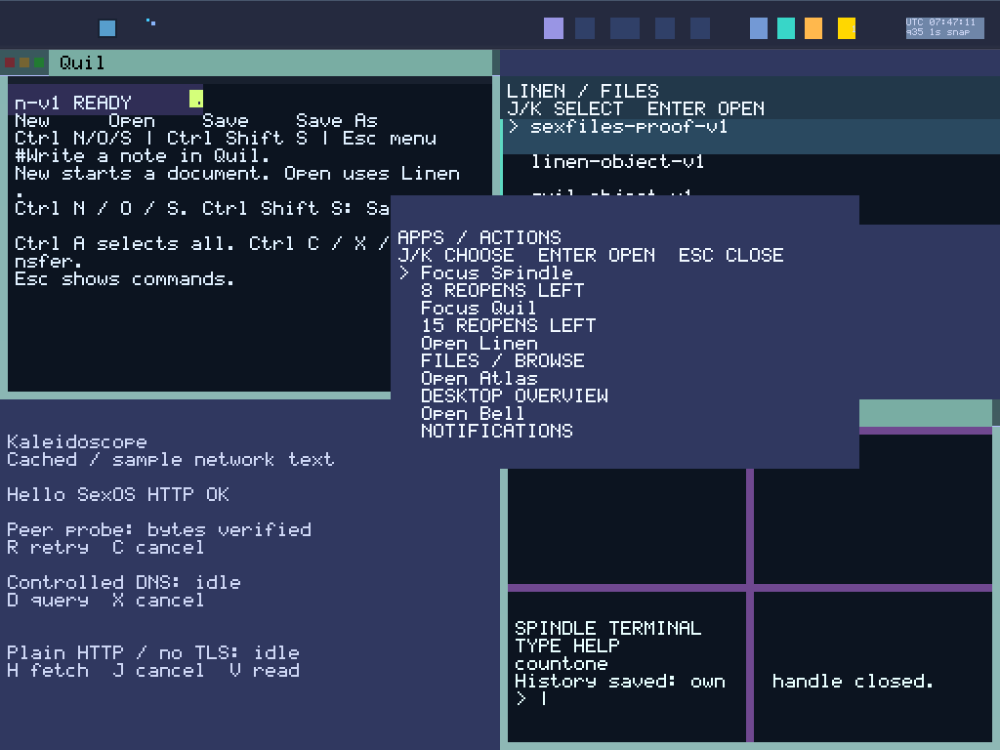

# Round 164: launcher counts from held reserves

The launcher-count change passes a three-boot qualification: one sealed build and targeted compact1024×768/e1000 and wide1280×800/e1000e runs. Both native runs and fresh replays pass four immutable menus each, for **eight qualified captures**. The final BOOT audit and archive verification pass.

The preview is a lossless conversion of the qualified compact `apps-live.ppm`, not an additional capture. Its original pixels, serial-prefix evidence and proof remain in the archive.

The launcher now shows the exact remaining reserve count when its existing held-grant observations establish a usable state. The initial labels are `15 REOPENS LEFT` for Quil, `8 REOPENS LEFT` for Spindle and `2 REOPENS LEFT` for Browser. After original Spindle12 closes and cleanup completes, the ready label is `8 RESERVED LEFT`. Selecting that existing held reservation activates Spindle17; once its history work is ready, the label becomes `7 REOPENS LEFT`.

These numbers describe reservations already held. They do not authorize activation, allocate a new task or mint a capability. The existing Close, custody, cleanup and activation checks remain responsible for authority. Native proof joins the source roster to actual BOOT task identities rather than inferring task identity from domain numbers.

Each rendered row owns its count-label storage until the launcher text builder copies the bytes into the display payload. Rows do not borrow a shared mutable formatting buffer. Short singular and terminal labels remain available, including `1 REOPEN LEFT`, `LAST INSTANCE` and `LAST RESERVED`; unavailable, unknown or inconsistent observations retain the existing fallback instead of inventing a count.

Spindle's operational messages take priority. Loading, saving, cancellation, uncertain history and disk-job states keep their existing labels. The live reserve hint replaces only the idle-ready focus label, so a count cannot conceal outstanding history or I/O work.

## Targeted evidence

The helper captures four immutable menus per profile: original live Quil/Spindle counts, the live Browser count, Spindle's post-Close ready count and the successor's idle-live count. Fresh `--check` replay verifies the pinned helper and frozen imports, full visible menu glyphs, positive text admission, serial-prefix capture fences and physical key edges. It joins the exact F11 Close to cleanup and the zeroed-pool receipt before the one held Spindle activation, then checks the successor's positive history save against the post-exit journal.

This is one Spindle successor transition per profile. It is not all-reserve exhaustion, arbitrary restart, an Alpha run, a connected-workflow cohort or current-image 1,800-second acceptance. It provides no new physical-hardware, SMP or hard realtime proof.

The first helper failed before QEMU or a run manifest was created: it passed a tuple resolution to an existing API requiring a string. Its helper, suite, failure trace and partial directory remain separately unqualified. They contribute zero boots and captures. The seed hash is retained; the untouched raw `.img` is omitted. This was a prelaunch harness error, not an OS failure, erasure result or recovery test. Native v2 uses the corrected external helper, verifies the actual native command and its parameter types, and runs on the same frozen source/image without rebuilding it.

## Binding and archive

Source: `a84043d05e2387aba7573c37525c6ac935be25c7`.
ISO: `d10f24d98e6d620c5aba8c8b407c12b44e559e0621d443b865fd2907ad5c33d3`.
Kernel: `4bef299f42a0a2f89dc2bda76ee717623f9a213341939268be908168006e1f7c`.
Source-binding SHA-256: `ea7437dc68dda6db9a601c47c15a5db91031f796b41670b331f60ee3a3f2815c`.
Native helper v2 SHA-256: `da5508197c082363b47471239ebbb27909beae6a34b1a7f2705d2391c40961e4`.

The current source audit covers 1,211 blobs totaling 12,023,092 bytes. The scalar audit scans nine ISO ELFs and 324,179 decoded instructions with zero FP/vector matches; this is not runtime register or cache erasure proof. All 43 frozen host checks and 1,124 Python cases pass. Host logs contain 3,144 successful Rust test executions, including SDK cases reused across fixtures; this is not a count of unique tests.

[Raw evidence](assets/sexos-launcher-counts-2026-11-01-raw.tar.gz): **9,573,670 bytes**, SHA-256 `b45dbc08691dd1e43f59c2c86be6012adc12e2d541db691d9978a14f319e9d32`. All **1,381 members** were reopened and size/SHA verified. The archive retains the frozen source/ISO/kernel, host logs, audits, pinned executed helpers, both native raw action/capture/journal records and fresh replays. The earlier prelaunch failure is separately unqualified with zero boots and captures.

Relative to Round163 B, 580 of 582 production blobs are unchanged. Only `servers/silk-shell/src/launcher.rs` and `servers/silk-shell/src/main.rs` differ; measured kernel bytes are identical. Catalog and authority remain 28 apps, 40 actual mains, capacity64, 16 Quil, nine Spindle and three Browser instances. Previous Round163 native evidence retains its own binding; it is not acceptance of this changed Shell image.

Architectural inventory remains **2 Open / 28 Partial / System Proven false**. **EPOCH_COMMIT** and **DETERMINISTIC_REPLAY** remain open; all other obligations remain partial. GLOBAL_VAS supplies addressing, BOOT creates authority, and typed sex-pdx and PKU retain their roles.

Next165 improves the date caption and formats it once per render. Next166 begins the substantive scene-epoch work described in [Display epoch implementation plan](DISPLAY_EPOCH_IMPLEMENTATION_PLAN_2026_11_01.md). That work must establish admitted work boundaries, atomic scene visibility and replay evidence; a counter or framebuffer copy alone does not close the open obligations. This follows the active 80–200 plan's dependency ordering.
