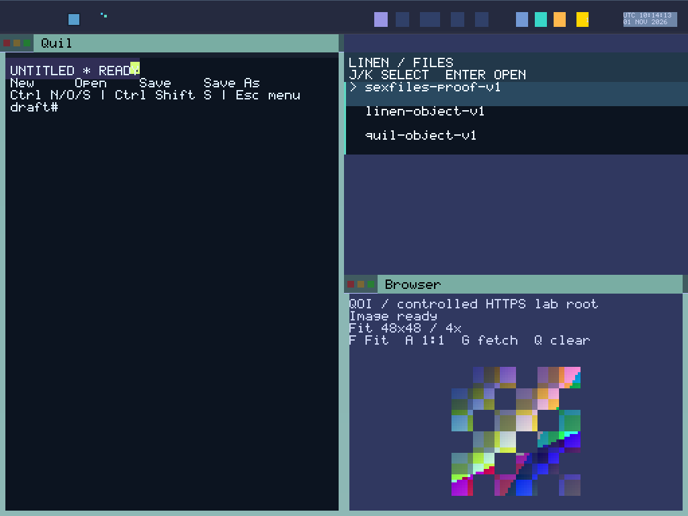

# BOOT-owned prepared frames and CPU publication

Round 167 qualifies **11 boots and 70 captures** on source `0c185625b086f6843e19d1c5de8c47d4c0a4e505`. All **46 frozen host checks** and **1,132 Python tests** pass. Display prepares its output in private backing and publishes through one checked, fenced CPU-copy function. Presentation records follow successful publication.

BOOT reserves one physical block containing two page-aligned frame spans sized from the actual geometry. It maps only Display's alias in GLOBAL_VAS with the actual domain key, writable/user/NX permissions, and grants slot 98 / region 11 through the existing memory-region interface. It checks zeroing, actual page-table leaves, capability readback, full-width slot rejection, range/rights denials and foreign-domain denials before sealing. Original full-width geometry is validated before narrowing; unsupported padded pitch and non-32-bit output fail bootstrap. The shared VA allocator now rejects overflow, invalid alignment and exhaustion without advancing its cursor.

The SDK resolves current-domain held INFO/full-view results into a checked descriptor. No capability kind, syscall or runtime allocator is added. This is **PD-held memory authority**; tasks within Display's domain share it. The descriptor creates no authority and guarantees no task isolation or physical uniqueness. Constructing the frame store requires explicit exclusive mapped-memory ownership; Main acquires and installs it once.

Full, strip, area, damage and cursor paths draw through borrowed private targets. Partial work copies the last committed frame into a disjoint candidate, preserving pixels outside the affected area and overlays. Failed or abandoned preparation erases the candidate and retains the old front/generation. Main restores tentative cursor patches, app bits, animation value and pending cursor metadata on failure. Cleanup scrubs both complete spans and padding before the removal render; app custody advances only after that render publishes and its scene lease releases.

The sole scanout writer verifies the exact BOOT address/shape, copies the completed candidate and issues an x86 SFENCE before successful presentation effects. Store generation, app/cursor/clock receipts and repaint completion follow this boundary. First-paint success requires publication. A callback that partially changes external output and then fails cannot be rolled back by the private store; hardware interruption recovery remains required.

Source review also found that full/partial rendering painted the launcher over the cursor while cursor-only movement painted the cursor over the launcher. All paths now keep the cursor last. Strip rendering restores the old cursor before painting overlays and capturing a fresh underlay. Five actual cursor pixel cases cover menu overlap, moving away without trails, clipping, changed-underlay restoration and partial/full equivalence over controlled background/menu layers. Two compiled mutants and four overlay-order counterexamples reject. Native connected workflows include pointer/wheel movement; exhaustive native menu/cursor combinations remain outside this cohort.

| Backing/budget | Qualified observation |
| --- | --- |
| Compact 1024×768 | 3,145,728 bytes/frame; 6,291,456 mapped bytes for two spans |
| Wide 1280×800 | 4,096,000 bytes/frame; 8,192,000 mapped bytes for two spans |
| Physical buddy reservation | 8,388,608 bytes per boot at either profile |
| Static scene / frame-store metadata | 59,584 / 88 bytes in the target Display ELF |
| Display ELF | 285,704 bytes; 5,184 smaller than Round 166 |
| BOOT heap after seal | 11,851,408 used; 256,584,048 free of 268,435,456 bytes; used rises by 192 |
| Recorded app-private backing | 2,465 pages / 10,096,640 bytes, unchanged |

Actual local prologue reservations are `_start` 4,616 bytes, `raster_full` 2,296 and `render_prepared` 2,008, each plus 48 bytes of register pushes. These exclude transitive callees, interrupts and dynamic paths. Physical free frames remain unmeasured. The heap, app pages and Display backing are distinct observations that cannot be added as disjoint total machine memory. ELF shrink and this CPU-copy design establish no measured speedup or tear-free output.

The new frame gate passes 27 cases: seven layout/descriptor, eight store, six VA allocator and six extracted Main pipeline cases. It rejects three compiled runtime mutants, four ownership-trait compiler controls and four source controls. The scene/cleanup gate retains 11 cases and six compiled controls; the compositor retains all 46 cases and its independent reference. Host raster/scanout and background/menu doubles keep their declared scope. Retained stdout logs contain 3,179 successful Rust test executions, with repeated SDK cases; named frame-gate counts are also recorded separately and are not an exhaustive unique-test total.

Four clock runs qualify 16 clock/full-chip captures, connected session/cold recovery qualifies 34, and Browser 15→30→31 reserve/Close/panel/exhaustion qualifies 20. Both sizes pass fresh frozen CLI replay; clock runs additionally pass complete pixel replay APIs. The explicit eleven-log BOOT audit joins actual observed Display task/key, frame grants, held views and first-paint ordering. It does not infer task=PD or task-isolated memory.

The first preflight host run passed 45/46; its clock-source guard rejected an inserted cursor-restore statement between captured scene bindings. The same guard caused three Python class setup errors and two failures after 1,084 executions. The corrected stable draft passes the full fresh checks. The original BOOT metadata auditor rejected unrelated hyphenated domain names; a strictly matched Display record fixes that host parser. A malformed packager pin edit was retained as an unexecuted diagnostic and corrected before packaging. These are separate UNQUALIFIED diagnostics; no guest was restarted or added to acceptance for them.

All **1,222 frozen source files / 12,187,477 bytes** match pinned Git blobs and manifest membership. Of 583 prior production files, 577 are unchanged, six change and two are added (585 total). The new 67-input ABI hash is `3b98b23398b7a309a74d5d10526e9234fa372ff448c79f51aa4f4b9f44fdc36a`. ISO `01e1c1f00b8a9b78dbbae2cc2225328a047687a41b1b36081da37d31361844c4` contains kernel `26bace17d464d1ea04667a6ff1dc47514d76be472342ca4ed396000f62a20f89`; the kernel changes from Round 166. Nine service/app ELF scans inspect 324,777 decoded instructions with zero matched FP/vector operations and an actual CPU store fence. Static scans establish no runtime register/cache erasure.

[Raw evidence](assets/sexos-private-frame-2026-11-01-raw.tar.gz): **11,424,751 bytes**, SHA-256 `bbe2943324bac23c80133748d2b198886bd31255e383327e89eb3d39ba65e8f6`. The packager and Root independently reopen and size/SHA-verify all **1,627 members**. Frozen source/image/kernel, native raw captures/actions/serial/PCAP/disks, host proofs, executed helpers, fresh replays, budgets and separate diagnostics are retained. Previous image acceptance is not transferred.

The preview preserves every RGB byte of the qualified compact connected `image-fit.ppm`; it adds no capture or boot.

Next, coalesce each post-drain desktop update into one immutable scene and one prepared publication, including simultaneous content, cursor and clock changes. Then implement transactional input/effect ownership under [the Display plan](DISPLAY_EPOCH_IMPLEMENTATION_PLAN_2026_11_01.md). Intake still mutates live stores; CPU copying supplies no atomic hardware flip, vblank/latch completion or interrupted-output recovery. EPOCH_COMMIT and DETERMINISTIC_REPLAY remain Open, 28 other obligations remain Partial, and System Proven is false. GLOBAL_VAS, BOOT-only capability genesis, typed sex-pdx authority and PKU enforcement remain mandatory. No current-image Alpha/1,800-second, complete all-app reserve, hardware/SMP, hard realtime, physical erasure or general daily-driver qualification is added. Active 80–200 continues: 88/121 accepted; 168–200 remain 33 substantive rounds.
