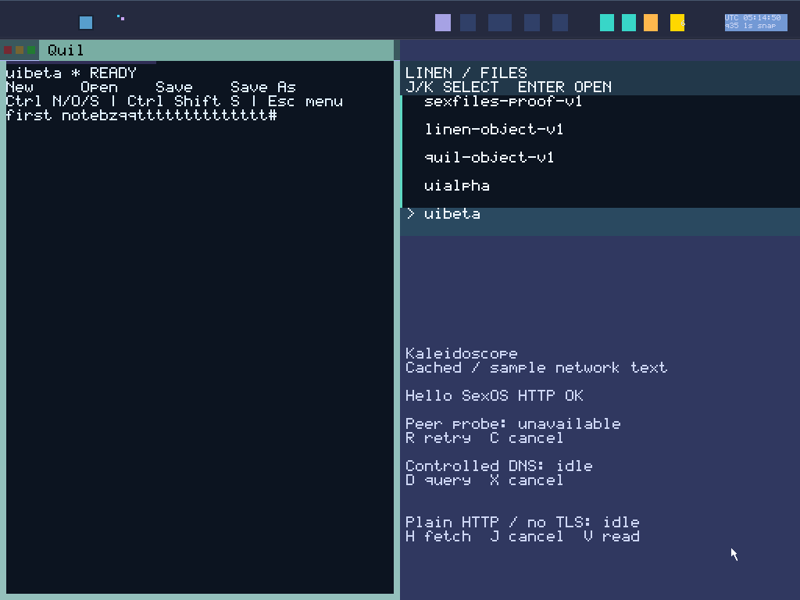

# Round 161: 16 Quil and nine Spindle launches per boot

Quil now has 16 BOOT-reserved instances, up from eight; Spindle has nine, up from eight. That provides 15 safe Quil reopens and eight Spindle reopens after the initial instances. Browser retains three instances. The catalog has 28 app reservations and the kernel registers 40 actual mains, beyond the former 32-main ceiling and within round 160's explicit 64-entry bound.

All 19 existing catalog rows remain intact. BOOT appends Quil targets 32–39 and Spindle 40, with distinct surfaces and holder-local slots 162–197. Existing creation, grant readback, dormant activation and cleanup machinery consumes the catalog. Runtime code gains no capability mint, task admission or process VAS. PKEY reuse still waits for the predecessor's private translations and custody to retire.

The full native chains preserve documents and history through the last instances. Fresh cold boots then recover Quil 39's saved document into Quil 9 and Spindle 40's history into Spindle 12, under the current held BOOT relationship. This recovers data, not old handles or rights. Exhaustion remains finite and explicit.

The preview is a lossless conversion of qualified capture 33. Its original PPM, glyph proof and source binding remain in the archive.

## Resource bounds

The expansion exposed Net's public denial-cache budget: 28 owners would require 5,384 bytes with the old representation. The cache now stores the latest DENIED sequence rather than its redundant deterministic word. Exact pending words remain retained, including STALE responses. A different pending sequence still backpressures; stale requests cannot lower the floor, evict another owner fence or change fair delivery and retirement.

The guest measures 4,040 bytes for 84 partitioned slots, within the unchanged 4 KiB bound. Five compiled defects are rejected, including the legacy larger representation. This saves 1,344 bytes against that same 28-owner representation; the total is 384 bytes above the previous 19-owner cache. The remaining margin is 56 bytes, so further expansion needs deliberate budget work.

All 11 boots audit 2,465 private app pages, totaling 10,096,640 bytes: Quil 1,136 pages, Spindle 864 and Browser 465. Sixteen 16 KiB Quil document buffers reserve 262,144 bytes; all 19 document participants have separate control windows, while only Quil receives snapshot buffers. These categories must not be added to heap accounting as though disjoint physical totals were established.

After grant sealing and before handoff, the actual 256 MiB kernel heap reports 11,850,832–11,851,216 bytes used across the cohort. Its guard is released before serial I/O. Physical free frames remain explicitly unmeasured. Actual history grants measure 96 bytes with nine participants; capability data remains 128 bytes and capability objects 192 bytes. Shell retains 43 lifecycle records; Display retains three isolated Browser bitmap stores totaling 55,992 bytes.

## Qualification

- All 43 frozen host checks pass without source drift. Logs contain 3,094 successful Rust test executions; all 1,124 frozen Python cases pass. These are execution counts, including SDK cases reused by different fixtures, not unique tests.
- Both 20-second desktop rehearsals and fresh replays pass the full 16/9 chains, finite exhaustion, dirty-Close guard, durable continuity and current viewport pixels: 49 qualified captures per profile.
- Both Browser allocated-Close profiles pass with fresh replays: 20 captures and six live-future teardowns with complete ACK, retirement and zeroed-pool evidence. Connected desktop sessions and cold recoveries pass at both sizes with fresh replays: four boots and 34 captures.
- Quil 39's terminal-disk recovery passes a separate compact boot and fresh replay. One frame proves recovered text and the current clock. Spindle 40's legacy cold helper passes its parent-bound journal/disk checks; it has no standalone replay and contributes no qualified pixel count.

The final cohort has **11 boots and 153 qualified captures**. Profiles are 1024×768/e1000 and 1280×800/e1000e. Audits join all 28 app grants, 40 mains, the 64-slot inventory, complete source/readback records, private-page totals, heap arithmetic/order and actual denial storage. The original five source-authority records remain byte-identical within the full 13-record inventory.

Queue tests now fill all 19 document windows, cancellation lanes and all 28 terminal lanes together. Earlier subset tests no longer call themselves absolute-capacity coverage. Expanded fixtures preserve unequal task identities and reject stale or crossed grants through the last reservation. Native task IDs still equal domain IDs in this BOOT assignment; synthetic unequal-task tests do not claim an unequal native allocation.

## Binding and archive

Source: `10b6eb7a5cd2a27080e509a46000a1ee6b307e04`.
ISO: `36b66ad37b361bedc496984f750374f8baa89ec543a4b1259facb394eed94ebc`.
Kernel: `4bef299f42a0a2f89dc2bda76ee717623f9a213341939268be908168006e1f7c`.
ABI: 66 declared inputs, `ff1d1346b449ed2efe6e5cffbc9c545b27d4d351979ad890fac43ffaa9725ba8`.
Architecture remains unchanged: `4085f8fa65234205c5fdab070fe36765d767a46edc001410bf2ed5bfb27a98d7`.

All 1,209 frozen source blobs (582 production +627 runner; 11,999,051 bytes) match Git and manifests. Nine ISO ELFs contain 323,915 decoded instructions with zero FP/vector scan matches. This is not runtime register/cache erasure proof.

[Raw evidence](assets/sexos-reserve-growth-2026-11-01-raw.tar.gz): 12,816,776 bytes; SHA-256 `a08681f2c235f7f158c4897a7b5764746e359624f93f7db6a741f04ec9f26bb9`. All 1,619 members were reopened and size/SHA verified. Frozen source, tested image, all boot logs, terminal disks, captures, fresh replays and helper sources are included. Host-only startup/parser diagnostics remain separately unqualified; neither represents a guest failure. A packaging API call also needed canonical `/private/tmp` inputs to match the CLI binding; no comparison was relaxed and guest outputs were unchanged.

These rehearsals are not a new 1,800-second acceptance run. Previous reports keep their original bindings. No physical-hardware, SMP, hard realtime or total physical-memory claim is made. Architectural inventory stays **2 Open / 28 Partial / System Proven false**. GLOBAL_VAS, BOOT-only authority genesis, typed sex-pdx and PKU remain the Sex Microkernel rules.

## Next

162: sustained 1,800-second mixed desktop acceptance on this qualified image, then cold recovery, retaining active input/save/Linen overlap evidence and explicit limits. 163: qualify a denser public denial cache against the actual current implementation before removing the next reserve-size bottleneck. Then improve launcher/clock clarity and desktop presentation while preserving held authority, finite exhaustion and independent pixels. Keep implementation diagnostics in reports and serial evidence rather than product flows.
