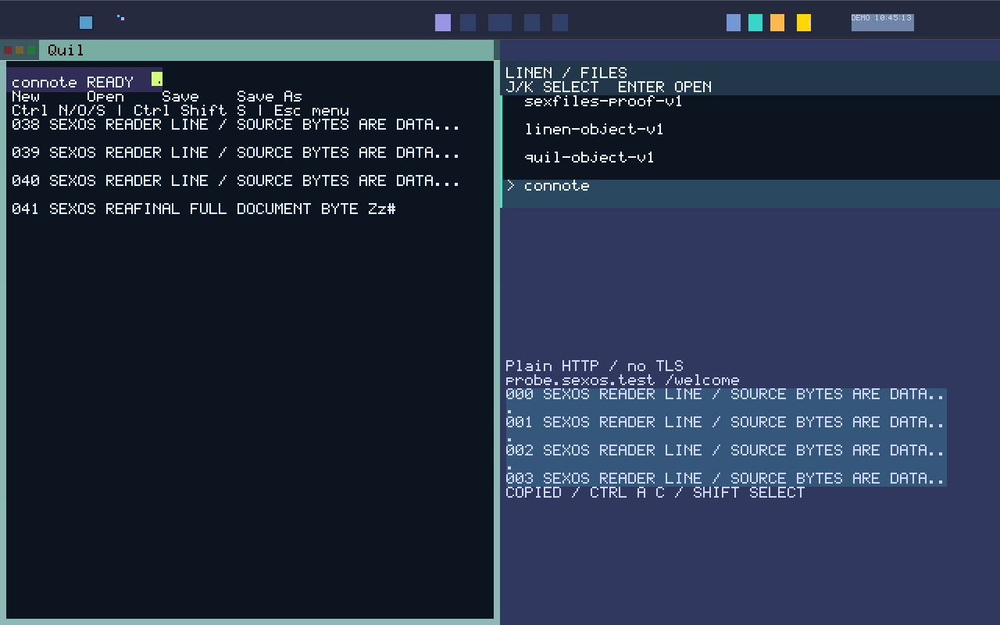

# SexOS development: round 108 acceptance and rounds 109–126

31 October 2026. Continues [rounds 80–200](SEXOS_DEVELOPMENT_ROUNDS_80_200_2026_10_30.md) from the [round 108 checkpoint](ROUND108_CHECKPOINT_2026_10_31.md). SexOS remains a single-address-space microkernel: GLOBAL_VAS supplies addressing only, BOOT alone creates capabilities, typed sex-pdx supplies authority and PKU enforces held authority. Nothing here introduces a Unix/POSIX mechanism, a per-process address space or a runtime capability mint.

## Summary

- **Round 108 is accepted.** The connected desktop session passes natively at both desktop sizes on a kernel identical to the checkpoint image, including same-image cold recovery and independent replay. Every failure on the way was a checker defect; production source did not change.
- **Rounds 109–115 close or narrow seven authority blockers.** Two ambient kernel paths are gone (slot-0 framebuffer disclosure, kernel-privileged SyncCall). Replies now need an accepted invocation. Capability revocation is real and runs natively at app retirement. Three architectural obligations now have executable checks.
- **Rounds 116, 118 and 119 add user features.** The SexTime calendar crate, Quil find (Ctrl+F) and a Spindle `sextime` calculator command.
- **Round 117 passes the 1800-second sustained alpha session** on the latest image at 1280x800. Its runner first needed five stale races fixed; none were OS defects.
- **Rounds 120–126 (second batch).** Quil find & replace, a close guard that keeps unsaved Quil work, and the first BOOT-granted UiIR stream. The compact sustained session uncovered two real bugs: a Shell focus bound that acted as a hidden deadline, and a round 111 defect that silently cut Shell off from Display after about 28 minutes. Both are fixed, and **the 1800-second sustained alpha session now passes at both desktop sizes**. One attempt (121, sequences in the listen ABI) was backed out because it would break two project guards.
- **Obligation inventory: 2 open / 28 partial** (was 7 / 23 at round 108). System Proven remains false.

### Evidence level

Rounds 80–107 were accepted against a very strict bar: frozen source/runner cohorts, raw archives with per-member hashes, ELF instruction scans and independent replay of every capture. Rounds 109–119 do **not** all meet that bar. Each states its evidence level below:

- **host**: production code compiled in host tests, usually with a compiled guard-removal control that must fail.
- **sealed**: a sealed GREEN_MASTER build and boot of the changed image.
- **native**: a native QEMU workflow on that image.

Treat 109–119 as *completed with scoped evidence*, not as accepted under the 80–107 definition. Re-qualifying them under that definition is open work.

The round numbers below are the order the work was done. They do not match the plan table in the 80–200 document: work moved forward from plan rows 119–127 (authority), 129 (time input), 182 (find) and 117 (sustained session). Plan rows 110 (physical target profile), 111 (storage torn writes) and 112–116 (lifetimes, reserves, pressure, packaging) were not started.

## Round ledger

| Round | Change | Evidence | Commit |
|---:|---|---|---|
| 108 | Connected desktop session accepted | native ×2 sizes, 4 boots, 34 frames, replay; 2,104 Rust + 836 Python | `fa026c6c`, `26e0afda` |
| 109 | Slot-0 bridge narrowed to 3 decoded caller-scoped ops; ambient 0xE3 framebuffer disclosure and 0xBB hook removed | host + compiled control, sealed | `4112b33c` |
| 110 | Kernel-privileged SyncCall edge removed; IPC capabilities name targets only | host source guard, sealed | `0a33ef98` |
| 111 | Every reply needs a kernel-recorded obligation from an accepted invocation | host (production router) + control, sealed, native connected ×2 with 0 denials | `16339df0`, `b02e255f` |
| 112 | Executable single-VAS check; NO_PER_PROCESS_TABLES open → partial | static gate + 5 injected negatives | `956e6879` |
| 113 | shell_app_cleanup host gate restored (silently broken since clipboard custody) | host + control | `9a2264a5` |
| 114 | Real capability revocation; app retirement revokes the terminal incarnation's table; PDX_REVOCATION open → partial | host (production table, concurrency) + control, sealed, native (9/9/7 revoked) | `26e4d77d` |
| 115 | Paired PKU-on/off authority parity; PKU_ENFORCEMENT_ONLY open → partial | native paired boot (179 identical records), host source guard | `c8cf7ee7` |
| 116 | SexTime civil calendar crate (Gregorian + Long Count) | host, no_std target build, 5,008-sample Python oracle | `1a2d1dfb` |
| 117 | Sustained 1800 s alpha session passes; five runner races fixed | native, 1 profile (wide), 80 cycles | `1ac9b3bc`, `5e054cb7`, `b649b519`, `d6608523` |
| 118 | Quil Ctrl+F find | host + native (prompt pixels, forward/wrapped/missing receipts) | `fc23ccfc` |
| 119 | Spindle `sextime <unix-seconds>` calculator | host + native (exact epoch record) | `8e482405` |
| 120 | Compact (1024x768) sustained 1800 s session passes (83 cycles) | native, final image | evidence below |
| 121 | Per-sender sequence in the listen ABI | **backed out, not committed**: needed r9, which the pipeline forbids | — |
| 122 | Quil find & replace (Down/Up switch fields, exact-match only, undoable) | host (actual dispatch) + native at 1024x768 | `a0a9bbb1` |
| 123 | Quil declines Close with unsaved work; window stays; next Close confirms | host + control-free checks + native (decline, intact window, confirm) | `42074deb` |
| 124 | First BOOT-granted UiIR stream (Shell → Display), per-sender sequence + epochs | host + control, sealed, native both sizes | `e5b95eb0` |
| 125 | Shell restore focus bounded by its tick deadline, not a poll count; cancel and content-blocker diagnostics | host regression + native soak | `f8058b31`, `bf86a0fc`, `1c54fbbf` |
| 126 | Reply bookkeeping never refuses an invocation (round 111 defect); Display heartbeat; stale wait checker | host regression, sealed, native both sizes + compact 1800 s | `c89ac1b5`, `754c0513`, `9e3348f9`, `3c02b10c` |

## Round details

### 108: connected desktop session accepted

The corrected runner passes at 1280x800/e1000e and 1024x768/e1000. Each profile runs one live boot and one same-image, terminal-disk cold boot, with 17 frames per profile. The live boot covers: an authenticated HTTPS image held while Quil typing completes, Fit/1:1 inspection and Clear, the plain-HTTP reader with real wheel scroll, hidden-Copy refusal, clipboard replacement, an exact 2049-byte SaveAs, Linen reopen, the Spindle history barrier, same-instance BringHere and ordered exact-incarnation Close. The kernel is byte-identical to the checkpoint; the ISO differs only in packaging bytes. `connected_desktop_gate.py --check` replays the wide cohort independently. [Evidence](assets/sexos-alpha-r108-2026-10-31-evidence.json), [raw archive](assets/sexos-alpha-r108-2026-10-31-qualified-raw.tar.gz).

Four runner defects were fixed:

- Shell's shared existing-app focus receipt (`launcher.action`) was treated as a launcher palette antecedent. Linen reopen emits it with no palette.
- The append edit was matched against the reopen's load receipt. It is now joined to the exact revision the single Save carries.
- Replay dropped the reader and copy anchors.
- Close windows sampled the serial boundary separately from the F11 action, which raced with background output.



### 109–115: authority

- **Slot-0 bridge (109).** Any domain could call slot 0 op `0xE3` and get the framebuffer address and geometry, bypassing the BOOT display holder check that sexdisplay uses through `0xE6`. Slot 0 now selects effects only through `decode_bridge_op`: the BOOT display query, a bounded serial record, and the caller's own init argument. A compiled control that restores `0xE3` fails.
- **SyncCall (110).** An IPC capability's `entry_point` was executed with a direct `call` at ring 0. Nothing constructed such a capability, but any future grant would have let a capability choose kernel code. IPC capabilities now carry no entry point and deny as invocation edges.
- **Reply obligations (111).** Syscall 29 let any domain publish a reply to any domain ID. The callee's protection domain now holds a finite 32-entry obligation table:
  - A typed enqueue grants an obligation before the call is visible, and withdraws it if the enqueue fails.
  - The obligation is spent only when the reply is published; a full slot keeps it for the retry.
  - Retirement clears it.
  - Obligations are counted per caller, not per invocation.
- **Single VAS (112).** `scripts/no_per_process_tables_gate.sh` scans every workspace and arch Rust source. CR3/TTBR loads and mapper roots must be one of the bound sites that reinstall the single boot root. Process-model identifiers are rejected.
- **Revocation (114).** `CapabilityTable` moved to `kernel/src/capability_table.rs` with `revoke`, `revoke_all` and `holds_none`. The old `verify_revocation` stub always returned true. A sealed table still cannot insert, so a revoked slot never refills. Retirement revokes the terminal incarnation's table and checks it empty; natively, Spindle/Browser/Quil revoke 9/9/7.
- **PKU parity (115).** `scripts/pku_parity_gate.py` boots one image twice from identical disks, with and without `pku`, and compares authority-decision records. A source guard keeps kernel-mediated authorization on the software key mask, never hardware PKU state. Without PKU, nothing stops direct user loads or stores in GLOBAL_VAS: hostile-code isolation remains a release blocker.

### 116, 118, 119: features

- **SexTime (116).** `crates/sex-time` implements the [SexTime proposal](SEXTIME_AND_WEB_MILESTONES_2026_10_31.md): epoch 2012-12-21T00:00:00Z (Unix 1,356,048,000), civil seconds without leap seconds, normalized nanoseconds, checked conversions, the Long Count under GMT 584283 on UTC days, no b'ak'tun wrap, and rejection before 0.0.0.0.0. No clock ABI or source trust changed.
- **Quil find (118).** Ctrl+F opens `Find: query#` in the status line. The query is at most 32 printable bytes. Enter selects the next exact match and wraps once; Esc closes and erases the query. Find is private editor state, and paste is declined while find is active. [Prompt](assets/sexos-r118-quil-find-prompt-wide-2026-10-31.png).
- **Spindle sextime (119).** `sextime 1356048000` prints `SexTime 0 s`, `UTC 2012-12-21T00:00:00Z` and `Long Count 13.0.0.0.0 (GMT 584283)`. It is a calculator, not a clock.

### 117: sustained alpha session

`quil_workflow_gate.py --soak-seconds 1800 --find` (with `alpha_session.py`) could not reach its soak on either the baseline or the current image. Five stale races were fixed, all in the runner:

- It typed the document name while emulated Ctrl was still held, so every letter arrived as a Ctrl chord.
- Spindle focus toggling re-read focus before the toggle took effect and toggled back. Two intermediate fixes waited for specific records that interleaved serial output can split. The final fix waits for any focus change after the key was sent.
- Linen reopen assumed every row loads, but non-document rows correctly report a failed load.

**Result: pass.** The session ran on ISO `e70a222a7a46770c95a9722afa828eacfcd243e512caa3f8e741e82e30464a8a`, whose production source equals HEAD. It completed 80 active cycles over 1800 s. Each cycle typed in Quil with pixel checks, saved with a concurrent Linen rescan, refreshed Linen and ran a Spindle storage stat, a history-saved command and, in cycle 1, `sextime`.

The run then completed:

- A Quil Close while an admitted save was pending.
- BOOT successor relaunch, with both saved documents reopened byte-exactly.
- A pending Spindle job Close and the Spindle successor's history reload.
- The full cleanup check.

The run recorded zero denied replies, and capability revocation fired for all five retired incarnations (9, 16, 15, 12, 17).

| Latency (s) | n | p50 | p95 | max |
|---|---:|---:|---:|---:|
| Quil key receipt | 80 | 0.144 | 0.197 | 0.206 |
| Quil key to verified pixels | 80 | 0.914 | 1.053 | 1.086 |
| Warm save receipt | 80 | 0.170 | 0.203 | 0.224 |
| Linen refresh | 162 | 0.151 | 0.195 | 0.217 |
| Spindle storage stat | 80 | 1.919 | 1.974 | 1.985 |
| App Close to pool reuse | 3 | 0.309 | 0.309 | 0.310 |

Host-measured times include QMP and screendump overhead and are not a hard real-time bound. Only the wide profile ran; compact and a second fresh-image repeat remain open. Earlier attempts are diagnostic only:

- The first full attempt failed at cycle 22 under heavy concurrent host load.
- Two later attempts failed on interleaved-record waits.

[Result](assets/sexos-r117-alpha-1800s-2026-10-31-result.json.gz) (sha256 of the uncompressed JSON `4ffec7c95866638a50dedbf64422eae4d58b1dfbe21806cb2c0059093b72a4f9`), [raw serial/frames archive](assets/sexos-r117-alpha-1800s-2026-10-31-raw.tar.gz).

## Rounds 120–125

### 121: sequences stay out of the register ABI

The first attempt stamped a per-sender sequence on each typed invocation and returned it from listen in r9. The sealed build refused it: `scripts/sexos_pipeline.sh` forbids r9 in IPC surfaces. That guard dates from commit `814d7437`. Before it, r9 carried a caller-chosen pointer that the kernel wrote a listen result into, and the guard keeps that raw-pointer side channel gone. Packing the sequence into rdi would instead weaken the task-ID alias guard. With Andreas's agreement, both guards stay and causal order moves to UiIR, where ARCHITECTURE.md §1.4–1.5 puts it. Round 124 implements that. Nothing from 121 was committed.

### 122: find and replace

In find mode, Down moves typing to a replacement field and Up back to the query. Tab stays with the desktop, because Shell uses it for focus. The prompt shows `Find: query > replacement`, with `#` after the active field. Enter in the replacement field replaces the selection only when it is exactly one match, as one ordinary undoable edit, then selects the next match. Native: [replace prompt](assets/sexos-r122-quil-replace-prompt-compact-2026-10-31.png).

### 123: close guard

Before this round, Close discarded unsaved Quil edits and cancelled an in-flight save without asking. Now:

- Quil declines an ordinary Close while dirty or saving, through a new `OP_APP_CLOSE_DECLINED`.
- Shell accepts the decline only from the exact live incarnation, only while its close is pending. It then stops retrying and marks the next Close as confirmed.
- Quil discards only the revision the user was warned about, and declines again after further edits.
- Shell no longer tears down a document app's window at F11. Retirement removes it when the app actually dies. The visible effect is a short delay between F11 and the window disappearing.
- The close-log checker accepts extra close requests only when each is followed by its exact decline.

Natively, the alpha runner sees the decline with the window intact (`close-declined` capture), then the confirmed close.

### 124: first UiIR stream

- **BOOT grant.** BOOT pairs Shell (PD 3) and Display (PD 1) through two zeroed, exact-peer regions: ring region 9, which only Shell writes, and cursor region 10, which only Display writes. Both sit at slots 96/97 on each side. Nothing is minted at runtime.
- **Protocol (`sex-pdx::uiir`).** Records carry contiguous per-sender sequences and their commit epoch. A record is visible only after its epoch commits. The producer never overwrites unconsumed records and distrusts a cursor beyond its commits. The consumer stops at any gap, repeat or regressed epoch.
- **Attach checks.** Both sides check region id, peer, rights and length before attaching.
- **Current use.** Shell publishes committed focus transitions. Display checks them in order but renders nothing from them yet.
- **Evidence.** Host tests include 200,000 records across threads; a compiled control fails. Natively, both sides attach and Display consumes in order through the connected session at both sizes.

### 125, 126 and 120: two real bugs from the compact session

The first compact 1800 s run stopped at cycle 79: Spindle restore focus was cancelled every time. Investigating it took four runs.

1. **A poll count acting as a deadline (125).** Cancel reasons showed `reason=turns`: Shell counted every loop poll and gave up after 4096, inside the 2000-tick deadline. The tick deadline is now the real bound, and the poll count only catches a stalled clock.
2. **Shell cut off from Display (126).** The next run failed the same way at the deadline. The new content-blocker record showed Spindle's frame state permanently pending, and from about 28 minutes in, Display committed nothing from any app. A Display heartbeat proved Display alive but receiving only SilkBar's messages. The cause was round 111. The kernel counted one reply obligation per accepted invocation and *refused the invocation* when a caller's count reached 65,535. Shell sends Display tens of thousands of one-way calls that are never answered, so after about 28 minutes every Shell→Display call was refused as not-ready. Wide sessions make fewer of these calls and never reached the cap.
   - Reply bookkeeping now never refuses an invocation. A caller's count saturates, and replies stay authorized at the bound. A full table records no obligation for a new caller; it never refuses that caller's call. Only a full ring refuses.
   - Regression tests drive 165,535 one-way invocations from one caller and pin that the enqueue path has exactly one refusal.
3. **A stale wait checker.** Since round 105, sexdrive (task 2) waits one tick for NVMe completions. When a sampled park record landed on that task, the connected-session checker rejected a correct boot. It now accepts exactly that wait.

The investigation also wasted one run: the stall sampler was written against the wrong QMP return type and recorded nothing.

**Compact result: pass.** ISO `739f1e609eea70707333bb4bb409ec264eee5051ac802497da6c050ccff8c641`, production equal to HEAD. 83 cycles over 1800 s, then the full close/relaunch/reopen/cleanup sequence, including Quil's decline of the dirty Close with its window intact, then the confirmed close. Zero denied replies, zero focus cancels, UiIR in order through sequence 640, and the Display heartbeat shows Shell traffic to the end. [Result](assets/sexos-r120-alpha-1800s-compact-2026-10-31-result.json.gz) (uncompressed sha256 `353c5177c3baa2fa88a43012aad613505b0665d3cd15faa07db05b7b7fa5e9ad`), [raw archive](assets/sexos-r120-alpha-1800s-compact-2026-10-31-raw.tar.gz), [declined close](assets/sexos-r123-close-declined-compact-2026-10-31.png).

| Latency (s), compact | n | p50 | p95 | max |
|---|---:|---:|---:|---:|
| Quil key receipt | 83 | 0.140 | 0.191 | 0.205 |
| Quil key to verified pixels | 83 | 0.668 | 0.718 | 0.843 |
| Warm save receipt | 83 | 0.171 | 0.199 | 0.214 |
| Linen refresh | 168 | 0.144 | 0.193 | 0.235 |
| Spindle storage stat | 83 | 1.918 | 1.962 | 1.972 |
| Close to pool reuse | 3 | 0.384 | 0.452 | 0.452 |

## Verification state at handoff

- Sealed GREEN_MASTER on the final image; ABI hash updated for each ABI-input change. `crates/sex-pdx/src/uiir.rs` and `kernel/src/capability_table.rs` were added to the ABI input list.
- The connected desktop session passes at both sizes on the final image, which includes 122–125.
- Python runner suite: 842 tests pass.
- `check_architectural_truth.py --run-host`: all 41 registered host/static checks pass on the final tree.
- Sustained 1800 s sessions: wide passes on the round 119 image (round 117); compact passes on the final image (round 120). The wide session has not been repeated on the final image, which now includes the round 126 kernel fix.

## Known pre-existing issues found

- `scripts/arm64_phase{2..5}_gate.sh` compare against a backup archive outside the repository and fail on any kernel change; they were already stale.
- The `shell_app_cleanup` host gate had been failing since clipboard custody was added (fixed in 113). Registered host checks are not all run routinely; run `check_architectural_truth.py --run-host` before each acceptance.
- The Quil status chip highlight is fixed-width and overlaps a longer status such as the find prompt (cosmetic).

## Remaining release gates

- **Open (2):** DETERMINISTIC_REPLAY and EPOCH_COMMIT. No recorder, replay or epoch engine exists.
- **Newly partial:** CAUSAL_DOMAIN_ORDER and UIIR_AUTHORIZED_STREAM have one checked stream (Shell → Display focus). There is no compositor consumer and no further streams.
- **Partial (26):** includes PDX_SOLE_AUTHORITY (slot-0 serial records remain an unsanctioned diagnostic channel), PKU_ENFORCEMENT_ONLY (no no-PKU hostile isolation), PDX_REVOCATION (no user-initiated or partial revocation, no revocation of others' capabilities naming a retired target), and the memory, scheduler and diskfs obligations listed in `spec/`.
- **Not started:** physical target profile and boot (plan 110, 199–200), storage torn-write campaign (111, 155), larger BOOT reserve (159–163), SMP lanes (143–148) and epoch replay (129–138).
- **Not claimed:** public web/CA, crash/power-loss, hostile-code containment, physical hardware, SMP, or a general daily driver.

## Next steps

1. Re-qualify 109–119 under the 80–107 acceptance bar: freeze one cohort and run the full native regression set at both sizes, with raw archives.
2. Wire SexTime into the Browser clock panel or SilkBar once a validated civil-time source is routed there. Unknown or synthetic sources must stay visible as such.
3. Grow UiIR: let Display drive one real rendering decision from the stream, then move a second Shell → Display path (e.g. desktop state) onto UiIR with epoch-gated commits.
4. Re-run the wide 1800 s session on the final image.
5. Quil autosave drafts (Andreas's suggestion). Write a draft through Quil's existing BOOT document route into one draft object it owns, without taking over the open document's identity, and offer recovery from Linen.
6. Plan rows 110–116: physical profile, torn-write recovery, lifetimes and reserves.

## Reproducing

```
make full
GATE_DIR=/tmp/gm ./scripts/master_runtime_gate.sh --keep-log
python3 scripts/freeze_native_evidence.py --build /tmp/gm --out /tmp/fz --iso sexos-v1.0.0.iso --kernel iso_root/sexos-kernel
cd scripts && python3 connected_desktop_gate.py --iso /tmp/fz/tested.iso --binding /tmp/fz/source-binding.json --source-disk <copy of /tmp/gm/nvme.img> --out /tmp/conn
python3 quil_workflow_gate.py --iso /tmp/fz/tested.iso --source-disk <disk> --out /tmp/alpha --soak-seconds 1800 --find
python3 pku_parity_gate.py --iso /tmp/fz/tested.iso --disk <disk> --out /tmp/parity
```

When an ABI input changes, recompute `abi_version_hash` in `sexos_build_spec.toml` from the `ABI_INPUTS` list in `scripts/entrypoint_build.sh`, using bash.
