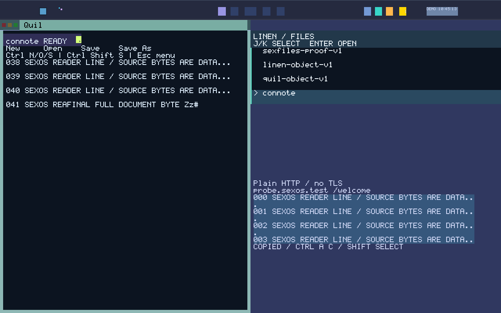

# SexOS development: round 108 acceptance and rounds 109–165

31 October 2026. Continues [rounds 80–200](SEXOS_DEVELOPMENT_ROUNDS_80_200_2026_10_30.md) from the [round 108 checkpoint](ROUND108_CHECKPOINT_2026_10_31.md). SexOS remains a single-address-space microkernel: GLOBAL_VAS supplies addressing only, BOOT alone creates capabilities, typed sex-pdx supplies authority and PKU enforces held authority. Nothing here introduces a Unix/POSIX mechanism, a per-process address space or a runtime capability mint.

## Summary

This ledger's original HEAD, test counts and obligation inventory below describe
the rounds 108–119 handoff. The appended Browser milestone identifies its
initial and integrated images separately. Later primary development is outside
the explicitly identified cohorts.

- **Round 108 is accepted.** The connected desktop session passes natively at both desktop sizes on a kernel identical to the checkpoint image, including same-image cold recovery and independent replay. Every failure on the way was a checker defect; production source did not change.
- **Rounds 109–115 close or narrow seven authority blockers.** Two ambient kernel paths are gone (slot-0 framebuffer disclosure, kernel-privileged SyncCall). Replies now need an accepted invocation. Capability revocation is real and runs natively at app retirement. Three architectural obligations now have executable checks.
- **Rounds 116, 118 and 119 add user features.** The SexTime calendar crate, Quil find (Ctrl+F) and a Spindle `sextime` calculator command.
- **Round 117 passes the 1800-second sustained alpha session** on the latest image at 1280x800. Its runner first needed five stale races fixed; none were OS defects.
- **Rounds 120–126 (second batch).** Quil find & replace, a close guard that keeps unsaved Quil work, and the first BOOT-granted UiIR stream. The compact sustained session uncovered two real bugs: a Shell focus bound that acted as a hidden deadline, and a round 111 defect that silently cut Shell off from Display after about 28 minutes. Both are fixed, and **the 1800-second sustained alpha session now passes at both desktop sizes**. One attempt (121, sequences in the listen ABI) was backed out because it would break two project guards.
- **Obligation inventory: 2 open / 28 partial** (was 7 / 23 at round 108). System Proven remains false.

### Evidence level

Rounds 80–107 were accepted against a very strict bar: frozen source/runner cohorts, raw archives with per-member hashes, ELF instruction scans and independent replay of every capture. Rounds 109–119 do **not** all meet that bar. Each states its evidence level below:

- **host**: production code compiled in host tests, usually with a compiled guard-removal control that must fail.
- **sealed**: a sealed GREEN_MASTER build and boot of the changed image.
- **native**: a native QEMU workflow on that image.

Treat 109–119 as *completed with scoped evidence*, not as accepted under the 80–107 definition. Re-qualifying them under that definition is open work.

The round numbers below are the order the work was done. They do not match the plan table in the 80–200 document: work moved forward from plan rows 119–127 (authority), 129 (time input), 182 (find) and 117 (sustained session). Plan rows 110 (physical target profile), 111 (storage torn writes) and 112–116 (lifetimes, reserves, pressure, packaging) were not started.

## Round ledger

| Round | Change | Evidence | Commit |
|---:|---|---|---|
| 108 | Connected desktop session accepted | native ×2 sizes, 4 boots, 34 frames, replay; 2,104 Rust + 836 Python | `fa026c6c`, `26e0afda` |
| 109 | Slot-0 bridge narrowed to 3 decoded caller-scoped ops; ambient 0xE3 framebuffer disclosure and 0xBB hook removed | host + compiled control, sealed | `4112b33c` |
| 110 | Kernel-privileged SyncCall edge removed; IPC capabilities name targets only | host source guard, sealed | `0a33ef98` |
| 111 | Every reply needs a kernel-recorded obligation from an accepted invocation | host (production router) + control, sealed, native connected ×2 with 0 denials | `16339df0`, `b02e255f` |
| 112 | Executable single-VAS check; NO_PER_PROCESS_TABLES open → partial | static gate + 5 injected negatives | `956e6879` |
| 113 | shell_app_cleanup host gate restored (silently broken since clipboard custody) | host + control | `9a2264a5` |
| 114 | Real capability revocation; app retirement revokes the terminal incarnation's table; PDX_REVOCATION open → partial | host (production table, concurrency) + control, sealed, native (9/9/7 revoked) | `26e4d77d` |
| 115 | Paired PKU-on/off authority parity; PKU_ENFORCEMENT_ONLY open → partial | native paired boot (179 identical records), host source guard | `c8cf7ee7` |
| 116 | SexTime civil calendar crate (Gregorian + Long Count) | host, no_std target build, 5,008-sample Python oracle | `1a2d1dfb` |
| 117 | Sustained 1800 s alpha session passes; five runner races fixed | native, 1 profile (wide), 80 cycles | `1ac9b3bc`, `5e054cb7`, `b649b519`, `d6608523` |
| 118 | Quil Ctrl+F find | host + native (prompt pixels, forward/wrapped/missing receipts) | `fc23ccfc` |
| 119 | Spindle `sextime <unix-seconds>` calculator | host + native (exact epoch record) | `8e482405` |
| 120 | Compact (1024x768) sustained 1800 s session passes (83 cycles) | native, final image | evidence below |
| 121 | Per-sender sequence in the listen ABI | **backed out, not committed**: needed r9, which the pipeline forbids | — |
| 122 | Quil find & replace (Down/Up switch fields, exact-match only, undoable) | host (actual dispatch) + native at 1024x768 | `a0a9bbb1` |
| 123 | Quil declines Close with unsaved work; window stays; next Close confirms | host + control-free checks + native (decline, intact window, confirm) | `42074deb` |
| 124 | First BOOT-granted UiIR stream (Shell → Display), per-sender sequence + epochs | host + control, sealed, native both sizes | `e5b95eb0` |
| 125 | Shell restore focus bounded by its tick deadline, not a poll count; cancel and content-blocker diagnostics | host regression + native soak | `f8058b31`, `bf86a0fc`, `1c54fbbf` |
| 126 | Reply-admission ceiling removed (later saturation corrected in `63b2f118`); Display heartbeat; stale wait checker | host regression, sealed, native both sizes + compact 1800 s | `c89ac1b5`, `754c0513`, `9e3348f9`, `3c02b10c` |
| 127 | Quil header keeps the document name beside long notices | host + native (compact) | `b4382ea3` |
| 128 | Long-session exhaustion audit after the reply-count bug | historical rate audit; later exact reply-credit fix in `63b2f118` | — |
| 129 | BOOT app incarnation catalog (`sex-pdx::app_catalog`), checked against the kernel boot plan | host gate + native (connected, all-incarnation rehearsal) | `d43e5347` |
| 130 | Shell's app view tables, routes and admission checks driven by the catalog; second stale self-wait checker fix | host (pinned to old tables) + native both sizes | `4762329f`, `c3677532` |
| 131 | Display's frame, content, viewport-group and per-pixel owner tables driven by the catalog | host (16,000-pair equivalence) + native both sizes | `4b714ed5` |
| 132 | sex-pdx clipboard, canvas, document-view and Spindle status/view policies driven by the catalog | host (equivalence) + 41/41 host checks + native both sizes | `3827a172` |
| 133 | Kernel BOOT app reservation (successors, grants, activation chain, document buffers) built from the catalog | identical boot authority/grant records before and after; native both sizes | `3f403a14` |
| 134 | Catalog-derived lifecycle/document capacity; 64-bit presentation receipts; separate future document region namespace | synthetic7/64 consumers and 65 rejection;43 host/2,663 Rust/965 Python; sealed and native both sizes | `21e7a960` |
| 135 | Catalog-driven app identity, activation/routes, viewport storage and file/Linen admission | expanded9 host policy + two compiled regressions; corrected43 host/2,667 Rust/965 Python; native both sizes | `b21ca26b`, `add0c94e` |

## Round details

### 108: connected desktop session accepted

The corrected runner passes at 1280x800/e1000e and 1024x768/e1000. Each profile runs one live boot and one same-image, terminal-disk cold boot, with 17 frames per profile. The live boot covers: an authenticated HTTPS image held while Quil typing completes, Fit/1:1 inspection and Clear, the plain-HTTP reader with real wheel scroll, hidden-Copy refusal, clipboard replacement, an exact 2049-byte SaveAs, Linen reopen, the Spindle history barrier, same-instance BringHere and ordered exact-incarnation Close. The kernel is byte-identical to the checkpoint; the ISO differs only in packaging bytes. `connected_desktop_gate.py --check` replays the wide cohort independently. [Evidence](assets/sexos-alpha-r108-2026-10-31-evidence.json), [raw archive](assets/sexos-alpha-r108-2026-10-31-qualified-raw.tar.gz).

Four runner defects were fixed:

- Shell's shared existing-app focus receipt (`launcher.action`) was treated as a launcher palette antecedent. Linen reopen emits it with no palette.
- The append edit was matched against the reopen's load receipt. It is now joined to the exact revision the single Save carries.
- Replay dropped the reader and copy anchors.
- Close windows sampled the serial boundary separately from the F11 action, which raced with background output.



### 109–115: authority

- **Slot-0 bridge (109).** Any domain could call slot 0 op `0xE3` and get the framebuffer address and geometry, bypassing the BOOT display holder check that sexdisplay uses through `0xE6`. Slot 0 now selects effects only through `decode_bridge_op`: the BOOT display query, a bounded serial record, and the caller's own init argument. A compiled control that restores `0xE3` fails.
- **SyncCall (110).** An IPC capability's `entry_point` was executed with a direct `call` at ring 0. Nothing constructed such a capability, but any future grant would have let a capability choose kernel code. IPC capabilities now carry no entry point and deny as invocation edges.
- **Reply obligations (111).** Syscall 29 let any domain publish a reply to any domain ID. The callee's protection domain now holds a finite 32-entry obligation table:
  - A typed enqueue grants an obligation before the call is visible, and withdraws it if the enqueue fails.
  - The obligation is spent only when the reply is published; a full slot keeps it for the retry.
  - Retirement clears it.
  - Obligations are counted per caller, not per invocation.
- **Single VAS (112).** `scripts/no_per_process_tables_gate.sh` scans every workspace and arch Rust source. CR3/TTBR loads and mapper roots must be one of the bound sites that reinstall the single boot root. Process-model identifiers are rejected.
- **Revocation (114).** `CapabilityTable` moved to `kernel/src/capability_table.rs` with `revoke`, `revoke_all` and `holds_none`. The old `verify_revocation` stub always returned true. A sealed table still cannot insert, so a revoked slot never refills. Retirement revokes the terminal incarnation's table and checks it empty; natively, Spindle/Browser/Quil revoke 9/9/7.
- **PKU parity (115).** `scripts/pku_parity_gate.py` boots one image twice from identical disks, with and without `pku`, and compares authority-decision records. A source guard keeps kernel-mediated authorization on the software key mask, never hardware PKU state. Without PKU, nothing stops direct user loads or stores in GLOBAL_VAS: hostile-code isolation remains a release blocker.

### 116, 118, 119: features

- **SexTime (116).** `crates/sex-time` implements the [SexTime proposal](SEXTIME_AND_WEB_MILESTONES_2026_10_31.md): epoch 2012-12-21T00:00:00Z (Unix 1,356,048,000), civil seconds without leap seconds, normalized nanoseconds, checked conversions, the Long Count under GMT 584283 on UTC days, no b'ak'tun wrap, and rejection before 0.0.0.0.0. No clock ABI or source trust changed.
- **Quil find (118).** Ctrl+F opens `Find: query#` in the status line. The query is at most 32 printable bytes. Enter selects the next exact match and wraps once; Esc closes and erases the query. Find is private editor state, and paste is declined while find is active. [Prompt](assets/sexos-r118-quil-find-prompt-wide-2026-10-31.png).
- **Spindle sextime (119).** `sextime 1356048000` prints `SexTime 0 s`, `UTC 2012-12-21T00:00:00Z` and `Long Count 13.0.0.0.0 (GMT 584283)`. It is a calculator, not a clock.

### 117: sustained alpha session

`quil_workflow_gate.py --soak-seconds 1800 --find` (with `alpha_session.py`) could not reach its soak on either the baseline or the current image. Five stale races were fixed, all in the runner:

- It typed the document name while emulated Ctrl was still held, so every letter arrived as a Ctrl chord.
- Spindle focus toggling re-read focus before the toggle took effect and toggled back. Two intermediate fixes waited for specific records that interleaved serial output can split. The final fix waits for any focus change after the key was sent.
- Linen reopen assumed every row loads, but non-document rows correctly report a failed load.

**Result: pass.** The session ran on ISO `e70a222a7a46770c95a9722afa828eacfcd243e512caa3f8e741e82e30464a8a`, whose production source equals HEAD. It completed 80 active cycles over 1800 s. Each cycle typed in Quil with pixel checks, saved with a concurrent Linen rescan, refreshed Linen and ran a Spindle storage stat, a history-saved command and, in cycle 1, `sextime`.

The run then completed:

- A Quil Close while an admitted save was pending.
- BOOT successor relaunch, with both saved documents reopened byte-exactly.
- A pending Spindle job Close and the Spindle successor's history reload.
- The full cleanup check.

The run recorded zero denied replies, and capability revocation fired for all five retired incarnations (9, 16, 15, 12, 17).

| Latency (s) | n | p50 | p95 | max |
|---|---:|---:|---:|---:|
| Quil key receipt | 80 | 0.144 | 0.197 | 0.206 |
| Quil key to verified pixels | 80 | 0.914 | 1.053 | 1.086 |
| Warm save receipt | 80 | 0.170 | 0.203 | 0.224 |
| Linen refresh | 162 | 0.151 | 0.195 | 0.217 |
| Spindle storage stat | 80 | 1.919 | 1.974 | 1.985 |
| App Close to pool reuse | 3 | 0.309 | 0.309 | 0.310 |

Host-measured times include QMP and screendump overhead and are not a hard real-time bound. Only the wide profile ran; compact and a second fresh-image repeat remain open. Earlier attempts are diagnostic only:

- The first full attempt failed at cycle 22 under heavy concurrent host load.
- Two later attempts failed on interleaved-record waits.

[Result](assets/sexos-r117-alpha-1800s-2026-10-31-result.json.gz) (sha256 of the uncompressed JSON `4ffec7c95866638a50dedbf64422eae4d58b1dfbe21806cb2c0059093b72a4f9`), [raw serial/frames archive](assets/sexos-r117-alpha-1800s-2026-10-31-raw.tar.gz).

## Rounds 120–125

### 121: sequences stay out of the register ABI

The first attempt stamped a per-sender sequence on each typed invocation and returned it from listen in r9. The sealed build refused it: `scripts/sexos_pipeline.sh` forbids r9 in IPC surfaces. That guard dates from commit `814d7437`. Before it, r9 carried a caller-chosen pointer that the kernel wrote a listen result into, and the guard keeps that raw-pointer side channel gone. Packing the sequence into rdi would instead weaken the task-ID alias guard. With Andreas's agreement, both guards stay and causal order moves to UiIR, where ARCHITECTURE.md §1.4–1.5 puts it. Round 124 implements that. Nothing from 121 was committed.

### 122: find and replace

In find mode, Down moves typing to a replacement field and Up back to the query. Tab stays with the desktop, because Shell uses it for focus. The prompt shows `Find: query > replacement`, with `#` after the active field. Enter in the replacement field replaces the selection only when it is exactly one match, as one ordinary undoable edit, then selects the next match. Native: [replace prompt](assets/sexos-r122-quil-replace-prompt-compact-2026-10-31.png).

### 123: close guard

Before this round, Close discarded unsaved Quil edits and cancelled an in-flight save without asking. Now:

- Quil declines an ordinary Close while dirty or saving, through a new `OP_APP_CLOSE_DECLINED`.
- Shell accepts the decline only from the exact live incarnation, only while its close is pending. It then stops retrying and marks the next Close as confirmed.
- Quil discards only the revision the user was warned about, and declines again after further edits.
- Shell no longer tears down a document app's window at F11. Retirement removes it when the app actually dies. The visible effect is a short delay between F11 and the window disappearing.
- The close-log checker accepts extra close requests only when each is followed by its exact decline.

Natively, the alpha runner sees the decline with the window intact (`close-declined` capture), then the confirmed close.

### 124: first UiIR stream

- **BOOT grant.** BOOT pairs Shell (PD 3) and Display (PD 1) through two zeroed, exact-peer regions: ring region 9, which only Shell writes, and cursor region 10, which only Display writes. Both sit at slots 96/97 on each side. Nothing is minted at runtime.
- **Protocol (`sex-pdx::uiir`).** Records carry contiguous per-sender sequences and their commit epoch. A record is visible only after its epoch commits. The producer never overwrites unconsumed records and distrusts a cursor beyond its commits. The consumer stops at any gap, repeat or regressed epoch.
- **Attach checks.** Both sides check region id, peer, rights and length before attaching.
- **Current use.** Shell publishes committed focus transitions. Display checks them in order but renders nothing from them yet.
- **Evidence.** Host tests include 200,000 records across threads; a compiled control fails. Natively, both sides attach and Display consumes in order through the connected session at both sizes.

### 125, 126 and 120: two real bugs from the compact session

The first compact 1800 s run stopped at cycle 79: Spindle restore focus was cancelled every time. Investigating it took four runs.

1. **A poll count acting as a deadline (125).** Cancel reasons showed `reason=turns`: Shell counted every loop poll and gave up after 4096, inside the 2000-tick deadline. The tick deadline is now the real bound, and the poll count only catches a stalled clock.
2. **Shell cut off from Display (126).** The next run failed the same way at the deadline. The new content-blocker record showed Spindle's frame state permanently pending, and from about 28 minutes in, Display committed nothing from any app. A Display heartbeat proved Display alive but receiving only SilkBar's messages. The cause was round 111. The kernel counted one reply obligation per accepted invocation and *refused the invocation* when a caller's count reached 65,535. Shell sends Display tens of thousands of one-way calls that are never answered, so after about 28 minutes every Shell→Display call was refused as not-ready. Wide sessions make fewer of these calls and never reached the cap.
   - Reply bookkeeping now never refuses an invocation. A caller's count saturates, and replies stay authorized at the bound. A full table records no obligation for a new caller; it never refuses that caller's call. Only a full ring refuses.
   - Regression tests drive 165,535 one-way invocations from one caller and pin that the enqueue path has exactly one refusal.
3. **A stale wait checker.** Since round 105, sexdrive (task 2) waits one tick for NVMe completions. When a sampled park record landed on that task, the connected-session checker rejected a correct boot. It now accepts exactly that wait.

The investigation also wasted one run: the stall sampler was written against the wrong QMP return type and recorded nothing.

**Compact result: pass.** ISO `739f1e609eea70707333bb4bb409ec264eee5051ac802497da6c050ccff8c641`, production equal to HEAD. 83 cycles over 1800 s, then the full close/relaunch/reopen/cleanup sequence, including Quil's decline of the dirty Close with its window intact, then the confirmed close. Zero denied replies, zero focus cancels, UiIR in order through sequence 640, and the Display heartbeat shows Shell traffic to the end. [Result](assets/sexos-r120-alpha-1800s-compact-2026-10-31-result.json.gz) (uncompressed sha256 `353c5177c3baa2fa88a43012aad613505b0665d3cd15faa07db05b7b7fa5e9ad`), [raw archive](assets/sexos-r120-alpha-1800s-compact-2026-10-31-raw.tar.gz), [declined close](assets/sexos-r123-close-declined-compact-2026-10-31.png).

| Latency (s), compact | n | p50 | p95 | max |
|---|---:|---:|---:|---:|
| Quil key receipt | 83 | 0.140 | 0.191 | 0.205 |
| Quil key to verified pixels | 83 | 0.668 | 0.718 | 0.843 |
| Warm save receipt | 83 | 0.171 | 0.199 | 0.214 |
| Linen refresh | 168 | 0.144 | 0.193 | 0.235 |
| Spindle storage stat | 83 | 1.918 | 1.962 | 1.972 |
| Close to pool reuse | 3 | 0.384 | 0.452 | 0.452 |

### 128: long-session exhaustion audit

The reply-count defect was a finite counter that silently refused work. All checked or saturating counters in the kernel, services and apps were reviewed against rates measured in the compact 1800 s session:

| Bound | Size | Measured rate | Exhausts after |
|---|---|---|---|
| Spindle history requests (per client, per boot) | 16.7M sequence | 43,202 in 30 min of heavy command use | ≈12 days at that rate |
| Quil document requests (per client, per boot) | 16.7M sequence | ≈130–770 per save (2–12 KiB) | ≈22,000 full-size saves |
| SexNet job tickets (per boot) | 17,535 | one per fetch | 17,535 fetches |
| Shell/Display/UiIR sequences, kernel task/fault/generation counters | u64 | — | not reachable |

None of these can exhaust in a day of real use, so no code changed. Two constraints carry forward. Autosave must not write every few seconds: at 3 s intervals with a full 12 KiB document, Quil's document sequence would exhaust in about 18 hours, so autosave should trigger on change with a floor of tens of seconds, or a per-session sequence rollover must exist first. And every remaining exhaustion path should report its state visibly, not degrade silently.

### 129–130: toward a larger app reserve

Apps are finite per boot. Browser cannot reopen after one Close, Spindle after two, and Quil after three, because every incarnation was hand-wired across about 130 sites. `sex-pdx::app_catalog` now describes each BOOT incarnation: domain/task, content and Shell surfaces, and lifecycle, close, activation and route slots. It is data only. A host gate checks it against the lifecycle constants and the kernel's boot plan, and pins it to the previous hand-wired tables.

Already migrated to the catalog:

- Shell custody, close/surface maps and view delivery
- the dirty-close deferral
- the launcher focus check
- sexfiles' document-caller admission
- Display's surface tables (131)
- sex-pdx clipboard, canvas, document-view and Spindle policies (132)

Still hand-wired: Quil/Spindle/Linen self-checks, Spindle history recovery (one successor) and sexfiles' save list. The kernel boot plan and grants moved to the catalog in round 133.

The kernel reservation loop now consumes the catalog. Round134 derives shared capacity and document bounds, but further app/service self-checks, delivery/task/surface budgets and exact broker bindings still need migration before adding a reserved incarnation can be a data change. A reopenable Browser requires those actual BOOT-held edges as well as its private image.

## Verification state at handoff

- Sealed GREEN_MASTER on the final image; ABI hash updated for each ABI-input change. `crates/sex-pdx/src/uiir.rs` and `kernel/src/capability_table.rs` were added to the ABI input list.
- The connected desktop session passes at both sizes on the final image, which includes 122–125.
- Python runner suite: 842 tests pass.
- `check_architectural_truth.py --run-host`: all 41 registered host/static checks pass on the final tree.
- Sustained 1800 s sessions pass at **both sizes on the final image**: compact with 83 cycles (round 120), and wide with 80 cycles ([result](assets/sexos-r126-alpha-1800s-wide-final-2026-10-31-result.json.gz), uncompressed sha256 `de1a00342adb041e730413f9f7866b306349fdbc6215195e2cf577e2a1736afc`). The round 117 wide pass was on the round 119 image.

## Known pre-existing issues found

- `scripts/arm64_phase{2..5}_gate.sh` compare against a backup archive outside the repository and fail on any kernel change; they were already stale.
- The `shell_app_cleanup` host gate had been failing since clipboard custody was added (fixed in 113). Registered host checks are not all run routinely; run `check_architectural_truth.py --run-host` before each acceptance.
- The Quil status chip highlight is fixed-width and overlaps a longer status such as the find prompt (cosmetic).

## Remaining release gates

- **Open (2):** DETERMINISTIC_REPLAY and EPOCH_COMMIT. No recorder, replay or epoch engine exists.
- **Newly partial:** CAUSAL_DOMAIN_ORDER and UIIR_AUTHORIZED_STREAM have one checked stream (Shell → Display focus). There is no compositor consumer and no further streams.
- **Partial (26):** includes PDX_SOLE_AUTHORITY (slot-0 serial records remain an unsanctioned diagnostic channel), PKU_ENFORCEMENT_ONLY (no no-PKU hostile isolation), PDX_REVOCATION (no user-initiated or partial revocation, no revocation of others' capabilities naming a retired target), and the memory, scheduler and diskfs obligations listed in `spec/`.
- **Not started:** physical target profile and boot (plan 110, 199–200), storage torn-write campaign (111, 155), larger BOOT reserve (159–163), SMP lanes (143–148) and epoch replay (129–138).
- **Not claimed:** public web/CA, crash/power-loss, hostile-code containment, physical hardware, SMP, or a general daily driver.

## Next steps

1. Re-qualify 109–119 under the 80–107 acceptance bar: freeze one cohort and run the full native regression set at both sizes, with raw archives.
2. Wire SexTime into the Browser clock panel or SilkBar once a validated civil-time source is routed there. Unknown or synthetic sources must stay visible as such.
3. Grow UiIR: let Display drive one real rendering decision from the stream, then move a second Shell → Display path (e.g. desktop state) onto UiIR with epoch-gated commits.
4. Quil autosave drafts (Andreas's suggestion). Write a draft through Quil's existing BOOT document route into one draft object it owns, without taking over the open document's identity, and offer recovery from Linen.
5. Plan rows 110–116: physical profile, torn-write recovery, lifetimes and reserves.

## Reproducing

```
make full
GATE_DIR=/tmp/gm ./scripts/master_runtime_gate.sh --keep-log
python3 scripts/freeze_native_evidence.py --build /tmp/gm --out /tmp/fz --iso sexos-v1.0.0.iso --kernel iso_root/sexos-kernel
cd scripts && python3 connected_desktop_gate.py --iso /tmp/fz/tested.iso --binding /tmp/fz/source-binding.json --source-disk <copy of /tmp/gm/nvme.img> --out /tmp/conn
python3 quil_workflow_gate.py --iso /tmp/fz/tested.iso --source-disk <disk> --out /tmp/alpha --soak-seconds 1800 --find
python3 pku_parity_gate.py --iso /tmp/fz/tested.iso --disk <disk> --out /tmp/parity
```

When an ABI input changes, recompute `abi_version_hash` in `sexos_build_spec.toml` from the `ABI_INPUTS` list in `scripts/entrypoint_build.sh`, using bash.

## Independent Browser SexTime milestone — 31 October

### Initial checkpoint `bf5de8db`

The Browser T action now displays a bounded last-query Clock panel with Gregorian
UTC, native SexTime seconds and Maya Long Count. Q clears its calendar values.
Source/precision/snapshot labels remain explicit, and invalid or unavailable
states remove stale dates. Rendering respects actual Reader/Copy precedence
and joins each text frame to its immutable held Display receipt.

Qualified on `codex/browser-sextime`, with committed primary base `f8058b31`:
sealed GREEN_MASTER; 40 registered checks with 2,581 passing Rust test executions;
851 Python tests; two rejected compiled calendar mutations; Browser ELF scan
of 92,261 instructions with zero inspected vector/FP matches; eight native
cohorts at both desktop sizes, 10 boots, 46 pixel-verified captures, independent
raw replay. Two additional Close screenshots are observational only. Native
Clock checks use full-screen views; default/tiny geometry has host scope.

The [Clock handoff](BROWSER_SEXTIME_SNAPSHOT_2026_10_31.md) and
[machine evidence](assets/sexos-browser-sextime-2026-10-31-evidence.json) identify
the exact image, original C/D bindings, input equivalence, raw archive and
diagnostics. Its frozen inventory remains 4 Open / 26 Partial / System Proven
false. This is an independently named milestone, not a new numbered round or
qualification of Claude's newer causal/dirty-close/UiIR work. Integrating and
verifying newer primary commits was the next step at that checkpoint.

### Integrated primary base `e5b95eb0`

The independent branch now incorporates the committed launcher deadline fix,
Quil dirty-close guard and BOOT-granted UiIR stream. A fresh single frozen
cohort qualifies the combined image: GREEN_MASTER; 41 registered checks with
2,590 passing Rust test executions; 854 Python tests; two rejected compiled
calendar mutations with identical recorded inputs. Browser, Shell, Display and
Quil ELF scans decode 222,704 instructions with zero inspected vector/FP matches.

Clock native checks also restore the exact original tile after T/Q/T, preserving
the second snapshot without a new query. Both default tile sizes keep the full
calendar/provenance rows readable. All eight Clock/connected cohorts pass
fresh independent replay: **10 boots, 50 verified captures, 52 raw screenshots**;
two Close screenshots remain observational only. UiIR BOOT pairing, attachments
and sampled committed focus records are observed across all ten boots, with
per-stream scope and no rendering-authority/global-epoch claim.

[Integrated evidence](assets/sexos-browser-sextime-integrated-2026-10-31-evidence.json)
links the 1,420-member size/hash-verified archive. Its exact inventory is
**2 Open / 28 Partial / System Proven false**, adopting the upstream Partial
UiIR/causal scope. Global epoch commit and deterministic replay remain Open.
Later primary commits and a sustained alpha on this newest image need fresh
qualification. Next independent UI work is a BOOT-routed, nonblocking validated
status-bar clock; the main physical/storage/lifetime/reserve plan continues.

## Independent status-bar civil-clock milestone — 31 October

The normal status bar now displays BOOT-held q35 UTC snapshots with source,
one-second precision and snapshot labels. Unknown/failure/stale/rollback/terminal
states hide numeric time. Exact PD6/task6 admission, canonical framing and an
immutable one-item publication outbox preserve authority and backpressure rules;
ticks and demo counters supply no UTC. The existing source wire epoch remains
unchanged, with full SexTime/calendar views available in Browser.

Qualified on `codex/silkbar-civil-time`, based on `876c30be`: one frozen cohort,
GREEN_MASTER, 42 registered checks with 2,628 passing Rust test executions,
880 Python tests, two rejected retained compiled guard-removal controls. Five
ISO-extracted application/service ELFs decode 228,757 instructions with zero
inspected vector/FP matches. Ten native cohorts pass independent replay:
12 boots, 70 verified captures, 72 raw screenshots; 22 captures verify the entire
clock cell, with 14 positive snapshots and 8 unavailable views. Two Close
screenshots are observational only. Real TLS work, Quil input/Save and Browser
Close remain responsive in the tested workflows.

The [status-bar handoff](SILKBAR_CIVIL_CLOCK_2026_10_31.md) and
[machine evidence](assets/sexos-silkbar-civil-clock-2026-10-31-evidence.json)
identify exact source/image hashes, raw archive and diagnostics. Inventory stays
2 Open / 28 Partial / System Proven false; no new general daily-driver claim.
Next is the compact 1800-second latest-image alpha workflow, then wide repeat and
repaint/source-traffic measurement, alongside the main physical/storage plan.

## Independent alpha evidence milestone — 31 October

The runner now retains every capture with unique sequence/name, exact serial
prefix and source-bound glyph proof. Linen/third-Quil/minimize frames use the
same registry. A read-only replay verifies all captures and exact terminal
document bytes after QEMU exit. Close facts distinguish pending-save decline
from actual terminal pending state; completed-save Close cannot claim pending
teardown. Per-cycle IDs/windows prevent duplicate samples from becoming a soak.

On the unchanged `73c06c82` production image, the new frozen runner cohort passes
42 registered checks, 902 Python tests and the compact rehearsal with 20 immutable
captures and fresh replay. The rehearsal is not sustained acceptance; observed
Quil terminal pending0 explicitly leaves pending-I/O teardown unproved.

The [alpha evidence handoff](ALPHA_EVIDENCE_2026_10_31.md) and
[machine evidence](assets/sexos-alpha-evidence-rehearsal-2026-10-31-evidence.json)
preserve the completed rehearsal separately from the live compact 1800-second
run. That longer run and subsequent wide repeat require terminal results and
independent replay. Inventory remains 2 Open / 28 Partial / System Proven false.

## Independent civil-clock repaint milestone — 31 October

Display now preserves every canonical clock admission/health renewal while
requesting top-strip repaint only when the two rendered rows change. Other UI
dirty causes survive. The native boot probe avoids a clock repaint request for
207 of 228 admissions (90.8%); full compact/wide app workflows avoid 78.2%/77.5%.
These are source-bound decision counts, not CPU or latency speedup claims.

One new frozen image passes GREEN_MASTER, 42 registered checks with 2,630
passing Rust test executions, 906 Python tests, two rejected compiled mutations,
six native boots with 68 verified captures and fresh independent replay. Five
exact ISO-extracted ELFs decode 229,004 instructions with zero inspected
vector/FP matches. Only Display changes among production inputs; the kernel,
ABI, source sampler and SASOS authority rules remain unchanged.

The [repaint handoff](CIVIL_CLOCK_REPAINT_2026_10_31.md) and
[machine evidence](assets/sexos-civil-clock-repaint-2026-10-31-evidence.json)
preserve the qualified short workflows and measured decisions. Separate earlier
image compact/wide 1800-second sessions remain live and excluded. Sustained
acceptance on the optimized image and actual Quil pending-I/O terminal teardown
still require qualification. Inventory stays 2 Open / 28 Partial / System Proven
false; the physical/storage/reserve plan continues.

## Alpha launcher-proof correction — 31 October

The first compact attempt completed 84 cycles over 1800.1757 seconds, then
failed the final legacy launcher-exhaustion wait. It remains diagnostic, with
an incomplete registry and explicit rejection by read-only replay. The runner
now selects Quil's row, requires fresh atomic post-selection status and verifies
the entire launcher through a uniquely retained frame and positive text Applied.
Replay joins that frame and exact offsets to third-incarnation cleanup.

Production is identical to the qualified repaint image. The corrected frozen
runner passes 42 checks/2,630 Rust executions, 910 Python tests and compact/wide
full rehearsals with 42 verified captures and fresh independent replay. The
[launcher handoff](ALPHA_LAUNCHER_PROOF_2026_10_31.md) and
[machine evidence](assets/sexos-alpha-launcher-proof-2026-10-31-evidence.json)
retain both the failed original cohort and qualified correction. A corrected
compact 1800-second run is live; the older wide run remains unchanged. Neither
is accepted before its actual terminal result and replay.

The next lifecycle work has a concrete
[pending device-I/O Close plan](QUIL_PENDING_IO_CLOSE_PLAN_2026_10_31.md), using
Quil's actual 12,288-byte logical limit, bounded runtime storage throttling and
same-trace write/Close/completion ordering. It is still planned. Inventory stays
2 Open / 28 Partial / System Proven false; no general daily-driver claim.

## Earlier-image wide sustained acceptance — 31 October

The original wide cohort finishes 85 distinct cycles over 1809.016 seconds,
then completes cleanup and fresh replay of all 206 immutable captures. The
[acceptance handoff](ALPHA_WIDE_ACCEPTANCE_2026_10_31.md) and
[machine evidence](assets/sexos-alpha-wide-1800-2026-10-31-evidence.json)
bind it to source `20c50957` and ISO `79a48af5`. Active/idle time is
547.557/1261.459 seconds; this is a mixed session with bounded intentional idle.

The version-2 workflow accepts pending-save decline followed by confirmed Close
after exact save completion. Actual Quil pending-I/O terminal teardown remains
explicitly unproved. This is neither optimized-image acceptance nor general
daily-driver readiness. The corrected optimized-image compact run remains live;
its terminal replay and a corrected wide repeat are still required. Inventory
remains 2 Open / 28 Partial / System Proven false.

## Pending device-I/O Close and recovery — 31 October

The unchanged optimized image now passes actual virtual NVMe WRITE → confirmed
Quil Close/task finish → matching completion → private-pool-ready ordering at
both sizes. Each profile observes 286,720 zeroed/reused private bytes, five-role
cleanup and BOOT successor recovery, then cold-boots exact terminal disk bytes
and verifies journal identity/generation/bank/payload, native Open/load and pixels.
This separately supplies the pending-device edge left unproved by completed-save
Close in the sustained workflow. Cancellation does not imply rollback.

One final frozen cohort passes four boots/26 verified captures, fresh replay,
42 registered checks with 2,630 passing Rust executions and 964 Python tests.
The [device-I/O handoff](PENDING_DEVICE_IO_CLOSE_2026_10_31.md) and
[machine evidence](assets/sexos-pending-device-io-close-2026-10-31-evidence.json)
retain original diagnostics separately from qualified evidence. Only host
qualification code changes; production inputs, kernel, ABI and SASOS authority
remain unchanged. Inventory stays 2 Open / 28 Partial / System Proven false;
physical/storage/reserve and global epoch work continues.

## Catalog/clock integration and completed paired soak — 31 October

Round 133 and the full PR #4–#10 ancestry are integrated in `63b2f118`.
BOOT compares all six catalog rows with actual app/task-context/grant/route and
activation bindings before sealing. A lossless, registry-indexed reply ledger
replaces silent 16-bit saturation/untracked accepted callers. Neither change
creates runtime authority or changes the SASOS model.

The [integration handoff](CATALOG_CLOCK_INTEGRATION_2026_10_31.md) records a
sealed GREEN build, 43 host checks/2,661 passing Rust executions, 965 Python
tests, 18 workflow boots/138 verified captures and fresh recovery replays.
The sealed probe adds a nineteenth boot with all six preseal catalog receipts.
Find/replace/undo, connected desktop, clock states, TLS responsiveness and
pending-write Close/cold recovery pass at both sizes. New-image alpha runs are
short rehearsals, not sustained acceptance.

The formerly live optimized-image compact and wide sessions are now both
terminal and independently replayed: 86 cycles/209 captures/~1800 seconds each,
172 cycles/418 captures total. The [paired acceptance record](ALPHA_PAIRED_ACCEPTANCE_2026_10_31.md)
binds every frozen input to `96f4436c`; its completed-save Close scope remains
distinct from the separately qualified pending-device edge.

Next: remove remaining catalog/capacity duplication, expand finite BOOT app
reserves and exact service grants (including Browser relaunch), verify repeated
reopen/exhaustion and launcher responsiveness, then sustain the expanded image.
Inventory remains 2 Open / 28 Partial / System Proven false; goal active.


## Round 134: reservation storage follows the catalog

The [capacity handoff](CATALOG_CAPACITY_2026_10_31.md) records source `21e7a960`:
lifecycle and document bounds derive from the catalog; presentation receipts
have 64 distinct bits with an explicit compile-time ceiling; future document
regions avoid UiIR 9/10. Synthetic 7/64 consumers pass and 65 is rejected. All 43
host checks/2,663 Rust executions and 965 Python tests pass, the sealed build is
GREEN, and 63 BOOT authority records match the prior integrated image exactly.
Native connected live/cold and app/find/relaunch workflows run at both sizes.
The actual catalog remains six entries; larger reserves are still the next work.
Inventory remains 2 Open / 28 Partial / System Proven false; goal active.


## Round 135: runtime policy consumes the incarnation catalog

The [policy handoff](INCARNATION_POLICY_2026_10_31.md) binds app self-identity,
ordered activation/route selection, frame/viewport/input association and service
participant storage to the descriptive catalog. Held lifecycle/Region queries
still authorize access; Browser imports remain create-new-only and sessions,
queued replies and retirement stay isolated per incarnation. The original
Spindle frame keeps its pre-registration geometry path after a review-found
regression was corrected before publication.

Expanded hypothetical Quil100/Spindle101/Browser102 rows exercise actual policy
modules with explicit doubles; compiled old-chain and Browser15-only regressions
fail. The current BOOT roster stays six and 63 authority records remain identical.
C's 43 host checks pass with 2,667 Rust executions; B's 965 Python tests pass. The
native/Python and corrected-host snapshots have identical production/image and
all native/Python inputs; only the host launcher guard differs. Original failed
checks remain archived without being relabelled successful. The shared image
passes 18 workflow boots/138 verified captures plus the sealed probe, with all
six catalog receipts before sealing in each boot. Fresh app/pending-device
replays pass; sustained acceptance of this image is not claimed.

Next: add actual Quil reserves and verify the entire extended reopen chain.
Spindle journal/recovery and Browser identity/broker bindings still require work.
Inventory remains 2 Open / 28 Partial / System Proven false; daily-driver goal active.


## Round 136 — eight actual Quil reservations

[Round report](QUIL_EIGHT_RESERVE_2026_10_31.md) records the expanded BOOT roster:
eight Quil incarnations and seven reopens, with Spindle/Browser unchanged.
Clipboard, deferred file windows, snapshot resolution, viewport admission and
pending display-state storage now cover the larger actual roster. Native checks
caught two independent old geometry inventories; original failures are preserved.

One committed/frozen cohort passes 43 host checks / 2,684 Rust executions and
968 Python tests. Both desktop sizes finish the entire eight-Quil chain with
fresh replay, exact document loads/edit-saves, cleanup and launcher exhaustion.
Connected and pending-I/O live/cold checks also pass at both sizes: eleven boots
including the sealed probe, 112 verified workflow captures. Every boot audits
all eleven catalog subjects before sealing. Five exact ELF scans inspect
228,332 instructions with zero inspected vector/FP matches. The report links
hash-verified raw evidence and states finite task/buffer/private-page budgets.

Next: cold-boot the exact post-Quil23 disk, then qualify sustained alpha on this
larger image; migrate remaining native captions/indicators before expanding
Spindle history/recovery authority. Inventory remains 2 Open / 28 Partial /
System Proven false. No unbounded relaunch or daily-driver acceptance claim.


## Round 137 — cold recovery after Quil23

[Round report](QUIL_RESERVE_COLD_RECOVERY_2026_10_31.md) closes the longer-chain
cold-boot gap. Both completed eight-Quil terminal disks boot fresh Quil9 and
recover the final save with exact journal identity/generation/bank/payload and
completed viewport/clock pixels. The default pending-I/O cold path is requalified
at both sizes too. Eight new boots, 80 verified captures and all fresh replays
pass; all eleven catalog tuples precede sealing in every new boot.

The kernel/ISO and all 576 production inputs are unchanged from round136.
Four Python checker/test changes form a separately frozen, committed cohort;
975 Python tests pass. Previous host/static production evidence is explicitly
identified rather than relabelled. Source-bound raw evidence includes fresh
parent sessions and exact compressed disk ancestry; every member is hash checked.
Sustained alpha jobs are separate/live, not accepted here. Next: terminal alpha
replays, native family captions/focus indicators, and Spindle history/recovery
catalog migration. Inventory remains 2 Open / 28 Partial / System Proven false.


## Round 138 — consistent catalog family status and focus appearance

[Round report](CATALOG_NATIVE_APPEARANCE_2026_10_31.md) replaces fixed visual
family IDs with bounded catalog associations, preserving original colors and
held-owner checks. Newly reserved Quil frames report their family and show its
mauve focus indicator. All late Quil captures now prove current family status
and every dot pixel: twelve native family proofs across both sizes. The first
attempt caught a nonatomic serial status record; its original failure remains
archived, and the corrected atomic record passes the same strict checks.

The final cohort passes 43 host checks / 2,685 Rust executions, 977 Python tests,
sealed GREEN probe and both full eight-Quil chains with fresh replay. Three boots,
50 verified captures; all eleven catalog subjects audited before sealing.
Five exact ELF scans inspect 228,399 instructions with no inspected vector/FP
matches. Targeted appearance checks do not relabel earlier cold/pending or live
sustained-alpha results as acceptance of this new image. Next: terminal sustained
replays, then held BOOT Spindle recovery roster/task identities before expansion.
Inventory remains 2 Open / 28 Partial / System Proven false.


## Round 139 — sustained acceptance of the expanded-reserve image

[Acceptance report](EXPANDED_RESERVE_ALPHA_ACCEPTANCE_2026_10_31.md) records two
terminal sessions and fresh independent replays on round136's actual eight-Quil
image: 168 mixed-app cycles and 380 verified captures. Compact runs 85 cycles /
1805.666035 seconds / 192 captures; wide 83 /1806.147640 / 188. Each finishes the full
BOOT chain through 23, exact save/load/cleanup and final exhausted launcher.

The source/image binding remains 9287fa3e / ISO 33d25951 / kernel 3624ee30, with all
576 production + 583 runner inputs matching committed Git blobs. Supporting host,
Python and static-scan evidence remains scoped to that cohort. Completed-save
Close does not overwrite its separate pending-I/O obligation; round136 supplies
that edge and round137 the exact post-23 cold recovery on the same production.
The newer appearance image is distinct and has its own live sustained jobs.
The report links member-verified raw evidence and the concrete
[Spindle held-roster plan](SPINDLE_RECOVERY_ROSTER_PLAN_2026_10_31.md), including
the caller-task transport boundary before stronger request-authentication claims.
Inventory remains 2 Open / 28 Partial / System Proven false; goal active.


## Round 140 — held BOOT recovery roster, two real Spindles

[Round report](SPINDLE_RECOVERY_ROSTER_2026_10_31.md) implements the bounded owned
history grant, populated from registered tasks and compared field by field with
the actual inserted capability before sealing. Catalog-sized history/probe
sessions, private names, observers and fair two-send pumps preserve existing
custody and disk format. Journal task fields now come from that held roster.
This is not per-request task authentication; Spindle app startup still couples
its task/domain, so unequal IDs remain a roster/journal host claim.

The sealed cohort passes 43 host checks / 2,698 Rust executions and 989 Python
tests. Six normal workflow boots across both sizes pass bound replay with 84
registry captures; sealed probe plus auxiliary bound-parent last-writer cold
observation bring qualified boots to 8. Every boot audits the actual recovery
grant, eleven catalog subjects and unchanged 40/128/192-byte grant/data/capability
layout. Six exact ELF scans inspect 254,656 instructions without inspected
vector/FP matches. The auxiliary cold probe has no standalone artifact replay;
its earlier obsolete-recall failure is retained separately. The report links
member-verified raw evidence and scopes all fixtures and observations.

Next: app startup task/domain separation, then one third Spindle with complete
native warm/cold cleanup/exhaustion. Two real Spindles and all release gaps
remain: 2 Open / 28 Partial / System Proven false. Larger goal active.


## Round 141 — sustained acceptance with family appearance

[Acceptance report](APPEARANCE_ALPHA_ACCEPTANCE_2026_10_31.md) records both terminal
appearance-image sessions and fresh independent replays: 169 mixed-app cycles /
382 immutable verified captures. Compact: 85 cycles over 1800.002870 seconds,
192 captures; wide: 84 over 1805.537984, 190 captures. Both finish the eight-Quil
chain, exact persistence/cleanup and launcher exhaustion; twelve later captures
also check current family status and all indicator pixels.

The binding remains af6a96c3 / ISO 2300c9cd / kernel 56df8882, with all 576 production +
586 runner inputs matching committed Git blobs. Supporting host/Python/static
checks remain scoped to that image. Its completed-save Close does not rewrite
pending-device obligations. The newer recovery-roster image is distinct and has
its own live sustained jobs. Member-verified evidence retains both source/image
and terminal artifacts. Next: held startup identity without task/domain equality,
then one third Spindle. Inventory stays 2 Open / 28 Partial / System Proven false;
larger goal active.


## Round 142 — held startup tasks without domain inference

[Round report](HELD_STARTUP_IDENTITY_2026_10_31.md) follows actual held task IDs
through Quil/Spindle startup, status SDK, Linen subject admission and Shell's
receiver binding. Shell requires exact held custody/catalog/LIVE and authentic
fresh sender task before binding. Four sets of extracted production-function/
SDK tests and compiled controls reject equality shortcuts and validation bypass.
File/deferred caller-task propagation and Browser migration remain outside scope;
native BOOT IDs still coincide, so unequal runtime allocation is not claimed.

The final B cohort passes 43 host checks / 2,716 Rust executions and 989 Python
tests, sealed probe and both full relaunch profiles with fresh independent
replay: three boots / 50 registry captures. Both actual Spindle statuses pass the
stricter checks. Eight exact ELF scans inspect 290,390 instructions with no
inspected vector/FP matches. All held recovery/catalog tuples precede sealing.
The superseded positive A cohort and final B/control evidence are archived with
verified member hashes. Next: one third BOOT Spindle with complete warm/cold and
resource cleanup/exhaustion. Inventory stays 2 Open / 28 Partial / System Proven false.


## Round143 — third actual BOOT Spindle and complete cleanup

[Qualified report](THIRD_SPINDLE_RESERVE_2026_10_31.md): actual12→17→24 at both
sizes, held three-task history recovery, owned load/save/recall,33-byte storage
create/fill/verify/delete, controlled1025-byte echo through positive RELEASE,
four-pane glyphs, five-role Close/389,120-byte zeroed reusable private span and
exhausted launcher. Exact last-writer24 journal cold-loads into fresh12.
Final sourcec5bf5120:43 host checks /2,724 Rust /1,011 Python;8 qualified boots /
92 registry captures plus separately observed auxiliary cold PPM. Eight ELF
static scans and1,171 committed source blobs match the selected image. Earlier
positive A and failing host goldens are retained. General deferred task auth,
unbounded reuse and new-image1800s acceptance remain open.

## Round144 — recovery-roster image paired sustained acceptance

[Acceptance report](SPINDLE_ROSTER_ALPHA_ACCEPTANCE_2026_10_31.md): older source
93a50598 /ISO669ce912 completes1800.003s compact and1809.050s wide:173 cycles,
390 immutable captures, all eight Quil incarnations and both actual Spindles,
cleanup and exact final disk bytes. Both pass fresh stopped-artifact replay.
This accepts the Round140 image only; newer startup/third-reserve images remain
separate. All archive members verified. Next: actual eight-Spindle reserve with
explicit retained-lifecycle budget, then Browser relaunch authority and readable
adaptive Spindle typography. Inventory remains2 Open /28 Partial /System Proven false.


## Round 145 — eight actual BOOT Spindles and retained lifecycle budget

[Qualified report](EIGHT_SPINDLE_RESERVE_2026_10_31.md): actual eight-incarnation
Spindle chain through 29, seven relaunches at both sizes, exact terminal history
handoff, six new reserve probes per profile, positive controlled TCP release,
current pane glyphs, all five-role cleanup/389,120-byte zero/reuse and exhaustion.
Exact writer29 generation55/761-byte journal cold-loads into fresh12.
Source502dda45: 43 host gates,2,730 gate-log Rust passes +8 extracted lifecycle
cases, three rejected compiled mutants,1,017 Python;8 boots/112 registry captures.
BOOT registers29/32 main self-waits and eight held history participants; grant88,
cap data128/full192. Catalog17/desktop51; lifecycle17+15=32 derives safely to34
for the tested future Browser roster. All1,172 source blobs and archive members
verified. No runtime mint, unbounded reuse or new-image sustained acceptance.
Next: readable Spindle typography and BOOT Browser authority. Inventory unchanged.


## Round 146 — readable Spindle tiles, exact restore and timing

[Report](SPINDLE_READABLE_TILES_2026_11_01.md): exact Spindle panes use2× from128px;
compact244px panes fit18 columns. Layout/Display glyph/wrap/damage and source-bound
oracle agree. Both sizes pass tiled-edit-Zoom-exactrestore and stopped-frame
audits; full8 desktop/cold29/connected regressions pass. Final348cc9ab:43 host /
2,738 logged Rust +8 extracted lifecycle cases /1,037 Python;10 boots/112 registry
captures +8 auxiliary viewport PPMs. All1,174 source blobs and raw members verified.
Future cycle timing now reads serial before end timestamp and anchors idle to
that boundary; strict bound unchanged. Original failed3-reserve wide remains
rejected, compact accepted; all auxiliary setup failures retained. No guest was
paused during coordinator-only TCP serialization. New image1800s remains open.

## Round 147 — eight-reserve image paired sustained acceptance

[Acceptance report](EIGHT_SPINDLE_ALPHA_ACCEPTANCE_2026_11_01.md) accepts the older Round145
source502dda45/ISO8ad3339e, with256px font threshold and original conservative
cycle-accounting implementation, not the newer readable-tile image. Both terminal
>=1800s sessions pass fresh stopped-artifact replay:172 cycles/414 captures,
all8 Quil/Spindle incarnations, cleanup and exact durable bytes. Scope/remaining
obligations unchanged. Next implementation: held Browser identity and request
metadata before any additional actual Browser reservation.


## Round 148 — held Browser startup and authenticated typed request task

[Report](BROWSER_HELD_IDENTITY_2026_11_01.md): successful heldSELF precedes
Browser effects; immutable target/task drives nested Close, without task=domain.
Original-only paging stays behind validated identity. All five fresh typedNet
job/source paths authenticate kernel caller_task against held live main task;
maintenance custody and legacy cached Domain-route reads remain scoped separately.
ActualBrowser15 only. Future30/31 are host metadata, not BOOT reservations.
Source d576eb17:43 host gates /2,760 logged Rust +8 extracted lifecycle cases /
1,037 Python; Browser15 metadata/transport cases and7 network-owner cases reject
five compiled mutants. Eight boots/112 captures pass full8 app chains, sourceTLS,
connected warm/cold and auxiliary writer29 recovery. All1,180 source blobs and
archive members verified; nine ELF scans inspect324,832 instructions without
inspected vector/FP matches. Files deferred-task gap/native unequal allocator
remain open. Next: Browser output identity, immutable bitmap binding and captured
input routing before individual BOOT successor source grants. Inventory unchanged.


## Round 149 — Browser-owned output identity

[Report](BROWSER_OUTPUT_IDENTITY_2026_11_01.md): held startup surface supplies
create/text/position/register/present and constructor-bound bitmap operations.
Full/retry and equal-sequence foreign-surface receipts cannot change the binding;
legacy status helpers also retain their explicit surface. CurrentBrowser15 only;
Display bitmap task authentication and successor routes remain separate.
Source2b0758e4:43 frozen checks,2,768 logged Rust+8 lifecycle cases,1,042Python;
2 compiled output mutants+5 wiring controls. Eight boots/112 verified captures,
full app chains, connected TLS/image/storage, bound writer29 cold recovery pass.
All1,181 source blobs and1,554 archive members verified; nine extracted ELFs,
324,945 decoded instructions, zero inspected vector/FP matches. Inventory unchanged.

## Round 150 — readable Spindle sustained acceptance

[Acceptance report](READABLE_SPINDLE_ALPHA_ACCEPTANCE_2026_11_01.md) qualifies
older typographyC source348cc9ab/ISO2ac80573, with2x Spindle text and corrected
cycle-final serial-read timing. Two terminal raw>=1800s sessions and fresh strict
read-only replays pass:171cycles/412captures, both resolutions, all8 Quil/Spindle
incarnations and cleanup. Acceptance bounds unchanged; workflow evidence is not
a guest CPU/idle benchmark or power-loss proof. Distinct from newer149 image.
Archive1,635members verified. Remaining native obligation includes Quil pending-I/O
terminal teardown. Next151: immutable held Display bitmap binding and actual
incoming task authentication before pixel/sequence/receipt effects.


## Round 151 — held-task Display bitmap binding

[Report](DISPLAY_BITMAP_BINDING_2026_11_01.md): statically reserved bitmap backing
starts UNBOUND and installs one exact held slot/PD/task/SID/coordinator tuple before
dispatch. Actual stampedtask and exact LIVE registry tuple guard all bitmap effects;
retirement requires provedtask. Historical Full receipts, sequence fences and terminal
no-rebind survive. ActualBrowser15 only; adjacent text/fill task gaps remain scoped.
Sourceb45c1bf6:43 frozen checks,2,773 logged Rust+8 lifecycle+8 binding/LIVE cases,
1,042Python. Two compiled binding mutants+3 wiring controls rejected. Eightboots /
112 verified captures pass both desktop sizes/full8 chains/connected TLSimage and
storage/parent-bound writer29 cold recovery. All1,184 blobs and1,530 archive members
verified; nine ELFs/325,243 decoded instructions, zero inspected vector/FP matches.
Next152: preserve captured Shell input while removing fixed Browser classification,
unused singleton queue and task==PD custody restriction. Inventory unchanged.


## Round 152 — captured Shell input and independent tasks

[Report](BROWSER_INPUT_CUSTODY_2026_11_01.md): active input retains its held
PD/task/SID/route through Full/focus/old-custody loss, with catalog Browser
classification and no legacy singleton. Fresh app operations and viewport controls
check stamped task; SDK workspace publisher preserves independent nonzero task.
Source3f189cb3:43 frozen checks,2,794 logged Rust+18 nested cases=2,812 executions,
1,051Python. Actual29-case input/22-case cleanup fixtures and custody mutations
pass; current/archival pixel contracts stay bound to exact source. Eightboots /
112 captures pass bothsizes/full8 chains/TLSimage/storage/cleanup/writer29 cold.
All1,185 blobs and1,533 archive members verified; nine ELFs/325,651 decoded
instructions, zero inspected vector/FP matches. ABI source hash575a6a0e over65
ordered inputs; no new actual Browser reservations. Next153: isolate unsupported
source denial receipts; then154 per-consumer BOOT source grants/selection.
Inventory unchanged; no new-image1800s or native unequal-task claim.


## Round 153 — unsupported source receipt isolation

[Report](SOURCE_RECEIPT_ISOLATION_2026_11_01.md): three denial partitions reserve
17 owner fences each in3,272 static bytes; unsupported held callers cannot consume
authorized source-machine fences or query providers. Exact typed words/floors
survive Full/uncertain liveness; only exact Net terminal proof retires. Original
source machines/globalclock unchanged; legacy authorized poll gap deferred154.
Source7e3a00c3:43 frozen checks,2,878 logged Rust+18 nested cases=2,896 executions,
1,051Python. Actual43-case denial/41-case dispatch fixtures prove8-Spindle flood
isolation and independent-task Browser seed32/release/time/trust;4 compiled mutants
and4 wiring controls rejected. Eightboots/112 nativecaptures ordinary supported
workflows pass bothsizes/full8chains/connected TLSimage/storage/cleanup/writer29 cold.
No native unsupported-flood or unequal-task claim. All1,190 blobs and1,552 archive
members verified; nine ELFs/326,655 decoded instructions, zero inspected vector/FP
matches. Next154: source liveness/lease retention, then155 per-consumer BOOT plan.
Inventory unchanged.


## Round 154 — source liveness and lease retention

[Report](SOURCE_LIVENESS_RETENTION_2026_11_01.md): authorized3source maintenance
and replies preserve state on uncertain held liveness; exact terminal Net proof
alone retires. Entropy waits without provider work but original deadline/backtick
scrub/redaction remain; query-time fresh ticks precede sampling/secret copy.
One clock high-water/poison remains. TCP/DNS/packet/fresh-lookup gaps stay scoped.
Sourced0b2a163:43 frozen checks,2,892 logged Rust+20 nested cases=2,912 executions,
1,051Python. Actual33-case lease/50-case dispatch fixtures,2 lease and6 dispatch
compiled mutants +9 wiring controls pass. Eightboots/112 nativecaptures ordinary
supported workflows pass bothsizes/full8chains/TLSimage/storage/cleanup/writer29 cold.
Forced uncertainty/querytick races/unequalTask hostonly. All1,191 blobs and1,554
archive members verified; nine ELFs/327,008 decoded instructions, zero inspected
vector/FP matches. Next155: catalog-derived actual BOOT source construction and
held per-consumer selection, stilloneBrowser triple. Inventory unchanged.


## Round 155 — catalog-driven BOOT source grants and held selection

[Report](BROWSER_SOURCE_CATALOG_2026_11_01.md): task-free metadata plan drives
currentBrowser15 triple60/61/62; allslotpreflight/actualregisteredtaskcontext/typed
insertedgrantINFOreadback/latepresealcheck. Net actualstartupslot-labelledqueries
bind immutable consumer task; freshrequest andactiveentropyowner selecttheirown
slots. One clockMachine/globalhighwater/rollback remains. Noactualfuturegrants.
Source2501ebb8:43 frozen checks,3,030 logged Rust+20 nested=3,050 executions,
1,051Python. Plan13+13/binding27+27/dispatch53+55 current+hostfuture cases; const10,
privateforge, binding3 anddispatch9compiled forms pluswiring/catalog controls reject.
Eightboots/112captures pass bothsizes/full8chains/TLSimage/storage/cleanup/writer29
cold; all5 originalsourceauthorityrecords byte-identical before/after, actualtable
readbackbeforeseal andruntimeNetbindingeveryboot. All1,197 blobs and1,648 archive
members verified; nine ELFs/327,421 decoded instructions, zero vector/FPmatches.
ABI66 inputs/hash73a2f412; existingwirelayouts unchanged. Next156: perBrowser static
bitmap stores/tombstones beforeactualsuccessors andselected-consumer evidence.
Inventory unchanged.


## Round 156 — independent Browser bitmap-store lifetimes

[Report](BROWSER_BITMAP_STORES_2026_11_01.md): staticStorepercanonicalBrowser holds
independent pixels/seq/receipt/tombstone; exactheldcountbeforeintake, no packet
binding/rebind. Current1=18,664B unchanged; host3=55,992B. FulloneOwnercannotstarve
others; terminalcleanup erasesonlyexacttask andneverrevivesoldmetadata.
Source6cb45e0d:43 frozen checks,3,050 logged Rust+22 nested=3,072 executions,
1,051Python. Stores10+10 current/hostfuture,2 ambiguity and3 compiled controls;
existing44compositor/17Stage +binding5/3,2compiled and7wiring pass. Eightboots /
112captures pass bothsizes/full8chains/TLSimage/storage/cleanup/writer29 cold;
actualone-store/count/size observedeveryboot. All1,200 blobs and1,567 archive
members verified; nine ELFs/327,612 decodedinstructions, zero vector/FPmatches.
NoactualfutureRows/grants. Next157: BOOTBrowser30/31, checkedNet/Bell, native
launcherfocus/activation/exhaustion and selected-consumer evidence. Inventoryunchanged.


## Round 157 — BOOT-reserved Browser relaunch

[Report](BROWSER_BOOT_RESERVE_2026_11_01.md): actual 15→30→31 chain with checked
Net/Bell/source grants, 19 app reservations, 31/32 sealed mains and 34 retained
Shell entries. Native Browser appends palette command10; old command indices and
WebStub stay distinct. Exact held focus, ordered activation/commit replay and
honest finite exhaustion. Separate registered predecessor tasks replace PD/task
inference. Display binds three stores/55,992 bytes; document clients grow to11.

Source eb774be9: 43 frozen host checks, 3,070 logged Rust +22 nested =3,092
executions; 1,085 Python. Ten final boots pass both Browser chains, both full
8-Quil/8-Spindle profiles, four connected warm/cold boots and parent-bound
last-writer29 cold recovery. Fresh Browser and Alpha replays pass. There are114
pixel-qualified captures +6 raw Browser frames; aux cold PPM is separate and has
no standalone artifact replay. All1208 source blobs and1618 archive members
match size/SHA; nine ISO ELFs/330084 decoded instructions, zero FP/vector matches.

Memory-accounting and palette-navigation counterexamples remain unqualified;
new source-bound controls reject them. ABI66 inputs/hash12d218c6. Inventory stays
2Open/28Partial/System Proven false. No successor paging, runtime cap genesis,
unlimited relaunch, public-web trust or new sustained alpha acceptance claimed.
Next158: identity/frame-correlated, viewport-aware Browser TLS panels and exact
per-incarnation glyph qualification; current small-tile panels clip, six raw
images remain unqualified. Then pending-operation Close/reopen stress and a
sustained unified desktop/cold recovery run, with31/32 task headroom reviewed.


## Round 158 — viewport-aware Browser TLS panels

[Report](BROWSER_TLS_PANELS_2026_11_01.md): bounded TLS status/help fits actual
small tiles and expanded views; explicit tiny fallback is not complete-status
qualification. Immutable queued identity/viewport/payload metadata and positive
Applied paint join an actual Display commit. Browser text requires the held
caller task before Stage mutation. Old text marker/other text/fill scope stays
unchanged. No new IPC authority, wire ABI, process VAS or R9 transport.

Source21ef9420:43 frozen host checks,3077 logged Rust+27 nested=3104 executions;
1098Python. Tenboots pass both3×3 Browser pixel profiles, both8-Quil/8-Spindle
rehearsals, four connected warm/cold boots and parent-bound writer29 cold. Fresh
Browser/Alpha replay passes.132 qualified captures include18 TLS panels+2launcher
and112desktop/connected; auxiliarycoldPPM remainsseparate/no standalone replay.
All1209sourceblobs/1594archivemembers matchsize/SHA. Nine ISOELFs/331077 decoded
instructions,zeroFP/vector matches; static scope only. ABI66/hash12d218c6 unchanged.

Pre-screendump receipt fences, during-capture supersession checks, absolute phase
offsets and exact Zoom/Enter joins reject stale evidence; caller-return ordering
is preserved. Incomplete Aattempt staysunqualified. Inventory remains2Open/
28Partial/SystemProvenfalse; no publicwebtrust/current sustainedalpha claimed.
Next159: Close while localTLSfuture is stillallocated across15→30→31, preserve
original deadlines and distinguish erasedpayload(task+8192) from privatebytes
(task+8248). Then sustainedunifieddesktop/cold recovery and31/32task headroom.


## Round 159 — Close with an allocated local TLS future

[Report](BROWSER_ALLOCATED_CLOSE_2026_11_01.md): explicit schema2 allocated-close
andquiescedmodes, actualF11causality, liveT+8192payload→nonzeroerasure/pending1→
zeroresources→finish→fiveACK31→retired/zeroedpool→sanctionedsuccessor. T+8248private
includes56Pipe metadata; erasure excludesmetadata/allocator/register/cache scope.
Deadlines unchanged; noQ/timeout/reprepare accepted as allocatedClose.

Sourcec78007be:fiveboots/fourmode-profilefreshreplays,40qualifiedcaptures,6allocated
Closes.43frozenhostchecks3077loggedRust+27nested=3104;1109Python. All1209sourceblobs
and1430archivemembers size/SHAverified;9ISOELFs331077decodedinstructions/zeroFPvector.
All582productionblobs/kernel identical158; prior desktop bindings stayoriginal,
no currentdesktop/sustainedacceptance relabel. Hostobservedkey→request5.57–35.44ms,
key→pool403.34–1034.67ms includesQMP/serial/polling, notguestlatency/hardRT.
Atomicmid-line resource counterexample staysunqualified. ABI66/hash12d218c6;
2Open/28Partial/SystemProvenfalse. Next160:explicitBOOTmaincapacity64, unchanged
catalog, boundedscan/sealing/exactpointer/overflow/wake checks beforemore reserves.


## Round 160 — bounded BOOT main inventory at 64

[Report](BOOT_MAIN_CAPACITY_2026_11_01.md): one explicit 64-entry constant for
inventory and receipt; exact pointers, RegistryBuild-only construction, seal,
self/main identity and cancellation/wake ownership retained. Actual catalog
remains 19 apps / 31 mains. Adds 256 bytes of pointer storage; scans remain
bounded at 64, with no performance or runtime-admission claim.

Source e601e78a: 43 frozen host checks pass (3,081 logged Rust +27 nested =3,108),
1,118 Python cases, two compiled capacity mutants and six source-wiring controls.
Three boots independently audit the actual 31/64 inventory and timer returns;
both allocated-Close profiles and fresh replays pass, 20 qualified captures and
six allocated Closes. Explicit observed Browser task selection fixes stale
original-only sampling assumptions without PD/task identity inference.
All 1,209 source blobs and 1,359 archive members verified; nine ISO ELF scans
contain 331,077 decoded instructions and zero FP/vector matches. No current
sustained/physical/SMP acceptance. ABI66 unchanged; 2 Open /28 Partial /System
Proven false. Next161: actual 16 Quil +9 Spindle +3 Browser, 40 mains, measured
BOOT memory budget, compact public denial cache and full native exhaustion.


## Round 161 — 16 Quil / nine Spindle / 40 actual mains

[Report](RESERVE_GROWTH_2026_11_01.md): append eight Quil incarnations and one
Spindle while preserving old 19 rows. Actual BOOT now grants 28 apps and registers
40 mains under the 64-slot bound. No runtime mint/admission/process VAS. All 16
Quil and nine Spindle chains pass at both sizes, including finite exhaustion and
fresh replays; cold boots recover last Quil39 and Spindle40 data under held BOOT
relationships. Browser stays three instances; both allocated-Close profiles pass.

Source10b6eb7a: 43 frozen host checks (3,094 logged successful Rust executions),
1,124 Python, 11 boots, 153 qualified captures. Alpha49/profile +connected17/profile
+Browser20 +last-Quil-cold1; legacy Spindle cold stays separate, no standalone
replay/pixel count. New cache4040B stays under4KiB; legacy28-owner5384B mutant and
four semantic defects rejected. Actual app private2465pages/10,096,640B; heap
used11,850,832–11,851,216B of256MiB after seal, physical-free unmeasured. All1209
source blobs and1619 archive members verified; nine ELF scans323915 instructions,
zeroFP/vector. ABI66/hashff1d1346; architecture immutable. No current1800s/hardware/
SMP acceptance;2Open/28Partial/SystemProvenfalse. Next162 sustained1800s mixed
desktop+cold recovery;163 dense denial-cache equivalence, then launcher/clock UX.


## Round 162 — sustained compact reserve desktop

[Report](RESERVE_SUSTAINED_ALPHA_2026_11_01.md): unchanged Round161 source10b6eb7a
and image pass compact1024×768/e1000 acceptance and fresh replay:1800.002482292s,
87 cycles,497.528s active windows and1302.474s outside them, not continuous load.
All16Quil/nineSpindle chains and finite exhaustion pass. Two cold boots recover
last39/40 data under current BOOT grants; Quil recovery has a fresh replay,
legacy Spindle recovery remains parent-bound with no standalone replay/pixel count.

Three new boots,220 qualified captures:219 parent+one Quil cold. No new sealed
build or host rerun;43host/3094loggedRust/1124Python remain previous same-image
validation. Host receipt p95:keyboard135.416ms,save228.783ms, including observer
trace/QMP/serial overhead; not guest latency or hard realtime. Three BOOT audits
retain28apps/40mains/cap64,2465private pages and4040B public denial storage.
No leak-absence or physical-free-frame claim. Archive1563members reopened
and size/SHA verified; source/image and prior evidence keep their exact bindings.
2Open/28Partial/SystemProvenfalse. Active80–200 plan follows documented dependency
reordering; next163 exact-semantics dense public error cache before further budget
expansion, then launcher/clock UX. Historical218 roadmap is not the active plan.


## Round 163 — dense public errors and ordered Spindle repaint

[Report](DENIAL_DENSITY_AND_REPAINT_ORDER_2026_11_01.md): public denial slots
shrink48→16B; actual28-owner outbox4040→1352B, preserving exact owner/task,
pending replies, floors, protocol partitions and retirement. A prospective64-owner
host fixture uses3080B versus old9224B; it creates no additional BOOT authority.
The pinned old48B implementation agrees over115248 depth-four histories/460992
operations and602484 long-trace operations. Eight runtime mutants and one
comparator-sensitivity control are rejected; finite comparisons are not formal
all-history/concurrent proof.

The first wide native attempt exposed a real Spindle stale-tail bug: paint11
was admitted before older queued paint9, leaving the prompt stale for90s.
New input now supersedes an unstarted older latest batch in the between-poll
gap while active batches remain immutable across Full. The old module fails the
actual ordering regression; the fix passes10 tests/540 matrix executions (not
540 unique scenarios). FailedA raw evidence and source/image remain separately
UNQUALIFIED; no A boots/captures count toward acceptedB.

Source50278538:43 frozen host checks,3139 logged successful Rust executions,
1124 Python tests. Nine fresh B boots/152 qualified captures: Browser20 with six
allocated Closes, Alpha49/profile with all16Quil/nineSpindle and exhaustion,
connected17/profile with same-image cold recovery. Fresh replays and all nine
BOOT audits pass. Actual28apps/40mains/cap64/private2465pages; denial1352B.
Heap used11851216B of256MiB after grant seal; physical-free frames unmeasured.
Of582 production blobs580 unchanged; only Net denial and Spindle outbox differ;
kernel byte-identical to161. All1211 source blobs and2900 archive members verified;
nine ELF scans323819 decoded instructions, zeroFP/vector matches. Two packaging
filename corrections retain their failed helpers/traces; no gate weakened.

ABI66/hashff1d1346 and architecture unchanged. Current-image Alpha runs are20s
rehearsals;162's1800s acceptance keeps its original image binding. No hardware,
SMP, physical-erasure, hard realtime or general daily-driver claim. EPOCH_COMMIT
and DETERMINISTIC_REPLAY remain Open;28 obligations Partial/SystemProvenfalse.
Next164 exact held-grant launcher counts;165 useful UTC date and per-render
formatting; then substantive Display snapshot/transform/swap/commit work toward
the complete epoch model. Active80–200 plan continues;164–200 remain37 rounds.


## Round 164 — exact launcher reserve counts

[Report](LAUNCHER_RESERVE_COUNTS_2026_11_01.md): the launcher now shows exact
short count labels such as15 REOPENS LEFT, derived from one observation of each
eligible app family's held BOOT activation edges. Each rendered row borrows its
own owned ASCII label until the outbox copies it; labels fit a256px tile.
Spindle I/O/recovery messages keep priority; unknown/unavailable states keep
existing fallbacks. Presentation counts never authorize activation or routing.

Sourcea84043d0:43 frozen host checks,3144 logged successful Rust executions,
1124 Python cases.17 launcher tests cover everyu8 count and actual narrow/wide
text rows. Three fresh boots/eight menu captures and independent replays pass
at1024×768/e1000 and1280×800/e1000e: originalQuil15/Spindle8/Browser2; exact
Spindle12 Close/five-role cleanup/zeroed pool→8 RESERVED LEFT; held successor17
activation, local echo/save/Ready→7 REOPENS LEFT. Only this first successor is
exercised; no new all-chain, connected, Alpha or1800s acceptance claim. A v1
probe argument-type error happened before QEMU startup; its helper/partial
output/trace remain UNQUALIFIED with zero boots/captures. v2 native command
construction and12 helper tests pass, distinct from current native proof.

All1211 frozen source blobs/12023092B and1381 archive members verified;
nine exact ISO ELF scans324179 decoded instructions/zeroFP-vector matches.
580/582 production files unchanged versus163; onlyShell launcher.rs/main.rs
change, kernel byte-identical. All three BOOT audits retain28apps/40mains/cap64,
private2465pages and denial1352B. ABI66/hashff1d1346 and architecture unchanged.
2Open/28Partial/SystemProvenfalse; no physical/SMP/hard-realtime/erasure or
full daily-driver claim. Next165 useful UTC date with per-render formatting;
then real Display scene isolation and commit work under the documented
[epoch implementation plan](DISPLAY_EPOCH_IMPLEMENTATION_PLAN_2026_11_01.md).
Active80–200 continues;165–200 remain36 rounds.


## Round 165 — useful UTC date and one formatting snapshot per render

[Report](UTC_DATE_CAPTION_2026_11_01.md): SilkBar now displays the UTC Gregorian
date from the same held sample as its time, replacing the hardware debug caption.
Full, strip and proof renderers compute13-column time/date rows once per pass;
pixel helpers use those immutable rows. Stale/Unavailable/Rollback/Exhausted
states erase the old date and show human captions. Existing pure sex-time math
adds no source query, interpolation, clock trust or authority. Source bounds and
wire remain unchanged.22 independent calendar vectors, date-only next-day
repaint, health erasure, three rejected runtime controls and independent Python
full-chip/date/legacy-profile controls pass.

Source398810b4:43 frozen host checks,3147 logged successful Rust executions,
1132 Python cases. Nine fresh C boots/50 qualified captures and fresh replays:
normal/invalid-year at both sizes give16 clock/body/full-chip captures; connected
session+cold recovery at both sizes give34. Normal samples show the date;
invalid source shows UTC unknown/Source error. No native rare rollback/stale
injection, Alpha,1800s or full-reserve-exhaustion acceptance is added.

Review strengthened the per-pixel source guard; B then caught a stale compositor
fixture signature, fixed without changing production. B failed-host report and
old fixture/gate/binding remain UNQUALIFIED, native0; its sealed boot is not a C
boot. The final packager preserves fresh CLI replay agreement and retrieves full
clock pixels through the frozen replay API; its first output-shape failure and
helper are retained. No acceptance predicate weakened.

All1211 source blobs/12041843B and1512 archive members verified; nine ISO ELFs
324207 decoded instructions/zeroFP-vector matches.579/582 production files
unchanged versus164; onlyDisplayMain/Cargo andCargo.lock differ; kernel remains
byte-identical. All nine BOOT inventories retain28apps/40mains/cap64 and bounded
private/grant/source metadata. ABI66/hashff1d1346 and architecture unchanged.
2Open/28Partial/SystemProvenfalse; complete EPOCH_COMMIT and DETERMINISTIC_REPLAY
remain Open. No physical/SMP/hard realtime/erasure or general daily-driver claim.
Next166 implements substantive immutable Display scenes and commit ownership under
the [published epoch plan](DISPLAY_EPOCH_IMPLEMENTATION_PLAN_2026_11_01.md).
Active80–200 continues;166–200 remain35 rounds.

## Round 166 — immutable Display composition inputs

[Report](DISPLAY_SCENE_OWNERSHIP_2026_11_01.md): source c947cccd, one fixed
59,584-byte owned scene and scoped non-copyable lease across full/strip/area/
damage/cursor/proof rendering. Captures surfaces, committed Browser pixels,
groups, bar, tokens, focus, dimensions, animation and backdrop rows. Nested
capture fails before exclusive borrowing; Drop scrubs owned payload. Cleanup
waits for release and scrubs cursor save-under before removal-frame custody ACK.
No new runtime authority or producer/framebuffer pointer enters the snapshot.

All44 frozen host checks and1,132 Python tests pass;3,174 logged successful Rust
executions include repeated SDK fixtures. Actual scene11cases/6compiled mutants/
2source controls; compositor46cases preserves its independent reference; bitmap
17current+17future-metadata cases/5mutants do not establish future BOOT grants.
Eleven boots qualify70captures:16clock,34connected/cold recovery,20Browser
reserve/Close/panel/exhaustion. Fresh frozen CLI replay for every workflow and
full clock API proofs pass. Original coordinator's result.frames/captures schema
error occurred after successful compactBrowser; read-only recovery retained that
raw run and started only unrun wide workflows. No compact guest restart/count.

All1,214 frozen source blobs match Git;578/582 prior production files unchanged,
four Display modules change and scene.rs adds one. Kernel byte-identical to165;
66-input ABI unchanged. Nine ISO ELFs:324,383 decoded instructions,0FP/vector
matches. Display ELF grows61,336bytes; measured prologues exclude transitive
stack/interrupts. BOOT heap/private-app records stay unchanged; physical free
frames unmeasured. Archive11,172,503bytes/1,569members independently reopened
and SHA/size-verified; source/image/replays and failed preflight/coordinator
diagnostics retained separately. No Alpha/1800s/performance/hardware/SMP/
physical erasure/full-epoch claim.2 Open/28 Partial/System Proven false.

Next167 BOOT-sanctioned frame backing and prepared-output publication ownership,
then transactional intake/effect commit under the Display implementation plan.
GLOBAL_VAS, BOOT-only genesis, sex-pdx authority, PKU enforcement and exact
terminal incarnation ownership remain mandatory. Active80–200 continues;
167–200 remain34 substantive rounds.
