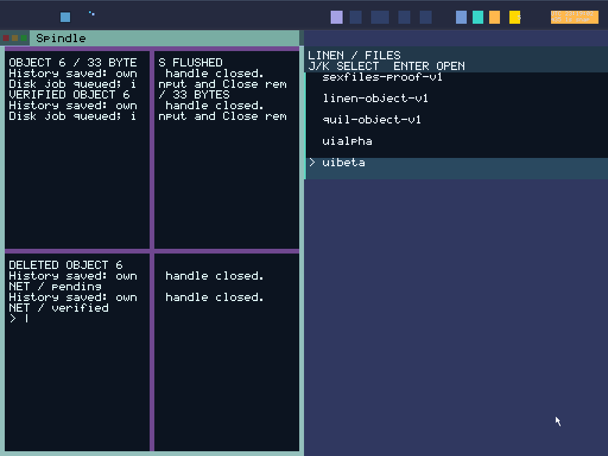

# Round 146: readable Spindle tiles and exact evidence timing

Spindle's normal compact tile now uses crisp **2× glyphs**. A 244-pixel pane
shows 18 bounded columns,36 across the pair, rather than tiny 1× text. Narrower
panes below 128 pixels retain 1×. The exact catalog Spindle owner/content pairs
select this style; other apps and Shell frames keep their existing scale.

Layout, Display wrapping, glyph sampling, damage bounds and the native pixel
oracle follow the same source-bound SDK rule. MAX_TEXT stays 126 bytes; compact
pane payloads need at most 114. The command/history bytes are unchanged. Prompt
tail/caret and Home/middle/End semantics remain bounded. At affected heights
90–103 the existing geometry collapses the upper pair to preserve the prompt.

GLOBAL_VAS remains addressing only. BOOT creates capabilities, typed sex-pdx
authorizes their use and PKU enforces held authority. This changes presentation
and test orchestration, without new runtime authority or process address spaces.

## Native qualification

| Framebuffer | Tiled view | Enlarged view | Exact restore |
|---|---|---|---|
|1024×768|512×359,18 columns/pane|1024×718,20 columns/pane|512×359,18 columns/pane|
|1280×800|640×375,20 columns/pane|1280×750,20 columns/pane|640×375,20 columns/pane|

Each profile checks recalled prompt, one-character edit, Zoom and restore with
full current glyph/background verification. Eight screenshots pass independent
read-only stopped-frame audits, including fresh viewport sequences and exact
restoration. These auxiliary probes do not supply a full native-input replay CLI.
The compact auxiliary's historical writer 17 seed is an existing stopped native
journal; its durable receipt and exact disk hash are preserved as provenance.

Both full desktop profiles execute all eight Quil and Spindle incarnations,
owned history/probes, all twelve controlled new-reserve TCP completions through
positive RELEASE, exact last-generation handoff, five-role cleanup/private-zero
reuse and exhausted launcher. Each 39-capture workflow passes fresh source/image
artifact replay. The current Spindle panes are verified at 2×, including unused
cell erasure. Writer29 generation55/761 bytes cold-loads into fresh 12 and recalls
`echo alpha29`; four connected-desktop warm/cold boots also pass. The cold probe
has bound parent replay but no standalone artifact-replay CLI.

A host coordinator waited 735.548 seconds to serialize the fixed TCP fixture
against older soak tails. **No guest was stopped.** Coordinator wall duration
includes this wait; guest workflow windows do not. The release audit proves the
older final peer completed and target 29's private pool was reusable before
resuming the coordinator. Its watcher exit130 is an intentional coordination
interrupt executing its finally/SIGCONT, not a guest/test failure.

## Correct measurement and retained diagnostics

The old three-reserve wide soak was rejected by the unchanged strict idle bound,
by about 95 ms. Its cycle-end timestamp preceded a growing serial-log read, so that
host work became idle before a fresh 15-second wait. The final helper reads the
snapshot first, timestamps that boundary and anchors idle to the same boundary.
Five actual-helper tests reject the old ordering, growing-reader gaps and
intentional 16-second idle; the acceptance bound is unchanged.

The old wide artifact remains rejected even though its pre-replay result flags
said ok/acceptance. Its compact companion passed fresh replay. This is recorded
separately in [partial-only evidence](assets/sexos-three-spindle-sustained-partial-2026-11-01-evidence.json)
and [raw records](assets/sexos-three-spindle-sustained-partial-2026-11-01-raw.tar.gz):
1,599 verified members /12,915,431 bytes. No paired acceptance is claimed.

Three auxiliary setup failures are retained: wrong writer 29 seed for a fixed17
runner, old<=180-pixel classification against a real640×375 tile, and requesting
compact VGA without selecting Limine's compact entry. C now selects that actual
boot entry and keeps framebuffer/glyph checks strict. A/B/C production hashes
and kernel are identical; the runner corrections do not hide a product change.

## Evidence

Final source `348cc9ab4d2988eb58c1e4dcacf8f7b4149d6ad7`; product first landed at
`308d261056c7032352c20a2171c553c939f070a6`. Sealed build/35-second BOOT probe GREEN.

- **43 host gates / 2,746 Rust passes**: 2,738 gate-log passes plus eight extracted
  lifecycle cases; three compiled lifecycle mutants separately rejected.
- **1,037 Python tests**. Focused layout 17, actual Display 12 and pixel 13 cases
  cover threshold boundaries, unequal owners/tasks, tiny/asymmetric tiles,
  wrapping/colors/scalars, prompt bounds, zoom/restore and old-scale ghost ink.
- **10 qualified boots /112 immutable registry captures**, plus eight auxiliary
  viewport PPMs and one separately observed cold PPM. All ten BOOT rosters/layouts
  and 29/32 self-wait registrations pass their audit before sealing.
- **1,174 distinct source blobs** match committed Git objects and the snapshot:
  576 production +598 runner files.
- Eight exact ISO-extracted ELF scans: **293,447 decoded instructions**, zero
  inspected vector/FP matches. Static inspection does not prove runtime erasure.

ISO SHA256: `2ac80573a5240fc0d30dd2900fb59da19513b0f098d33013b8bc985f94e41b5e`

Kernel SHA256: `08bd29a9099ad90a8fa91698b973b18c1d9f6aa5e65dadbf6291f9e0f2064b82`

Architecture SHA256: `4085f8fa65234205c5fdab070fe36765d767a46edc001410bf2ed5bfb27a98d7`

[Machine evidence](assets/sexos-spindle-readable-tiles-2026-11-01-evidence.json)
and [raw archive](assets/sexos-spindle-readable-tiles-2026-11-01-raw.tar.gz)
retain 4,064 members /24,746,335 bytes. Every member size/hash was verified after
reopening. Archive SHA256: `08a1b34e29fc9b571161e2b4798cc98c52d6233ed30016bcce20459024e69da1`.

This image has not completed its own 1800-second acceptance. Eight Spindles remain
finite; Browser still has one incarnation. General deferred caller-task authority,
a native unequal task allocator and unrestricted daily-driver readiness remain
open. Inventory: **2 Open / 28 Partial / System Proven false**.

Next: [Browser held-identity and relaunch authority phases](BROWSER_RELAUNCH_AUTHORITY_PLAN_2026_11_01.md).
