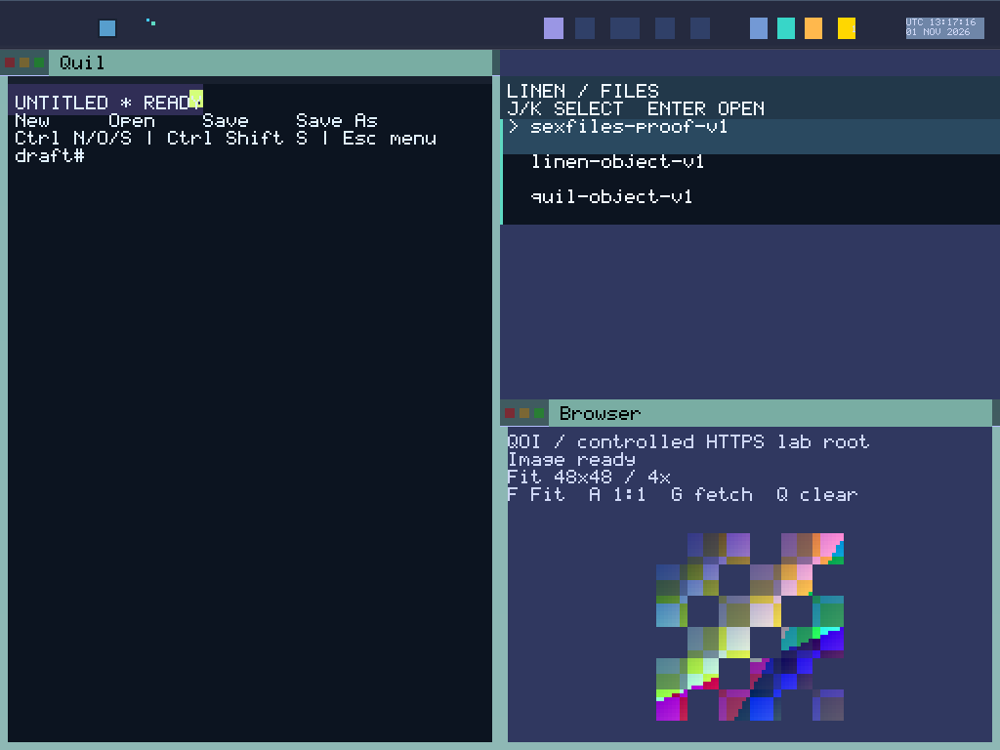

# Round 171 — coverage-proved text settlement

Status: **qualified**. Source `a187f0008f947d8f261334c239d4f81cbbe72285`.
GLOBAL_VAS, BOOT-only capability genesis, sex-pdx authority and PKU remain.
No Unix/POSIX model, per-process address space, runtime capability mint, new
capability kind, syscall or kernel change is introduced.

## Result

Round170 retained canonical typed text until successful Full publication.
Round171 retains that boundary while reducing conservative Full raster work.
After geometry fitting, Main projects each pending candidate through its actual
text/layout helper and joins the union of **old and new** glyph/selection damage.
Shortening and clear retain the old bounds. This is conservative clipping, with
no new hidden/occlusion assumption. Initial awaiting_parent is not treated as a
complete visibility predicate. Structural movement remains Area/Full work.

Owned SceneSnapshot captures each descriptive Context and its checked requirement
together: Body(rect) or explicit NoPixels. The successful publication result
retains those records after SceneLease Drop. Main commits only exact still-pending
contexts whose complete Body requirement is covered by the actual output plan.
Missing metadata is not NoPixels. Failure or insufficient coverage preserves old
canonical text and pending bytes. No geometry/chrome is copied back from Scene.

NoPixels permits **Settle**, which republishes the unchanged CPU baseline and
settles canonical metadata without raster, cursor restore/overlay/draw, app-present
or clock effects. Settle+strip still renders the strip. No baseline and tiny modes
retain Full fallback; Atlas previews retain Area coverage. Bitmap and lifecycle
completion remain Full-only. FrameStore still clones its baseline and copies the
complete CPU image to scanout: reduced raster work does not establish reduced
copy bandwidth or hardware atomicity.

Context remains descriptive under a single-Main closed-intake window, not a
capability, reset-unique token or exact-task reply isolation. Text ownership and
reply queues retain their existing PD authority. Other producer intake remains
mutable; Dirty is an output obligation, not a captured causal input stream.

## Frozen correctness evidence

- All46 registered frozen host checks and1,132 Python tests pass. Logs contain
  **3,214 successful Rust executions**, including repeated fixtures; this is not
  a unique/exhaustive count. Actual text Stage remains24 cases.
- Scene23 cases/15 compiled defect controls/2 source fences cover projection,
  old/new damage, insufficient output, explicit NoPixels, missing/wrong context
  and bitmap Full-only custody. Actual compositor54 cases pass.
- Frame47 cases: layout7, stores8, VA6, plan13, Main pipeline13. Ten pipeline and
  three plan defects, four compiler-trait and seven source controls are rejected;
  nine wiring checks pass. Pure Settle side-effect suppression, strip joining,
  failed publication, no-front/tiny fallback and actual post-drain joining run.
  Plan13 cases include1,728 join permutations.
- Cursor5 actual/2 compiled/4 source controls pass. Binding13 actual/5 compiled/
  17 source controls pass. Existing bitmap Stage22 and stores17 actual+17 future
  cases/5 compiled controls remain qualified.
- Core qualification: **11 boots/70 captures** — one sealed build plus10 native
  boots, with16 clock/date,34 connected/recovery and20 Browser captures. Eight
  native workflows pass fresh frozen CLI replay; clock also passes full API
  replay. All11 core BOOT inventories and typed-release witnesses pass. Bitmap
  release witnesses require Full; text may release with Full0 after coverage.
- The current typing/Close workload adds **one boot/18 captures**, bringing the
  current image to **12 boots/88 captures**. Its Round170 comparison adds a
  separate one boot/18 captures; it supplies no current-image acceptance. Both
  pass fresh frozen CLI and independent semantic replay, including four burst
  joins, exact paint/cursor/glyph prefixes and recovered24-byte saved payload.
  Nineteen synthetic validator controls pass; they are not guest qualification.

## Bounded responsiveness observations

Same compact1024x768/e1000 profile, seed bytes, runner files and workload; images
run sequentially after the core tests. Each run sends bursts of1/5/1/5 keys and
exercises Close during a real outstanding device WRITE, then successor recovery.
The following milliseconds are measured on the host from send to observed
Applied or verified pixels. They include QMP, trace polling, screenshot and proof
overhead. Four samples establish these observations, not a robust speedup,
guest latency, hard realtime, hardware performance or sustained acceptance.

| Burst | Keys | R170 Applied ms | R171 Applied ms | R170 pixels ms | R171 pixels ms |
| --- | --- | --- | --- | --- | --- |
| 1 | 1 | 475.80 | 70.98 | 521.19 | 115.46 |
| 2 | 5 | 705.26 | 122.63 | 751.32 | 167.56 |
| 3 | 1 | 363.64 | 62.64 | 409.88 | 107.28 |
| 4 | 5 | 705.51 | 132.36 | 752.48 | 177.73 |

Close/task.finish crosses an outstanding journal WRITE in both runs; the existing
strict trace proof and successor payload replay pass. No Close latency improvement
or separate cold-recovery claim is derived from this bounded pending-I/O test.

During typing, retained repaint records show seven Full records on170 and one
sampled text record on171. Ordinary text draws are sampled every16, and the first64
batch-publication log budget was exhausted before typing in **both** runs. These
are observed log subsets, not comparable total frame/pixel/work counts; absent
batch records do not mean zero work. Host pipeline controls separately verify
zero raster/cursor/app/clock work for pure Settle.

## Provenance and cost

Frozen binding `e80707e3cdb82cf442f1047af1f7ad5638fd090b6588fe9096bd05f6e2c9b8ad`.
ISO `f7c9fe1ccbf2e79c21deaeec23007a7f65eb02a483b722926c2ca015dae5cef7`.
Kernel `26bace17d464d1ea04667a6ff1dc47514d76be472342ca4ed396000f62a20f89`.
All1,224 frozen files/12,323,427 bytes matchGit (586 production,638 runner).
583/586 production files remain unchanged from170; Main, Scene and paint_batch
change, with no additions. ABI67/hash
`3b98b23398b7a309a74d5d10526e9234fa372ff448c79f51aa4f4b9f44fdc36a`
and kernel are byte-identical170. Nine ISO ELFs contain326,346 scalar instructions
and zero matched FP/vector instructions.

Display ELF298,280 bytes (+6,520). Scene60,608 (+512), text stages9,088, bitmap
stores55,992 and frameStore88 bytes. Frame buddy reservation8MiB, post-seal heap
used11,851,408 and app private2,465 pages remain. Physical free frames are
unmeasured; these budgets are not additive disjoint RAM totals.

Selected local stack reservations: _start5032(+304), raster_batch24,
render_prepared1304, raster_full2328, raster_area2264, raster_strip136,
raster_damage2248; each additionally pushes48 bytes of registers. The compiler
outlined pass functions, so raster_batch24 is **not** a transitive stack reduction.
Measurements exclude caller/callee totals, interrupts and dynamic stack. The
initial three-symbol budget helper is retained as superseded diagnostic evidence.

Current preflight Scene wiring and cursor extraction failures are retained under
UNQUALIFIED with their logs; corrected frozen gates pass. No failed native cohort
or prior-round diagnostic is relabelled current acceptance. The first actual
package passes after exact post-build pins; no guest is restarted on a timeout.

[Raw evidence](assets/sexos-text-coverage-a-2026-11-01-raw.tar.gz): **17,636,725 bytes/2,907 members**,
SHA256 `05271fa78b8cf3c462e3f21044d01f314e1cf225b2125b359a028b38f5d1891e`. Packager and Root independently reopen every member and
verify size/SHA; baseline frozen evidence stays under comparison, outside current
acceptance. [Root audit](assets/sexos-text-coverage-a-root-audit.json).
[Compact capture](assets/sexos-text-coverage-a-connected-compact.png) is a lossless RGB conversion of a qualified
capture; it adds no guest boot/capture.

## Next

Round172: retain sealed bitmap Commit/Clear candidates, project their owned bytes
into Scene, then commit canonical bitmap pixels and release exact captured contexts
only after successful Full publication and scene release. Reuse current staging/
published arrays; preserve old canonical pixels on failure, immutable duplicate
handling, reset historical receipts without pixel resurrection, and terminal
cancellation. Move committed diagnostics to that boundary. Bar freshness and
anti-rollback admission state must not be rolled back with renderer state.

Other source state, causal input capture, interrupted output, hardware latching
and deterministic replay remain further work. **2 Open/28 Partial/SystemProven
false**; EPOCH_COMMIT and DETERMINISTIC_REPLAY stay Open. No current-image1800s,
Alpha/daily-driver, full reserve-chain, hardware/SMP, hostile isolation or physical
erasure claim. Accepted80–171=92/121;172–200 remain29 substantive rounds.
