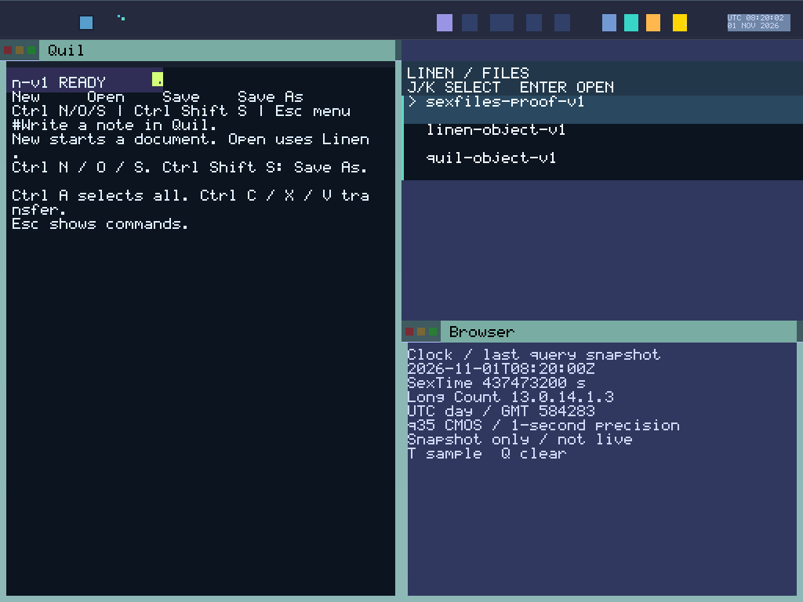

# Round 165: UTC date and one clock snapshot per render

The UTC-date change passes its nine-boot qualification: one sealed build, four clock runs and four connected session/recovery boots. Fresh replays qualify **50 captures**. All 43 frozen host checks and 1,132 Python cases pass; host logs contain 3,147 successful Rust test executions, including SDK cases reused across fixtures rather than that many unique tests.

The preview is a lossless conversion of the qualified normal-compact `clock-tile.ppm`, not an additional capture. Its original pixels, prefix and proof remain in the archive.

The status strip now pairs `UTC HH:MM:SS` with a human-readable date such as `01 NOV 2026`. Both rows derive from the same accepted whole-second UTC sample. Calendar formatting does not query another source, advance time locally, change the wire epoch or relax clock authority and range checks.

When there is no usable sample, the second row describes the state: `Awaiting UTC`, `Sample stale`, `Source error`, `Time blocked` or `Updates ended`. These captions replace the previous date; an unavailable or stale clock cannot leave yesterday's date beside an invalid time.

The full renderer and strip redraw each construct the two padded rows once per pass and pass that snapshot to their pixel helpers. The proof renderer follows the same rule. Calendar conversion is not repeated for each pixel. Source checks reject either time-row or date formatting injected into any of the three pixel helpers. This establishes the intended computation placement, not a measured frame-time improvement or a completed scene epoch.

## Calendar and rendering evidence

The host fixtures include 22 independent literal UTC calendar vectors, a same-time-next-day update that must repaint despite unchanged time-of-day text, and unhealthy/stale transitions that erase the prior date. Existing source bounds and receipt rules remain in force. The ClockSource provider, display wire and authority ABI are unchanged.

Python pixel oracles reconstruct the caption independently with UTC calendar conversion and verify the complete clock strip, including background erasure. The completed native runs use the actual frozen `certificate_time_gate.py`: normal time and an explicitly invalid-year RTC configuration, each at compact1024×768/e1000 and wide1280×800/e1000e. Each run passes four immutable clock/full-chip captures and a fresh replay. The invalid-year profile tests time unavailability, not a different grant inventory or authenticated time.

The two connected profiles each pass a live session and recovery boot, 17 captures and a fresh replay. The completed total is **nine boots and 50 captures: 16 clock plus 34 connected**. There is no current Alpha, all-reserve exhaustion or 1,800-second acceptance claim.

Compatibility checks against eight old Round164 PPMs are separate evidence bound to that older source/image. They are not eight additional C captures, new boots or transferred native acceptance. Likewise, A's earlier passing sealed build belongs to its original binding. B added stronger source-cache checks, then its host gate exposed one stale compositor fixture/API guard; the native wrapper stopped before starting any native guest. C corrects only that fixture/gate wiring. Its product renderer remains unchanged from A. Earlier A/B sealed builds and passing checks keep their old bindings and are not C acceptance. B's failed host report, log, binding and exact old fixture/gate remain separately unqualified harness diagnostics.

## Binding and archive

Source: `398810b4f168f0fe41d2131fda8bf173f9b5cf49`.
ISO: `6b6134f142a8132f1fdeba4f4b74f50fd3c93c67c25b0b5ee4dbb382c7db128f`.
Kernel: `4bef299f42a0a2f89dc2bda76ee717623f9a213341939268be908168006e1f7c`.
Source-binding SHA-256: `1ff1034fbfb7dffb143923da4455bc211f0fb8c16cf5334dc50879c9e8db8442`.

The source audit covers 1,211 blobs totaling 12,041,843 bytes. Nine ISO ELF scans decode 324,207 instructions with zero FP/vector matches. These are static source/image checks, not runtime register, cache or physical-memory erasure proof.

Relative to Round164 source `a84043d05e2387aba7573c37525c6ac935be25c7`, 579 of 582 production blobs are unchanged. The exact changes are `Cargo.lock`, `servers/sexdisplay/Cargo.toml` and `servers/sexdisplay/src/main.rs`. Measured kernel bytes remain identical. The catalog remains 28 apps and 40 mains within capacity64; the strict nine-boot audit passes actual task identities, held grants, private backing and the 1,352-byte denial-storage measurement.

[Raw evidence](assets/sexos-clock-date-2026-11-01-raw.tar.gz): **10,460,806 bytes**, SHA-256 `b71300c7648d3a368f6a8ad7609102523b8748a059dc27097bc2a05a0986bfe1`. All **1,512 members** were reopened and size/SHA verified. The archive retains current frozen source/ISO/kernel, host logs, audits, executed helpers, native raw captures/actions/journals/PCAP, and fresh replay proofs. Previous native evidence retains its own binding.

One packaging attempt stopped because the clock CLI returns a compact `ok/mode/captures` summary rather than the full replay object. The correction preserves fresh CLI agreement and additionally invokes frozen `replay_evidence` in a fresh process to validate and archive the complete clock pixel proofs. No acceptance predicate was weakened. The old package helper and failure trace remain inside the archive as a harness diagnostic, separate from B's failed compositor fixture. The successful packager SHA-256 is `bc6468ef477ed44d59e56db78104cf9f0adc22761d235e7d1e9208ea2972f340`.

Architectural inventory remains **2 Open / 28 Partial / System Proven false**. **EPOCH_COMMIT** and **DETERMINISTIC_REPLAY** remain open; all other obligations remain partial. GLOBAL_VAS supplies addressing, BOOT alone creates authority, and typed sex-pdx and PKU retain their roles. No physical-hardware, SMP, hard realtime or general daily-driver qualification is claimed.

Next166 begins full immutable scene isolation under the [Display epoch implementation plan](DISPLAY_EPOCH_IMPLEMENTATION_PLAN_2026_11_01.md). The two-row clock snapshot is only a local formatting decision. A substantive scene epoch must establish the admitted work boundary, atomic visible scene and replay evidence; neither a counter nor a framebuffer copy alone closes those obligations. This follows the active 80–200 plan's dependency ordering.
