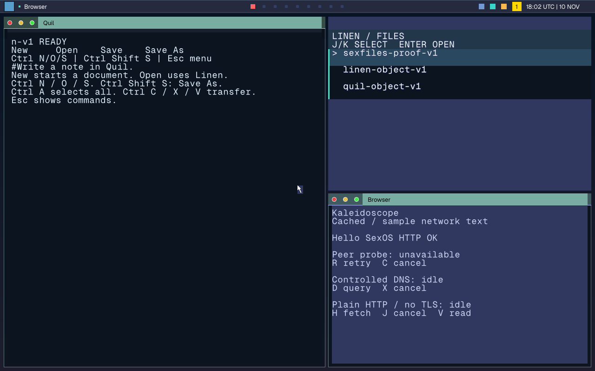
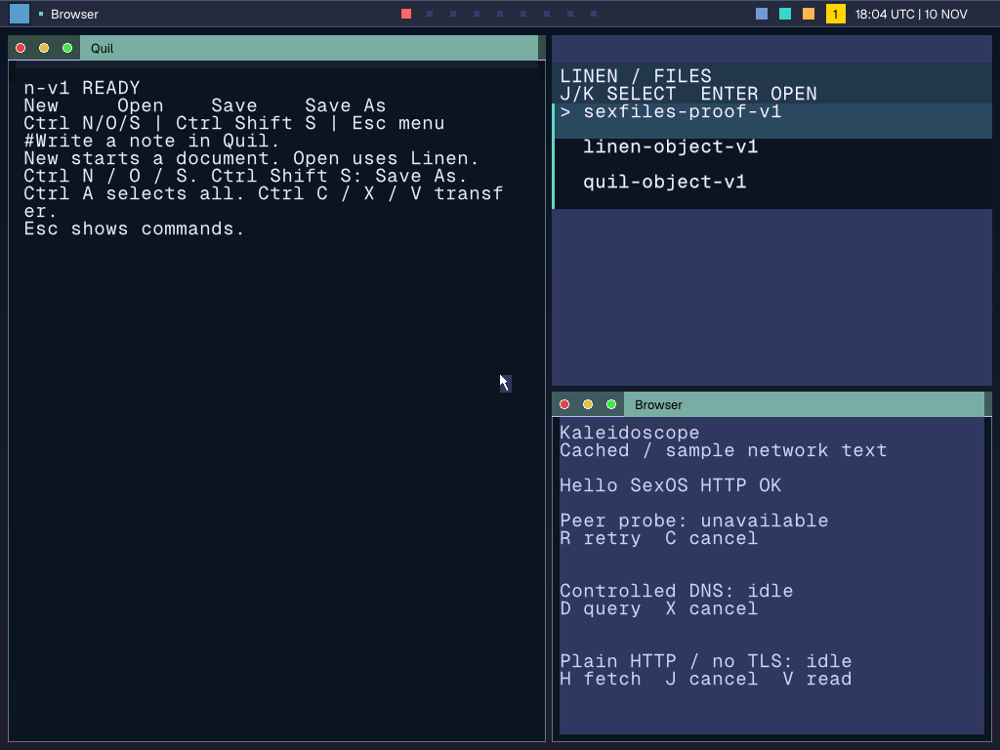

# Actual native slim desktop checkpoint

These are QMP captures of the real SexOS desktop, converted from guest PPM pixels
without retouching. Source `17c7f700185635428b0193979bd60cd7b55f2e48` includes
master `3e075b59` (native screenshot capture, encoder and dormant source pin).
ISO SHA-256: `213007e199bb3cda516abe5ad08c7b8ed54bc99e4153a073e74c3bdc86cde34b`.
The source tree was clean during the successful build; compiler/header details are
recorded in `build-inputs.json`. No Rust target was copied from another worktree.

Both views pass the strict complete 3,456-pixel Geist Sans clock oracle and published
28/26/8/34/24 geometry checks. This UI candidate omits FFmpeg/libc++ libraries, so
these captures do not qualify media or the complete C capability suite. Native app
body text remains Geist Mono and panels remain square pending the next approved
Sans-label/whole-panel-mask stage. These are implementation evidence, not final UX
acceptance or performance evidence.

