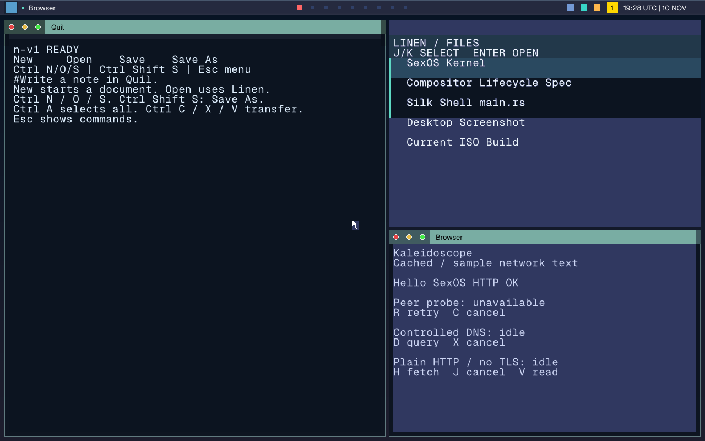

# Fresh integrated 151 slim desktop qualification

Clean build source `a427b95c73dc9f0c75a5ca6a3aab93202b3c57af` includes master 151
`d92091cb`. ISO SHA-256 is
`817e08083f5a72f9614c094f3e4294c3339ed961f6b0d8541056d45261469249`.
The build uses verified musl headers/Apple clang 21 and an own-worktree Cargo target;
no copied Rust outputs. FFmpeg/libc++ are absent: this is UI-only qualification.

The entire native desktop-close gate passes: original/successor document persistence,
input glyphs, Spindle successor/history/observer/Bell/command glyphs, exhausted
launcher glyphs, survivor filenames and minimize/absent/restored glyphs. The 1280
capture passes all 3,456 clock pixels. Native 2560 mode and matched post-publication
scale receipts pass 1→2→1 with ink 2,280/18,616/2,280. No new timing claim follows: the
matched performance result remains the separate geometry-isolation 3e/17c cohort.

The image below is an actual QMP PPM converted to PNG without retouching. Whole-panel
rounding and natural Sans app labels remain next, so this is not full approved-UX
completion. Final current-head CI remains mandatory.

