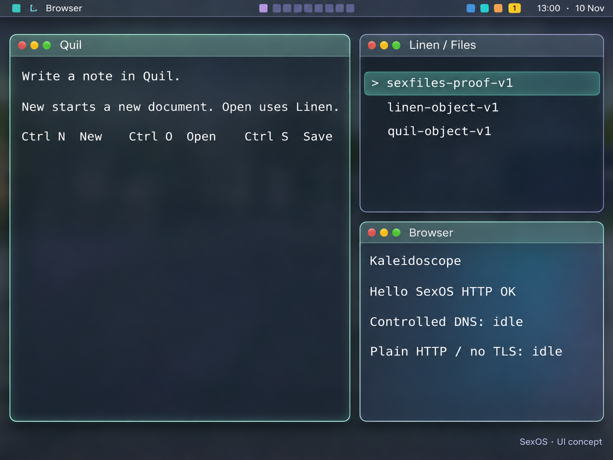

# Slim chrome: revised shared F2 plan (2026-11-10)

Status: visual and written proposal before geometry implementation. Baseline master
`fab6598f` includes Geist defaults (#126), native-mode/text/cursor scaling (#77), and
wallpaper/night light (#128). This entry revises the geometry proposal in
[`2026-11-10-display-f2-plan.md`](2026-11-10-display-f2-plan.md) and the earlier
[`desktop UX plan`](2026-11-10-desktop-ux-plan.md). It adds no executable change.

Andreas's latest direction: the earlier concept is close, but its top bar is too thick.
Use the slender Apple-like bar proportions with SexOS's mint/navy identity, Geist, quiet
rounded panels and fine edges. Keep strong glow and heavy framing out of the proposal.
The generated reference below was shown in the chat before new geometry work.

This is an **AI-generated design concept, not a guest screenshot**. Typography, spacing,
clock contents and glass are approximations. Implementation uses bundled Geist fonts
and the explicit metrics below, preserves real source states, and needs new QEMU images.
The [generation prompt](../assets/ux-concept-2026-11-10/slim-bar-concept-prompt.txt) is
retained for review. Raw user screenshots stay local and are not included in this PR.

## Geometry and typography contract

All numbers are logical pixels. Device pixels come from the same whole-number scale
(1-3) in Shell, Display and client viewport metrics; no Display-only multiplier.

| Role | Proposed value / behavior |
| --- | --- |
| Global top bar | **28px total**, including its 1px bottom separator; edge-to-edge, no tall floating-pill container |
| Bar targets | 24x24px with 2px vertical padding; visible icons may be 14-16px |
| Bar type | **13px Geist Sans**, 16px line, centered baseline; selected app title is secondary to controls |
| Clock/date | One line, e.g. `13:00 UTC  |  10 NOV`; no stacked date chip |
| Window title bar | **26px**; 24px-high control targets with 1px vertical padding |
| Window title/UI labels | 13px Geist Sans; preserve natural advances and kerning |
| Control marks | Restrained circular red/amber/green marks, about 10px visible diameter inside shared targets; honor disabled actions |
| Editor, terminal, code and diagnostics | Geist Mono; preserve existing per-window zoom and selection/cell semantics |
| Frame visible edge | 1px; a stable 2px focus treatment when needed, never a broad glowing band |
| Frame resize target | Keep the logical 8px band independently of visible edge width, clipped to the shared rounded shape |
| Panel corners | 12px floating, 10px separated tiled panels; square fullscreen/edge joins where appropriate; clamp on tiny frames |
| Window gaps | Existing 6px internal / 8px external, scaled consistently; no new spacing change in the first geometry topic |
| Canvas/palette | Existing navy native canvas and applied mint/lavender/teal accents; preserve actual runtime tokens, not assumptions about compile-time defaults |

The 28px height includes the separator: the bar owns rows `[0, bar_px)`, and the work
area starts at `bar_px`. Tiling's outer gap then places a normal window at logical y=36.
Replace the old 50/51 split with this one contract; do not retain an extra hidden row.

Clock presentation still derives from the same accepted civil snapshot. UTC remains
labeled until a real timezone preference exists. Unknown, stale, blocked and unavailable
states show their actual nonnumeric state; no stale date/clock is presented as healthy.
Formatting happens once per pass, not per pixel. Hiding seconds from the visible bar
must not weaken source admission, source health checks, sequence receipts or TLS time.

At normal logical widths show nine workspace marks and the genuine status controls.
When space is tight, elide the app title first, then move secondary date/status details
into existing or explicitly designed overflow views. At very narrow logical widths use
an obvious workspace/overview affordance rather than clipped invisible hit boxes.
All nine workspaces, keyboard shortcuts, clock/status access and focus escape remain
available. Specify and test compact layout before claiming scale-3 support at 1024px.
No placeholder network, battery, microphone or notification value may masquerade as live.

## Shared implementation inventory

| Area | Required coordinated change |
| --- | --- |
| `crates/sex-pdx/src/desktop_style.rs` | Pure logical chrome metrics, `step_scale(before, boot, step)`, logical/device conversion, shared control boxes and rounded row/hit masks; metric data grants no authority |
| `crates/silkbar-model/src/lib.rs`, SilkBar producer and Shell consumer | One bar layout contract for launcher, title, workspaces, status and clock; define compact flow and scale-aware hit tests together |
| `servers/silk-shell/src/main.rs`, `desktop_keys.rs`, `wm.rs` | Read sanctioned boot scale, mirror only accepted scale, derive workarea/clamps, title/control/drag/resize geometry and scaled gaps from shared metrics |
| `servers/sexdisplay/src/main.rs`, `glyphs.rs` | Shared strip/title/body bounds; natural 13px Sans bar/title roles; scale font size/height/baseline and preserve the existing bounded cache |
| `servers/sexdisplay/src/surface_groups.rs` | Update **all** child fitting, body selection and row-winner clipping: current literals 8/36/16/44 and y>=50 encode the old chrome |
| `scene.rs`, `damage.rs`, `paint_batch.rs`, frame/cursor output | Capture the chosen metrics with the scene; derive strip/body damage boundaries; preserve output preparation/publication and typed completion coverage |
| Native client view/input metrics | Spindle plus Quil/other fixed-cell clients must know the applied scale through their held viewport/layout route; text, carets, selections and pointer hit mapping must agree |
| Wallpaper/night-light path from #128 | Preserve background choice and final tone application; test contrast against the actual final pixel, including night-light states |

Scale changes must not let Shell hit-test new controls while Display still shows the old
frame. Audit the current request/reply contract: Display currently accepts a step while
Shell ignores the value return. Define an authenticated applied-scale/geometry receipt
and bounded transition behavior before changing both sides. Keep ordinary unrelated
input live; do not invent a global kernel GUI API. Apps receive window-local metric data
through held routes, not new ambient monitor authority.

Rounded painting and hit testing use the same bounded integer row mask, not separate
approximate formulas. Transparent corner pixels pass to the correct live window below;
visible arc points still resize the intended window. Test both cases. Corner radius
clamps to frame dimensions, and clipping occurs before selecting child content. Flags
and surface-family metadata describe presentation; ownership is still authenticated from
the live BOOT catalog. Prefer cached row spans over an extra corner calculation at every
content pixel. Declare any mask/backing growth and keep it out of thread stacks.

A 3x 28px bar needs 84 physical rows. Audit the old 50-row blur backing and captured rows,
width caps, render loops and cursor save-under together. Size buffers from a bounded
maximum, or remove demonstrably redundant backing in its own topic. Measure the actual
static/stack/BOOT cost; never expand a scratch array without accounting for it. No new
full-frame blur pass or continuously running glow/animation timer is part of this plan.

The concept's glass should initially use restrained existing tint/blur capability with
an opaque navy fallback. Soft depth must remain subtle and bounded. Additional blur or
shadows need a separate measured proposal; the image is not evidence they already run.

## Small PR sequence

1. **Shared F2 contract, current look retained.** Add metrics/scale helpers and independent
   goldens. Coordinate Shell, Display, grouping, damage, view/caret metrics and scale
   receipt behavior. Keep old visual sizes until the common path works at 1x/2x/3x.
2. **Slim bar and title geometry.** Switch the shared bases to 28/26, 24px targets and
   13px Sans; replace the stacked clock with the real one-line UTC/date. Update bar
   producer/consumer layout together, compact behavior, workarea, hit mapping and gates.
3. **Rounded panel shape and fine edges.** Introduce shared masks and restrained corner
   treatment with resize/click-through tests. Preserve layout ownership and client bounds.
4. **Native UI typography/spacing.** Split UI labels from document/terminal cells using a
   typed natural-text/pixel path. Fixed-cell Files/menu bodies currently use Mono; do not
   relabel stretched Sans cells as a proportional UI implementation or alter editor text.
5. **Optional depth polish.** Only after the prior stages meet contrast/latency/memory
   budgets; additional effects get their own evidence and a reduced-effects fallback.

PR #132 is the separate geometry-preserving quiet-rim slice, not this new bar/rounding
implementation. Its source-bound images and timings cannot qualify future 28px geometry.
Kernel growth target for all these stages: **zero**. Keep the 21,500-line guardrail.

## Acceptance before any geometry stage is called done

- Fresh before/after guest captures at 1024x768 and 1280x800, plus native 2560x1600 and
  scale 1->2->1; include 3x/tiny logical viewport and 4K geometry coverage. Source/ISO
  hashes and build flags accompany each artifact; concept images never stand in for them.
- Assert 28/26 logical geometry and 24px target boxes, shared transformed workarea, no
  overlapping bar/window rows, no offscreen status targets, and proper compact flow.
- Real clicks on scaled close/minimize/zoom and on visible resize arcs, corner pass-through,
  overlapping windows, drag/resize, fullscreen, tiling/workspaces/scratchpad and restart.
  Verify text caret, selection, clipboard and program pointer mapping at every scale.
- Run relevant compositor/scene/frame-output/clock/readability/cache/layout host gates,
  `window_manager_gate.py`, float/resize/close gates, `display_native_gate.py`, text zoom,
  notification/launcher/connected-desktop/crash flows and all changed source-bound oracles.
  Recompute ABI pins when shared input files change, even if the wire is unchanged.
- Preserve actual source semantics and admitted/published receipt order. Single-line clock
  oracles must prove glyphs, erasure and unhealthy states, not just read a log label.
- Ordinary text >=4.5:1 and essential/focus boundaries >=3:1 against final composed/tone
  pixels; inspect default, wallpaper/night-light, focused, hover and disabled states.
- Compare repeated guest input-to-visible traces with an exclusive QEMU window, an A/A
  control and identical guest/core/host configuration. Retain failed/noisy runs; report
  scope and uncertainty. Explain and resolve a reproducible >5% p95 regression. Track
  memory and written pixels alongside latency; host cache timings are not guest frame time.
- Preserve immutable scene ownership, bounded failure handling, restart/session recovery,
  and exact live input authority. No daily-driver, hardware or whole-system proof is added
  merely by drawing the new concept successfully.
