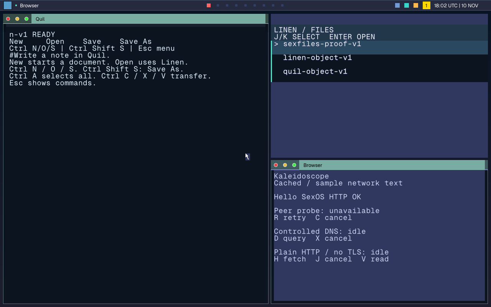

# SexOS User Guide

Welcome to **SexOS**, a pure-Rust single-address-space operating system (SASOS) built from first principles. SexOS replaces traditional monolithic kernel designs, Unix process hierarchies, and POSIX file descriptors with modern hardware memory domains (Intel Memory Protection Keys / PKU), unforgeable capability grants, zero-copy PDX inter-process communication, and autonomous user-space server organs.


*The SexOS Silk desktop running at native 1280×800 resolution with tiling windows, SilkBar status metrics, and responsive geometry.*

---

## The SexOS Philosophy

SexOS is fundamentally different from Linux, macOS, or Windows:
1. **Single Address Space (SASOS)**: All programs and servers reside in one coherent 64-bit address space. Context switches require zero TLB invalidation; IPC passes data through zero-copy typed channels.
2. **Hardware Protection Domains (PKU)**: Programs and device drivers run in isolated "organs" protected by CPU PKRU keys in user mode (ring 3).
3. **No Ambient Authority**: A program cannot inspect the filesystem, talk to the network, or interact with other software unless explicitly given a capability grant by **Collar** or by you at launch (`@file`, `+net`, `+pkg`).
4. **Themed Identity**: Every system component and application bears a canonical themed name inspired by textiles, romance, psychedelic vision, or playful puns. **Jot** (the notepad) is the sole plain-name exception.

### Quick Reference: Themed Names & Concepts

| Canonical Name | Conceptual Role | Description |
|---|---|---|
| **Silk** | Desktop Shell & Window Manager | Tiling compositor, window frames, and the **SilkBar** status panel. |
| **Atlas** | Workspaces & Overview | Virtual desktop switcher and live thumbnail workspace overview (`Super+W`). |
| **Spindle** | Terminal & Command Surface | Central command surface, interactive shell, script runner, and split-pane terminal. |
| **Yarn** | Command Sessions | Spindle's persistent shell session and multiplexer. |
| **Linen** | Object System | Persistent structured document and session storage without POSIX file descriptors. |
| **Collar** | Capability & Authority Broker | Security arbiter mediating filesystem grants, network flows, and hardware custody. |
| **Bell** | Notification System | Desktop notification server and alert log (`Super+N`). |
| **Mesh** | System Monitor & Capability Graph | Live inspection of protection domain resource usage, CPU/memory, and capability grants. |
| **Shibari** | Secret Keeper | Volatile RAM-only vault for keys, Wi-Fi passwords, and TLS secrets. Never paged to disk. |
| **sexfiles** | Filesystem Service | SASOS zero-copy filesystem engine managing persistent storage volumes. |
| **sexdrive** | Storage Drivers | Native NVMe, AHCI, and Intel VMD storage driver service. |
| **BDSM** | Block Device Storage Manager | Partition management, disk lenses, RAID arrays, and volume encryption at rest. |
| **sexnet** | Network Stack | Microkernel TCP/IP, UDP, DNS, TLS, Wi-Fi, and Ethernet communications service. |
| **sexshop** | Application Store | Cryptographically verified package catalog and package manager (`/bin/sexshop`). |

---

## User Guide Contents

### Core Desktop & System Architecture
- **[Silk Desktop & Navigation](desktop-and-navigation.md)**: Master the Silk window manager, Atlas workspace navigation, keyboard chords, tiling layouts, and interactive screenshots.
- **[Security, Capabilities & Collar](security-and-capabilities.md)**: Understanding PKU domain isolation, Collar capability grants, Shibari volatile secrets, and the Mesh capability graph.
- **[Installation, Boot & Updates](installation-and-updates.md)**: Booting the live ISO, UEFI installation beside other operating systems, and atomic A/B system updates.

### Core Application Manuals
- **[Spindle (Terminal & Shell)](apps/spindle.md)**: The command surface, built-in commands, background task management, pipelines, and split panes.
- **[Kaleidoscope (Web Browser)](apps/kaleidoscope.md)**: Full CSS/HTML rendering, QuickJS engine, WebGL, tabs, reader mode, and ad shields.
- **[Loom (File Manager)](apps/loom.md)**: Visual file management, archive inspection, live previews, trash recovery, and capability grants inspection.
- **[Quil (Code Workstation)](apps/quil.md)**: The developer workstation and code editor with syntax highlighting, search/replace, and document exchange.
- **[Jot (Notepad)](apps/jot.md)**: Lightweight, distraction-free notepad with fast undo tree and markdown previews (*sole plain-name exception*).
- **[Tatami (Settings Center)](apps/tatami.md)**: System configuration, display scaling, appearance, network connections, and privacy grants.
- **[Qupid (Media Player)](apps/qupid.md)**: Video and audio playback, hardware-accelerated streams, playlists, and subtitles.
- **[sexshop (App Store)](apps/sexshop.md)**: Discovering, verifying, installing, upgrading, and rolling back signed software packages.
- **[Mesh (System Overview)](apps/mesh.md)**: Real-time task manager, CPU/memory monitor, and interactive capability graph.
- **[Vellum (PDF Reader)](apps/vellum.md)**: Document viewer with smooth zoom, text search, outline navigation, and form display.
- **[Gaze (Image Viewer)](apps/gaze.md)**: High-speed viewer for PNG, JPEG, WebP, and animated GIF images.
- **[Abacus (Calculator)](apps/abacus.md)**: Exact rational math, scientific expressions, bitwise programmer tools, and base conversion.
- **[Voyeur (Search & Launcher)](apps/voyeur.md)**: Universal spotlight search across programs, files, settings, math, and emoji.
- **[Date (Calendar & Clock)](apps/date.md)**: Calendar management, iCalendar (`.ics`) scheduling, alarms, timers, and world clocks.
- **[Chastity (Password Vault)](apps/chastity.md)**: Encrypted KDBX4 KeePass-compatible vault protected by Shibari memory isolation.
- **[Gestalt (Vector Canvas)](apps/gestalt.md)**: Anti-aliased 2D vector drawing and graphics demonstration.
- **[Flirt (Voice, Video & Network)](apps/flirt.md)**: Encrypted real-time voice, video calls, screen sharing, and socket explorer.

### Application Suites
- **[Creative & Professional Suite](creative-and-pro-suite.md)**: Deep dive into upcoming parity applications: **Assuit** (word processor), **Spreadeagle** (spreadsheets), **Burlesque** (presentations), **Batik** (image editor), **Polyamour** (3D modeling), **Splicy** (video editor), **Moan** (DAW audio editor), **Bodice** (e-books), and **Drag** (virtual machines).
- **[Communication & Sharing Suite](communication-and-sharing.md)**: Connected tools: **Valentine** (mail & Matrix messaging), **Flirt** (voice & video), **Multipass** (online accounts), **Crush** (contacts), **Hookup** (phone link), and **Swingers** (BitTorrent distribution).

---

## Essential First Steps

### Opening the Command Surface
Press **`Super+Enter`** anywhere on the desktop to summon **Spindle**. Alternatively, tap the **`Super`** key alone or press **`` ` ``** (backtick) to trigger the **Voyeur** launcher overlay.

### Launching Programs
Programs in SexOS run with strictly zero ambient authority. To run an installed program from Spindle:
```text
run jot                     # Launch Jot notepad with local sandbox
run +net kaleidoscope       # Launch Kaleidoscope with explicit network authority
run vellum @/document.pdf   # Launch Vellum with access to exactly one PDF file
```

### Navigating Windows
- **`Alt+Tab`**: Cycle through open windows with live thumbnail previews.
- **`Super+H / J / K / L`** or **`Super+Arrows`**: Shift focus spatially between tiled windows.
- **`Super+W`**: Open the **Atlas** Workspace Overview to view all windows across workspaces.
- **`Super+Q`**: Close the active window.
- **`Print`**: Activate the interactive screenshot tool.
