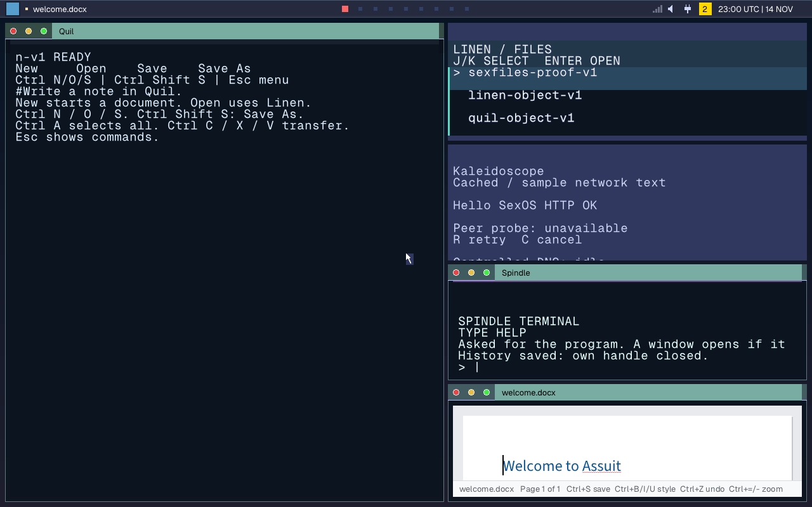

# Assuit (Word Processor)

> **Identity Note**: **Assuit** (`apps/assuit`, `/bin/assuit`, `crates/sex-office`, `crates/assuit`) is the SexOS professional rich-text word processor. Named after traditional Egyptian metal-thread net embroidery in accordance with the project's fabric naming theme (Andreas's pick).

**Assuit** delivers typography layout, document formatting, and multi-format document exchange for SexOS. Powered by an adaptation of the WordCraft engine running inside an isolated PKU protection domain, Assuit enables distraction-free composing alongside comprehensive formatting controls: paragraph styles, inline bold/italic/underline decorations, font sizing, page zoom, and seamless DOCX document interchange.


*Assuit running on the Silk desktop at 1280×800, displaying a formatted document page with live typography and text editing.*

---

## Launching Assuit

Assuit runs with strictly zero ambient authority:

- **Open the default welcome document**:
  ```text
  run assuit
  ```
  *(Creates and opens `welcome.docx` with introductory formatting if no file is specified).*

- **Open a specific document with capability grant**:
  ```text
  run assuit @thesis.docx
  run assuit @notes.odt
  run assuit @manuscript.md
  ```

- **From Voyeur**: Press **`Super+D`**, type `assuit`, and press **`Enter`**.
- **From Loom**: Select any supported document file in **[Loom](loom.md)** and press **`Enter`** to open it in Assuit with an explicit single-file custody token.

---

## Supported File Formats

| Format | Extension | Capabilities |
|---|---|---|
| **Office Open XML Document** | `.docx` | Full Word-compatible formatting, paragraphs, fonts, colors, and layout structure. |
| **Legacy Word Document** | `.doc` | Binary document parsing and conversion. |
| **OpenDocument Text** | `.odt` | Open standard document loading and editing. |
| **Rich Text Format** | `.rtf` | Standard formatted text exchange. |
| **HyperText Markup** | `.html` | Web document text and markup rendering. |
| **Markdown Document** | `.md` | Plain-text structured markdown editing and rendering. |
| **Plain Text** | `.txt` | Raw unformatted text editing. |

---

## Keyboard Controls & Navigation

| Shortcut | Action | Description |
|---|---|---|
| **`Arrow Keys`** | **Navigate Caret** | Move insertion cursor horizontally through characters and vertically across lines. |
| **`Ctrl+Left` / `Ctrl+Right`** | **Word Skip** | Jump caret backward or forward by whole words. |
| **`Home` / `End`** | **Line Boundaries** | Jump caret to the beginning or end of the current line. |
| **`Shift+Home` / `Shift+End`** | **Select to Boundary** | Select all text between the current caret position and the line start or end. |
| **`Shift+Arrows`** | **Extend Selection** | Extend or shrink active text selection character by character or line by line. |
| **`Ctrl+A`** | **Select All** | Select the entire text body of the active document. |
| **`Enter`** | **New Paragraph** | Split line or create a new paragraph block with matching style. |
| **`Backspace` / `Delete`** | **Erase Text** | Remove the character before or after the caret (or delete active selection). |
| **`Ctrl+B`** | **Bold** | Toggle bold weight on the active text selection or at the insertion caret (`format.bold`). |
| **`Ctrl+I`** | **Italic** | Toggle italic font styling on selected text (`format.italic`). |
| **`Ctrl+U`** | **Underline** | Toggle text underline decoration (`format.underline`). |
| **`Ctrl+Z`** | **Undo** | Revert the most recent typing, formatting, or deletion action. |
| **`Ctrl+Y`** | **Redo** | Reapply the previously undone document change. |
| **`Ctrl+=`** | **Zoom In** | Increase page display scale for comfortable reading. |
| **`Ctrl+-`** | **Zoom Out** | Decrease page display scale to view more layout context. |
| **`Ctrl+S`** | **Save Document** | Flush document changes and serialize atomic XML bytes to disk via **sexfiles**. |
| **`F11`** | **Close Window** | Safely close Assuit and retire its surface. |

---

## Key Capabilities

### 1. High-Fidelity WordCraft Engine
Assuit utilizes the WordCraft text engine:
- **True Page Layout**: Documents are paginated in real time with accurate page boundaries, margins, headers, and footers.
- **Rich Inline Styling**: Mix weights, styles, and sizes within sentences and paragraphs without layout reflow glitches.
- **Word-Compatible Keybindings**: Familiar shortcuts ensure productive, muscle-memory editing right from the start.

### 2. Mouse and Touch Navigation
- **Caret Placement**: Click anywhere on the text canvas to immediately place the caret at that character coordinate.
- **Smooth Scrolling**: Rotate the mouse wheel or swipe on the touchpad to scroll through multi-page manuscripts effortlessly.

### 3. Capability Confinement & Data Privacy
In compliance with SexOS architectural principles:
- Assuit cannot inspect other documents or explore parent folders outside of files explicitly granted by **Collar**.
- Background auto-flushing occurs through zero-copy typed channels to the persistent storage organ without blocking user input.
- No network capabilities (`+net`) are assigned by default, guaranteeing that confidential manuscripts and notes remain strictly local.
