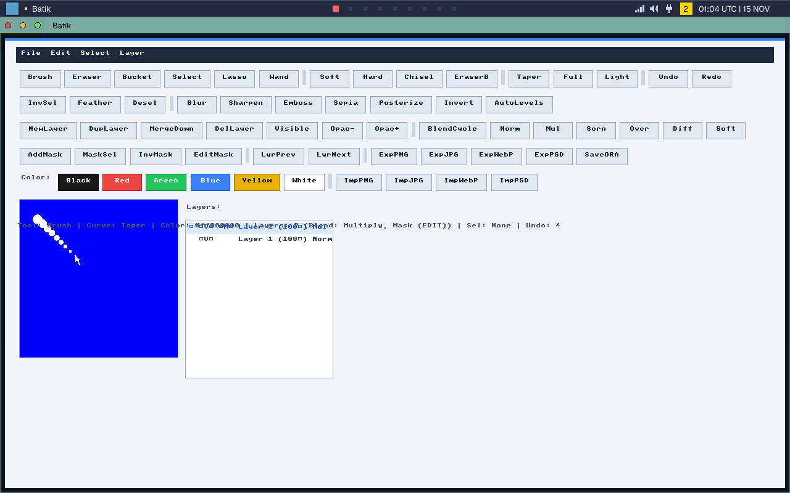
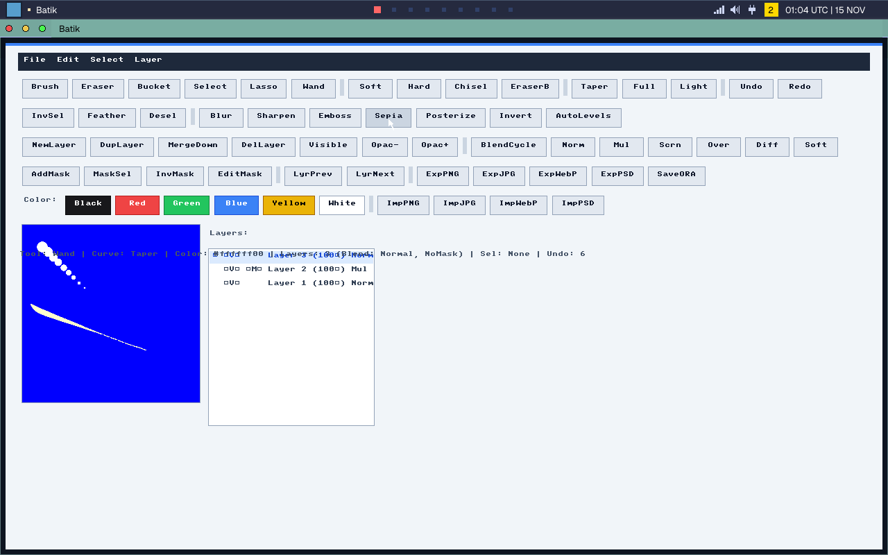

# Batik (Raster Image Editor & Digital Painting)

> **Identity Note**: **Batik** (`crates/batik-core`, `apps/batik`) is the SexOS professional-grade raster image editor and digital painting application. Named after the traditional Indonesian wax-resist fabric dyeing technique, its canonical name honors the project's fabric and textile naming convention (`DESIGN_GUARDRAILS.md` §6).

**Batik** delivers a Pixelmator-class digital darkroom and creative studio to the SexOS desktop. Built on a `#![no_std]` and `#![forbid(unsafe_code)]` pure-Rust compositing engine, Batik provides straight-alpha Porter-Duff blend modes, 8-bit paintable layer masks, pressure-sensitive dynamic brushes, polygonal lasso and magic wand selections with marching-ants previews, spatial convolution filters, color adjustments, and multi-layer interchange with Adobe Photoshop (`.psd`) and OpenRaster (`.ora`).


*Batik running on SexOS Weft at 1280×800, displaying multi-layer compositing, blend mode controls, and responsive UI.*

---

## Architecture & Subsystems

Batik is structured as a separation between a pure-math `#![no_std]` core and a Weft-based confined user-space application:

1. **Batik Core (`crates/batik-core`)**:
   - **Compositor (`blend.rs`, `document.rs`)**: Straight-alpha Porter-Duff SrcOver compositing with golden-tested blend modes (`Normal`, `Multiply`, `Screen`, `Overlay`, `Difference`, `SoftLight`, `Darken`, `Lighten`, `ColorDodge`, `ColorBurn`, `HardLight`, `Exclusion`).
   - **Layer Architecture (`layer.rs`)**: Multi-layer document model supporting raster layers, 8-bit grayscale layer masks, alpha locks, and group layers.
   - **Brush Engine (`brush.rs`)**: Sub-pixel stroke interpolation with pressure-dependent radius, flow, and chisel angle dynamics.
   - **Selection Mask (`selection.rs`)**: 8-bit selection masks supporting rectangular, elliptical, polygonal lasso, and stack-bounded flood magic wand tools with separable box-blur feathering.
   - **Filters & Adjustments (`filters.rs`, `adjust.rs`)**: Spatial convolutions (box blur, gaussian blur, unsharp mask, sharpen, emboss) and color tone mapping (auto-levels, curves, sepia, posterize, invert).
   - **Codecs (`png.rs`, `jpeg.rs`, `webp.rs`, `psd.rs`, `ora.rs`)**: In-crate pure-Rust baseline JPEG encoder, lossless WebP encoder, RGBA PNG encoder, OpenRaster ZIP reader/writer, and multi-layer Photoshop PSD decoder and encoder.
2. **Batik Application (`apps/batik`)**:
   - Interactive GUI window rendered on Weft with full keyboard shortcuts (`Ctrl+Z`, `Ctrl+Y`, `Ctrl+I`, `Ctrl+L`, `Ctrl+D`, `Ctrl+Shift+N`).
   - Dedicated toolbar rows for tools, brush presets, pressure dynamics curves, layer controls, blend mode switches, mask operations, and format import/export.
   - Live canvas preview featuring non-destructive black-and-white marching-ants selection boundaries.

---

## Core Capabilities

### 1. Layers & Blend Modes


Batik provides full layer stack management:
- **Operations**: `New Layer`, `Duplicate Layer`, `Merge Down`, `Delete Layer`, `Toggle Visibility`, and fine-grained `Opacity` adjustment (0–100%).
- **Porter-Duff Blend Modes**: Select between `Normal`, `Multiply`, `Screen`, `Overlay`, `Difference`, and `SoftLight` in real-time. Compositing uses straight (unpremultiplied) alpha mathematics for clean color preservation across transparent edges without dark halos.

### 2. 8-Bit Paintable Layer Masks



Every raster layer supports an optional 8-bit grayscale mask:
- **`Add Mask`**: Attaches a reveal-all (255) mask to the active layer.
- **`Mask from Sel`**: Creates a mask directly from the active selection.
- **`Invert Mask`**: Reverses transparency non-destructively (`255 - m`).
- **`Edit Mask` Toggle**: When active, all brush strokes, erasers, and bucket fills paint directly onto the mask buffer in grayscale. Painting black hides the layer to reveal lower layers; painting white restores visibility.
- **Mask Application & History**: Mask adjustments participate fully in undo and redo journaling through `HistoryAction::LayerMaskDelta`.

### 3. Pressure-Sensitive Dynamic Brushes


Batik's stroke engine interpolates pointer samples at sub-pixel resolution, applying dynamic brush dynamics:
- **Presets**:
  - `Soft Airbrush`: Large radius, low hardness (0.05), soft gaussian-like cosine falloff.
  - `Hard Round`: Crisp mechanical edge (0.95 hardness).
  - `Calligraphy (Chisel)`: Elliptical dab with 4:1 aspect ratio angled at 45° for hand-lettered flourishes.
  - `Eraser`: Non-destructive alpha clearing mode.
- **Pressure Taper Curves**:
  - `Taper`: Modulates radius and flow smoothly from 1.0 down to a sharp 0.15 tip along the drag stroke.
  - `Full`: Constant full-strength pressure.
  - `Light`: Feathered low-pressure contact for gentle shading.

### 4. Selections & Marching Ants


Selecting regions for isolated editing:
- **Rect Select**: Drag bounding box to define rectangular selection.
- **Lasso Tool**: Drag freehand polygon path around subjects; automatically closes upon pointer release.
- **Magic Wand Tool**: Click any canvas pixel to flood-select contiguous matching colors within configurable tolerance (`wand_tolerance`).
- **Marching Ants Boundary**: Active selections display a crisp, alternating black-and-white dashed marching-ants contour on the preview canvas without mutating underlying layer pixels.
- **Selection Operations**: `Invert Selection`, `Feather` (softening boundaries with separable box blur), and `Deselect`. Painting and spatial filters automatically clip to the active selection.

### 5. Spatial Filters & Color Adjustments



One-click toolbar and menu filters:
- **Blur**: Separable box blur smoothing out high-frequency noise.
- **Sharpen**: 3×3 high-pass laplacian kernel enhancing image details.
- **Emboss**: Directional relief filter rendering 3D surface depth.
- **Sepia**: Warm vintage photographic color matrix.
- **Posterize**: Quantizes color channels into 4 distinct tonal bands.
- **Invert**: Negative color inversion (`255 - c`).
- **Auto-Levels**: Histogram analysis automatically stretching darkest tones to black and highlights to white.

### 6. Universal Codec IO & Photoshop Interoperability


Batik includes full export and import support for major industry formats:

| Format | Extension | Capabilities | Serial Trigger |
|---|---|---|---|
| **Adobe Photoshop** | `.psd` | Multi-layer document, layer masks, blend modes, straight alpha | `export_psd`, `import_psd` |
| **OpenRaster** | `.ora` | Open standard multi-layer archive (ZIP of PNG layers + stack.xml) | `save_ora`, `@path.ora` |
| **Lossless WebP** | `.webp` | Modern web image format with lossless VP8L compression | `export_webp`, `import_webp` |
| **Baseline JPEG** | `.jpg` | Baseline 4:4:4 DCT compression with custom quantization tables | `export_jpg`, `import_jpg` |
| **Portable Network Graphics** | `.png` | Standard 32-bit RGBA flattened export | `export_png`, `import_png` |

---

## Command Line & Serial Automation

Batik can be launched from the SexOS shell with direct file arguments:
```bash
# Launch fresh workspace
run batik

# Launch and import existing multi-layer PSD or image
run batik @painting.psd
run batik @artwork.png
```

During execution, Batik logs structured serial records for deterministic headless testing:
- **State**: `[batik.state] layers=... active=... blend=... mask=... edit_mask=... tool=... sel=... undo=... pixel0=...`
- **Controls**: `[batik.control] name=... x=... y=...`
- **Codecs Export**: `[batik.exported] fmt=png|jpg|webp|psd bytes=...`
- **Codecs Import**: `[batik.imported] fmt=png|jpg|webp|psd layers=... w=... h=...`
