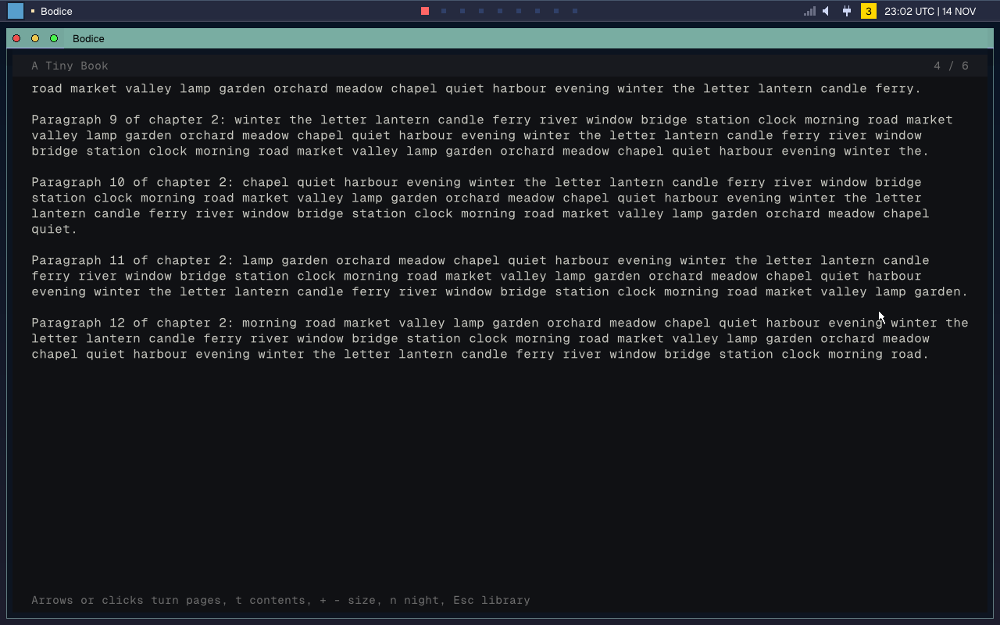

# Bodice (E-Book Reader)

> **Identity Note**: **Bodice** (`apps/bodice`, `/bin/bodice`, `crates/sex-ebook`) is the SexOS digital book and comic reader, named after the structured romantic garment in adherence to the project's fabric and romance naming themes (PR #230).

**Bodice** offers a distraction-free digital reading experience for books, comics, and illustrated documents. Featuring native EPUB reflow, FictionBook parsing, and comic book archive extraction, Bodice renders crisp typography with custom reading themes (warm daylight paper and dark OLED night mode), instant table-of-contents navigation, and persistent bookmarking.


*Bodice running on SexOS at 1280×800 in distraction-free night mode, rendering formatted chapter text.*

---

## Launching Bodice

Bodice manages books inside its isolated storage organ and supports capability-based importing:

- **Launch library overview**:
  ```text
  run bodice
  ```
  *(Displays all imported books in your library with reading progress indicators).*

- **Import and open a new book with capability grant**:
  ```text
  run bodice @novel.epub
  run bodice @manga.cbz
  run bodice @story.fb2
  ```
  *(Imports the book directly into Bodice's local library and immediately opens page 1).*

- **From Voyeur**: Press **`Super+D`**, type `bodice`, and press **`Enter`**.
- **From Loom**: Selecting any `.epub`, `.cbz`, or `.fb2` file in **[Loom](loom.md)** and pressing **`Enter`** launches Bodice with single-file custody.

---

## Supported Book Formats

| Format | Extension | Capabilities |
|---|---|---|
| **Electronic Publication** | `.epub` | EPUB 2 and EPUB 3 navigation, reflowable text, chapters, typography styling, and inline images. |
| **Comic Book Archive** | `.cbz` | ZIP-compressed image archives with page-by-page hardware-scaled graphic rendering. |
| **FictionBook 2.0** | `.fb2` | XML-based electronic fiction formats with structured chapter divisions. |

---

## Keyboard Controls & Navigation

### Reading Navigation

| Shortcut | Action | Description |
|---|---|---|
| **`Right` / `Down` / `Page Down` / `Space`** | **Page Forward** | Advance to the next page in the active chapter. |
| **`Left` / `Up` / `Page Up` / `Backspace`** | **Page Backward** | Turn backward to the preceding page. |
| **`Home`** | **First Page** | Jump directly to the first page of the book. |
| **`End`** | **Last Page** | Jump to the final page of the book. |
| **`+`** | **Increase Font** | Step font size up through 5 tuned sizing presets (8×16 to 16×32 pixels). |
| **`-`** | **Decrease Font** | Step font size down for more content density per page. |
| **`n`** | **Toggle Night Mode** | Switch color theme between warm paper (`Day`, `#F4EFE6`) and deep OLED contrast (`Night`, `#101114`). |
| **`t`** | **Table of Contents** | Open the structured chapter index overlay (`Contents`). |
| **`Esc`** | **Return to Library** | Leave the current book, save reading position, and return to the library screen. |
| **`F11`** | **Close Window** | Exit Bodice cleanly. |

### Library & Table of Contents Navigation

| Shortcut | Action | Description |
|---|---|---|
| **`Up` / `Down`** | **Select Item** | Move selection cursor through the book catalog or chapter index. |
| **`Enter`** | **Open / Jump** | In library: open the selected book. In TOC: jump immediately to the selected chapter. |
| **`Esc`** | **Dismiss / Back** | Close the Table of Contents overlay or exit the current view. |

---

## Mouse & Touch Controls

Bodice is optimized for intuitive mouse, trackpad, and touchscreen gestures:
- **Left Margin Click**: Click or tap the left side of the reader page to turn back one page.
- **Right Margin Click**: Click or tap the right side of the reader page to turn forward one page.
- **Scroll Wheel**: Turn pages smoothly forward or backward using the mouse scroll wheel.
- **Library Selection**: Single-click any book title or cover in library mode to open it immediately.

---

## Reading State & Privacy Architecture

### 1. Automatic Position Persistence
Bodice saves your reading progress automatically to `positions.txt` whenever you turn a page, switch to the Table of Contents, or exit. When you re-open any book days or weeks later, Bodice restores your exact chapter, page, and character offset.

### 2. Tailored Typography & Night Vision
Reading preferences—including your selected font scale index and night mode state—are stored in `settings.txt`. Night mode adjusts both background tones and foreground typography colors to reduce eye strain in low-light environments.

### 3. Isolated Storage Organ
Bodice is completely sandboxed:
- It maintains its own local books directory without inspecting ambient user directories.
- Books imported with `@file.epub` are copied securely into Bodice's organ via zero-copy capability transfers.
- No network capabilities are granted, ensuring your reading habits and library remain completely confidential.
