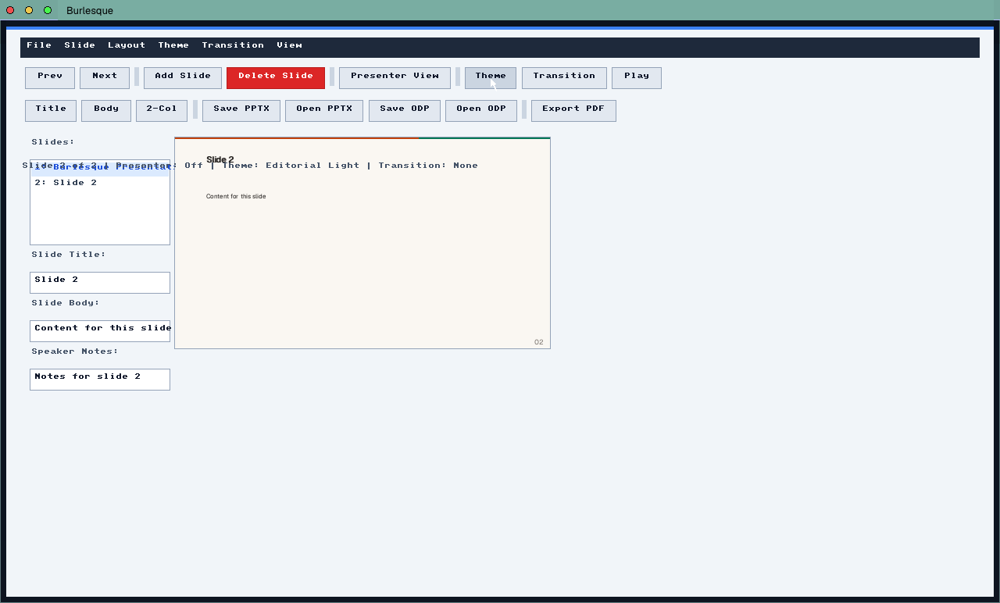

# Burlesque (Keynote-Class Presentations)

> **Identity Note**: **Burlesque** (`apps/burlesque`, `/programs/burlesque`) is the Keynote-class presentation suite for SexOS, named in keeping with the cabaret, theatrical romance, and fabric aesthetic of the operating system.

**Burlesque** delivers desktop presentation authoring and live delivery on SexOS. Built on the `#![no_std]` `burlesque-core` engine and the Weft windowing system, Burlesque provides 6 designer themes, live animated slide transitions, editable speaker notes, dual-pane Presenter View with timers, memory-bounded OOXML (`.pptx`) and OpenDocument (`.odp`) import/export, and vector PDF-1.4 generation.


*Burlesque authoring interface showcasing Keynote-class typography, slide layouts, and designer palettes.*

---

## Launching Burlesque

- **From Spindle**:
  ```text
  run burlesque                     # Open with default blank presentation
  run burlesque @presentation.pptx  # Open OOXML PPTX presentation with custody grant
  run burlesque @deck.odp           # Open OpenDocument ODP presentation
  run burlesque @talk.md            # Open Markdown presentation
  ```
- **From Loom**: Double-click any `.pptx`, `.odp`, or presentation `.md` file.
- **From Voyeur**: Press **`Super+D`**, type `burlesque`, and press **`Enter`**.

---

## Screenshots & Visual Walkthrough

### Designer Themes
Burlesque comes out of the box with 6 distinct themes engineered for typographic contrast and high-impact projection:
1. **Burlesque Velvet**: Deep cabaret plum (`#180828`), warm ivory, crimson rose, champagne gold.
2. **Editorial Light**: Warm newsprint alabaster (`#FAF7F2`), obsidian ink, terracotta vermilion, deep emerald.
3. **Midnight Slate**: Midnight navy slate (`#0B1120`), ice white, electric sky cyan, indigo glow.
4. **Champagne Ivory**: Luminous ivory silk (`#FBF8F1`), warm charcoal, burnished amber gold, warm bronze.
5. **Cyber Prism**: Void black-indigo (`#09071A`), luminescent aqua, hot neon magenta, cyan laser.
6. **Swiss Modern**: International stark white (`#FAFAFA`), dense typographic black, Swiss signal red.


*Theme Picker active with Editorial Light theme applied across slide deck.*

### Live Animated Slide Transitions
Burlesque renders real-time software transition frame interpolation:
- **Dissolve / Fade**: Smooth 256-level cross-dissolve alpha blending.
- **Push Left / Push Right**: Horizontal slide pushes with subpixel rendering.
- **Wipe Right**: Sharp linear wipes across canvas boundaries.
- **Zoom In**: Dynamic scaling transition from 20% to 100% viewport.


*Interpolated frame rendering during a live slide transition playback.*

### Dual-Card Presenter View & Speaker Notes
Toggle Presenter View (**`F5`** or toolbar button) to enter speaker mode:
- **Left Card**: Large Current Slide display with slide counter and transition badge.
- **Top-Right Card**: Real-time Next Slide preview (or "End of Presentation" card).
- **Bottom-Right Card**: High-contrast Speaker Notes card with word-wrapped Geist Sans rendering.
- **Header Bar**: Deck title, running elapsed timer (`MM:SS [RUN]`), and animated progress bar.


*Dual-card Presenter Display with elapsed timer, live next-slide preview, and speaker notes.*

### PPTX, ODP, and Vector PDF Workflows
Burlesque provides full interoperability with enterprise presentation suites:
- **Save PPTX / Open PPTX**: Standards-compliant OOXML `.pptx` container reading and generation.
- **Save ODP / Open ODP**: OpenDocument `.odp` container reading and generation.
- **Export PDF**: Multi-page vector PDF-1.4 export with exact layout preservation and font embedding.


*Exporting vector PDF documents and roundtripping PPTX and ODP slide archives in `/data/burlesque/`.*

---

## Keyboard Shortcuts & Toolbar Commands

| Shortcut | Command | Action |
|---|---|---|
| **`Left`** | `burlesque.prev` | Navigate to previous slide. |
| **`Right`** | `burlesque.next` | Navigate to next slide. |
| **`Ctrl+N`** | `burlesque.add-slide` | Add a new slide to the presentation. |
| **`Delete`** | `burlesque.delete-slide` | Delete the current slide. |
| **`Ctrl+T`** | `burlesque.cycle-theme` | Cycle through the 6 Keynote-class themes. |
| **`Space`** | `burlesque.play-transition` | Play animated transition for current slide. |
| **`F5`** | `burlesque.presenter` | Toggle dual-pane Presenter View on/off. |
| **`Ctrl+E`** | `burlesque.export-pdf` | Export multi-page vector PDF to `/data/burlesque/deck.pdf`. |
| — | `burlesque.save-pptx` | Export presentation to `/data/burlesque/deck.pptx`. |
| — | `burlesque.import-pptx` | Import presentation from `/data/burlesque/deck.pptx`. |
| — | `burlesque.save-odp` | Export presentation to `/data/burlesque/deck.odp`. |
| — | `burlesque.import-odp` | Import presentation from `/data/burlesque/deck.odp`. |

---

## Security & Architectural Guarantees

1. **Pure Rust `#![no_std]` and `#![forbid(unsafe_code)]`**: The presentation core (`burlesque-core`) is completely panic-free, bounded in memory allocation, and contains zero unsafe code.
2. **ZIP Bomb DOS Protection**: PPTX and ODP import features strict 32 MiB per-member limits, 128 MiB total uncompressed archive limits, and a maximum of 2,048 archive entries.
3. **Hardware Isolation**: Burlesque executes within an unprivileged PKU protection domain, holding explicit access only to its `/data/burlesque/` storage directory and granted presentation documents.
