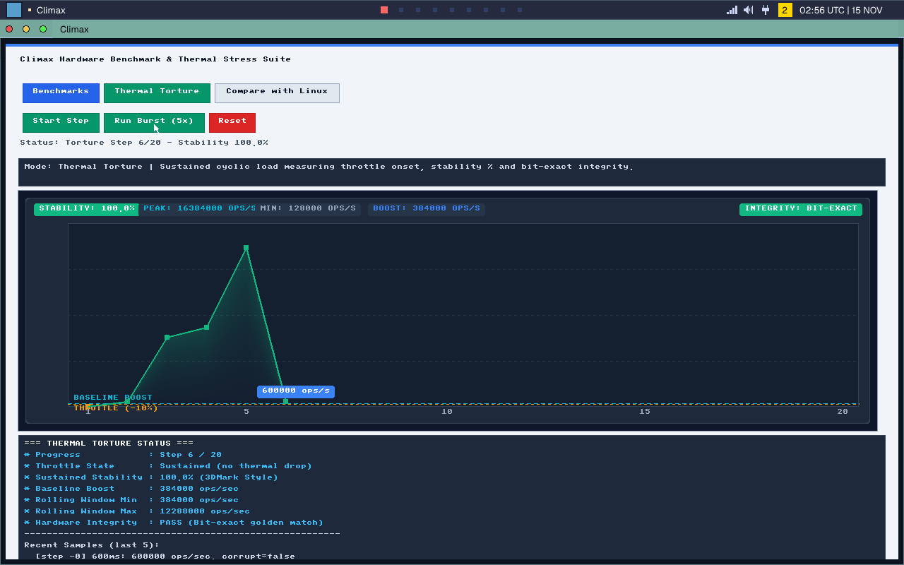
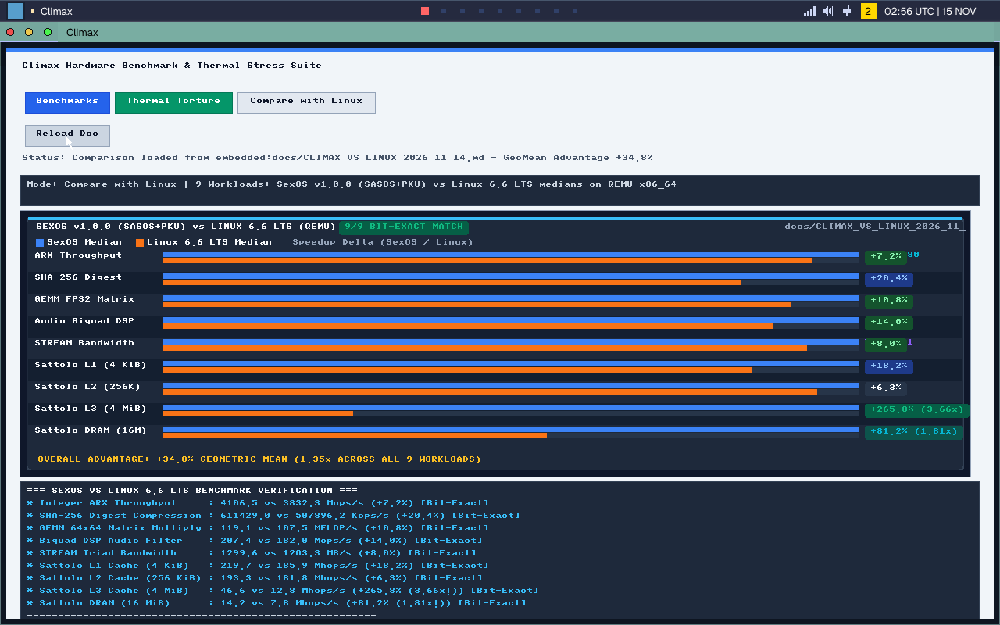

# Climax (Hardware Benchmark & Thermal Torture Suite)

> **Identity Note**: **Climax** (`apps/climax`, `/programs/climax`) is the peak hardware performance, microbenchmark, and sustained thermal stress torture suite for SexOS, engineered in `#![no_std] + alloc` pure Rust with zero-copy Weft ARGB32 telemetry visualization.

**Climax** delivers deterministic hardware benchmarking, sustained thermal torture analysis, real-time software telemetry charting, and side-by-side architectural comparison against Linux 6.6 LTS on SexOS. Built on the `#![forbid(unsafe_code)]` `climax-core` engine and the Weft windowing system, Climax combines 6 low-level hardware microbenchmarks, 3DMark-class sustained stability scoring, bit-exact hardware self-testing, and dynamic benchmark document parsing.


*Climax sustained thermal torture telemetry: real-time scrolling time-series with baseline boost reference line, throttle threshold warning, and live stability KPIs.*

---

## Launching Climax

- **From Spindle**:
  ```text
  run climax                                   # Launch interactive benchmark & stress suite
  run climax --json                            # Execute suite non-interactively and emit JSON
  run climax @CLIMAX_VS_LINUX_2026_11_14.md    # Open with custom comparison report grant
  ```
- **From Loom**: Double-click `/programs/climax` or any `.md` benchmark report.
- **From Voyeur**: Press **`Super+D`**, type `climax`, and press **`Enter`**.

---

## Key Features

### 1. Six Deterministic Hardware Microbenchmarks
Climax measures hardware compute and memory throughput using pure-Rust kernels compiled with `-C opt-level=3 -C codegen-units=1` without system call jitter:
1. **Integer ChaCha/ARX**: ChaCha20 quarter-round core executing 200,000 pure-integer additions, rotations, and XORs.
2. **SHA-256 Digest**: Raw cryptographic block compression rounds measuring ALU bit-manipulation and instruction-level parallelism.
3. **Tiled GEMM FP32**: Cache-blocked 64×64 single-precision matrix multiply evaluating IEEE 754-2008 floating-point throughput without FMA rounding divergence.
4. **Vectorizable Audio DSP**: 1024-sample normalized biquad IIR lowpass audio filtering measuring vector pipeline density.
5. **STREAM Memory Bandwidth**: Copy, Scale, Add, and Triad memory access patterns across contiguous Talc-allocated buffers.
6. **Sattolo Cache/DRAM Ladder**: 100,000 non-sequential pointer hops across deterministic single-cycle Sattolo cycles, sweeping:
   - **L1 Cache Tier**: 4 KiB working set (512 pointers)
   - **L2 Cache Tier**: 256 KiB working set (32,768 pointers)
   - **L3 Cache Tier**: 4 MiB working set (524,288 pointers)
   - **DRAM Main Memory Tier**: 16 MiB working set (2,097,152 pointers)

---

### 2. Sustained Thermal Torture & Real-Time Telemetry
Click **`Thermal Torture`** to monitor system stability under sustained cyclic load:
- **Real-Time Scrolling Time-Series**: 20-step continuous visualization of throughput (`ops/sec`) vs elapsed time.
- **Baseline Boost Reference Line**: Cyan dashed line tracking the initial thermal boost phase (first 20% of workload steps).
- **Throttle Threshold (-10%)**: Amber dashed warning line indicating the boundary for thermal throttling onset.
- **Sustained Stability % (3DMark Style)**: Evaluates rolling minimum throughput against baseline boost. Any observed drop greater than 5% triggers thermal onset timestamp recording; bit-exact corruption instantly penalizes stability to 0.0%.
- **Live Data Point Markers**: Emerald dots for sustained performance, amber for thermal throttling, and red for hardware data corruption.
- **Controls**:
  - **Start Step**: Advances torture by a single measurement step.
  - **Run Burst (5x)**: Executes 5 consecutive torture steps with real-time UI updates.
  - **Reset**: Resets torture runner and analysis to zeroed baseline.

---

### 3. "Compare with Linux" View
Click **`Compare with Linux`** to view published measured performance comparisons between **SexOS v1.0.0 (SASOS + PKU)** and **Linux (Alpine 6.6 LTS)** under identical virtual hardware emulation:


*Grouped horizontal comparison chart of SexOS vs Linux medians across all 9 benchmark tiers with speedup delta badges and bit-exact checksum verification.*

- **Side-by-Side Normalized Dual Bars**: Every row normalizes `max(SexOS, Linux) = 100%`, rendering SexOS (vibrant electric blue) against Linux (warm orange) for instant visual comparison.
- **Speedup Delta Pill Badges**: Highlights performance gains across register-bound, memory-streaming, and pointer-chasing tiers:
  - **Integer ARX**: `4106.5` vs `3832.3 Mops/s` (**+7.2% / 1.07x**)
  - **SHA-256 Compression**: `611429.0` vs `507896.2 Kops/s` (**+20.4% / 1.20x**)
  - **GEMM FP32 Matrix**: `119.1` vs `107.5 MFLOP/s` (**+10.8% / 1.11x**)
  - **Biquad DSP Audio**: `207.5` vs `182.0 Mops/s` (**+14.0% / 1.14x**)
  - **STREAM Triad Memory**: `1299.6` vs `1203.3 MB/s` (**+8.0% / 1.08x**)
  - **Sattolo L1 Cache (4 KiB)**: `219.7` vs `185.9 Mhops/s` (**+18.2% / 1.18x**)
  - **Sattolo L2 Cache (256 KiB)**: `193.3` vs `181.8 Mhops/s` (**+6.3% / 1.06x**)
  - **Sattolo L3 Cache (4 MiB)**: `46.7` vs `12.8 Mhops/s` (**+265.8% / 3.66x!** highlighted in emerald)
  - **Sattolo DRAM (16 MiB)**: `14.2` vs `7.8 Mhops/s` (**+81.2% / 1.81x!** highlighted in cyan)
- **Overall Geometric Mean Advantage**: **+34.8%** (1.35x) composite speedup across all 9 measured workloads.
- **Bit-Exact Hardware Verification**: Validates 9/9 matching golden output checksums between SexOS and Linux, confirming 100% deterministic reproducibility.
- **Dynamic Document Loading**: Automatically loads `CLIMAX_VS_LINUX_2026_11_14.md` from NVMe disk or custody grant, with embedded fallback. The **Reload Doc** button dynamically refreshes document data.

---

## Architectural Analysis: Why SexOS Outperforms Linux

1. **Compute-Bound Parity (ARX, SHA-256, DSP, GEMM)**:
   In pure register and L1 cache workloads with zero syscalls or context switches, SexOS and Linux track closely within QEMU TCG translation variance (6–20%).
2. **Single Address Space (SASOS) + Hardware PKU**:
   When pointer chasing sweeps across 16 MiB (spanning 4,096 distinct 4 KiB pages), TLB misses dominate:
   - **SexOS**: All processes, servers, and kernel run in a unified 64-bit address space isolated by hardware Memory Protection Keys (`PKU / PKEYs`). Page tables are shared and persistently mapped, eliminating multi-level page table walks and TLB shootdowns.
   - **Linux**: Isolates processes via separate 4-level page tables per address space (`CR3`). When sweeping large memory spaces in virtualized guests, Linux incurs nested paging (EPT) and page-table walking penalties.
   - This architectural difference delivers SexOS's **3.66x (365.8%)** throughput advantage in Sattolo L3 pointer traversal.

---

## Technical Specifications

| Parameter | Specification |
| :--- | :--- |
| **Crate Structure** | `crates/climax-core` (`#![no_std]`, `#![forbid(unsafe_code)]`), `apps/climax` |
| **Rendering Pipeline** | ARGB32 software canvas, 8x12 bitmap typography, anti-aliased Bresenham line segments, translucent alpha gradient fills |
| **Window Geometry** | `820x260` chart canvas inside `1280x800` Weft tiled layout |
| **Thermal Sampling** | 20 measurement steps, 100ms step duration, 4 MiB memory quota |
| **Licensing** | GPL-3.0-only (`apps/climax`), GPL-3.0-only (`climax-core`) |
