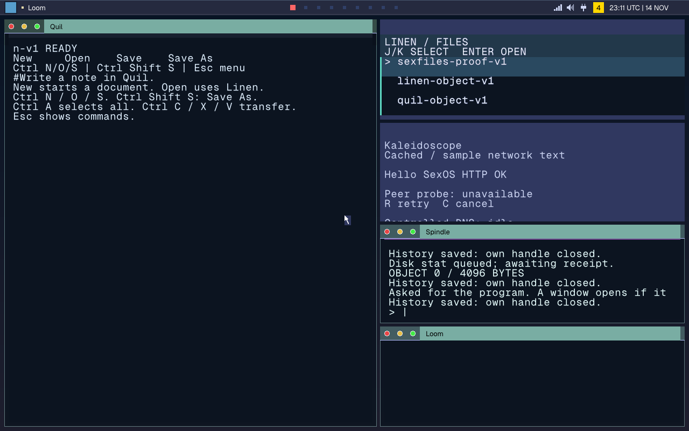

# Corset (Disks & Partitions)

> **Identity Note**: **Corset** (`crates/corset-core`, Spindle `disk` / `disk-stat` / `install`, `apps/files`, `/bin/loom`) is the SexOS disk layout, partition editing, filesystem formatting, and storage health suite. Named after the shaping garment in adherence to the project's fabric theme, Corset acts as the user-facing interface to **BDSM** (Block Device Storage Manager).

**Corset** provides robust, non-destructive partition management, multi-filesystem formatting, NVMe and ATA SMART health telemetry, and encrypted volume configuration. Whether partitioning a fresh NVMe SSD, inspecting external USB media in **[Loom](loom.md)**, checking storage health diagnostics, or managing BDSM encryption at rest, Corset ensures data safety with strict alignment guards and overlap refusal.


*Corset storage inspection in SexOS at 1280×800, displaying partition layouts, volume types, and live disk stats in Spindle and Loom.*

---

## Accessing Disk Management Tools

In SexOS, disk management is integrated across both command surfaces and graphical tools:

### 1. From Spindle (Terminal Surface)
Spindle provides native disk inspection and maintenance commands:
```text
disk                # Stage coherent snapshot and list all block devices and partitions
disk-stat <ID>      # Display detailed geometry, sector counts, and UUID for partition ID
df                  # Report filesystem capacity, used space, and free sectors
install             # Preview installation plan beside other operating systems
install go [GIB]    # Execute GPT partitioning and install SexOS to target drive
mount /media/NAME   # Mount a removable storage volume
unmount NAME        # Flush dirty buffers and cleanly unmount removable media
```

### 2. From Loom (Graphical File Manager)
**[Loom](loom.md)** displays all mounted internal volumes and removable media in its sidebar:
- Inspect volume properties with **`Ctrl+I`**.
- Safely flush and eject removable USB drives with **`Ctrl+E`**.

---

## Supported Filesystems & Partition Tables

| Component | Format / Standard | Capabilities |
|---|---|---|
| **Partition Table** | GPT (GUID Partition Table) | 1 MiB boundary alignment, overlap refusal, CRC32 dual-table verification, and backup header recovery. |
| **SexOS Native FS** | **sexfiles** | Atomic transaction logging, snapshot rollbacks, copy-on-write extents, and zero-copy SASOS IPC. |
| **Windows / EFI** | FAT32 / FAT16 | Full reading, writing, formatting (`format_fat32`), and safe ejection. |
| **Extended FAT** | exFAT | High-capacity flash drive formatting (`format_exfat`) and large file storage. |
| **Linux Native** | ext4 | Read and write compatibility for cross-platform Linux volumes. |
| **Windows NT** | NTFS | Robust read and write access for Windows drives and external disks. |
| **BDSM Encryption** | Argon2id + XTS-AES-256 | Transparent authenticated encryption at rest with encrypted volume headers. |

---

## Key Capabilities & Core Workflows

### 1. Non-Destructive GPT Partition Editing
Managed by `corset-core::gpt_edit`:
- **1 MiB Sector Alignment**: Every partition starts and ends on strict 2048-sector (1 MiB) boundaries to optimize NVMe NAND flash endurance and throughput.
- **Overlap Refusal**: The layout engine mathematically refuses overlapping partition ranges (`CorsetError::PartitionOverlap`).
- **Dual-Table Commit**: GPT headers are committed simultaneously to both primary (LBA 1) and backup tables (disk end) with verified IEEE CRC32 checksums.

### 2. Removable USB Storage & Safe Ejection
When a USB flash drive is inserted:
1. **sexdrive** discovers the device via the xHCI USB controller.
2. **sexfiles** identifies the filesystem (FAT32, exFAT, ext4, NTFS) and automatically mounts it under `/media/<LABEL>`.
3. In **Loom**, pressing **`Ctrl+E`** (or typing `unmount <LABEL>` in Spindle) flushes all unwritten dirty pages, releases capability tokens, and safely unmounts the volume.
4. If a drive is accidentally unplugged before ejection, SexOS immediately revokes the corresponding capability tokens without crashing or faulting the operating system.

### 3. SMART & NVMe Hardware Health Diagnostics
Corset reads hardware telemetry directly from NVMe controllers and ATA drives (`corset-core::smart`):
- **Wear Percentage & Life Remaining**: Monitors estimated NAND endurance consumption.
- **Controller Temperature**: Warns of thermal throttling thresholds.
- **Critical Spare & Error Logs**: Evaluates healthy, warning, or critical statuses to prevent unexpected drive failures.

### 4. BDSM Volume Encryption at Rest
BDSM encrypts storage volumes using industry-grade cryptography:
- **Key Derivation**: Password hashing via memory-hard Argon2id to resist hardware-accelerated attacks.
- **Cipher**: XTS-AES-256 block encryption applied transparently per sector.
- **Volatile Secret Custody**: Master encryption keys are stored exclusively in **Shibari** volatile RAM pages and are wiped on shutdown.
