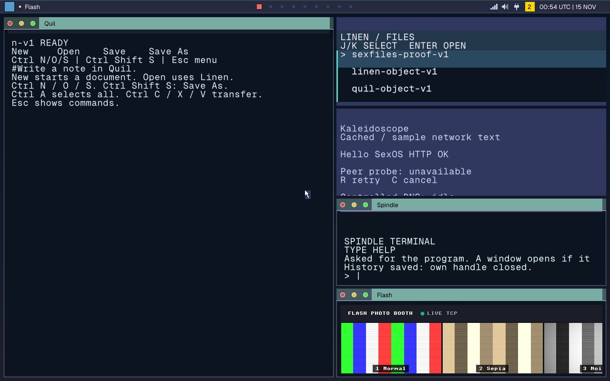
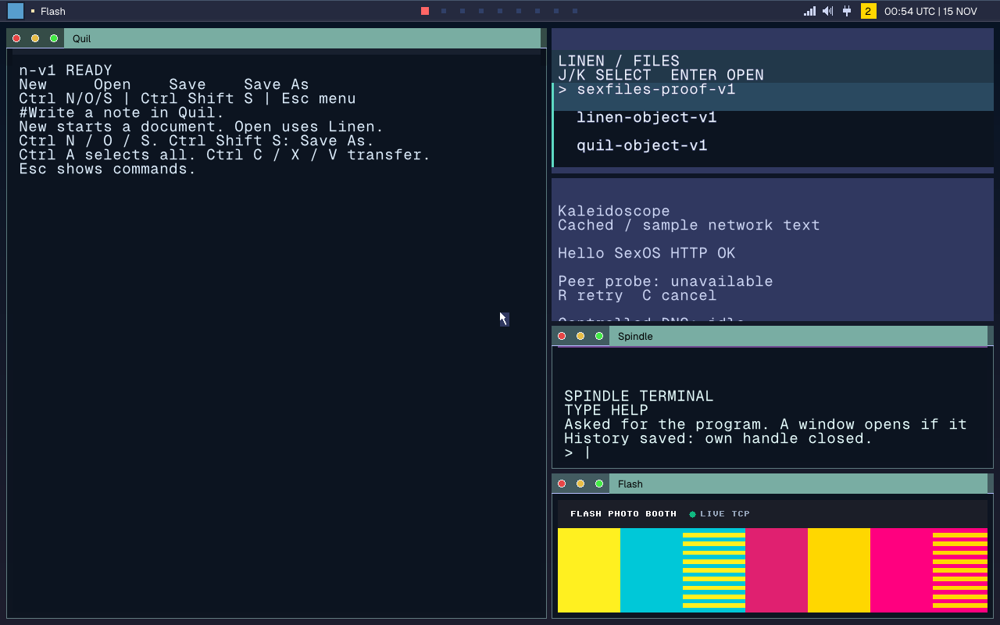
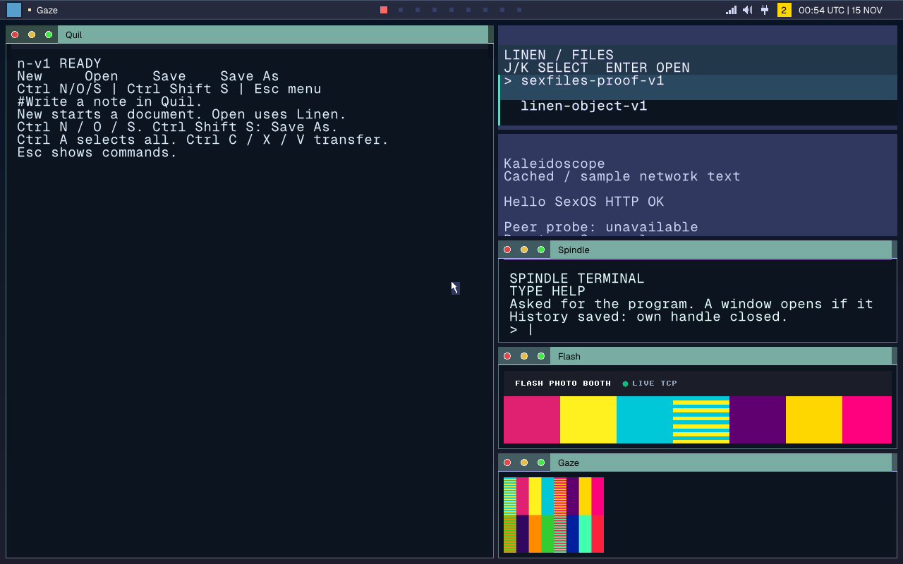

# Flash (Photo Booth & Camera)

> **Identity Note**: **Flash** (`apps/flash`, `/bin/flash`) is the native SexOS camera capture and Photo Booth application, named under the photography / romance pun theme. In Spindle, typing `run +net flash` opens Flash.

**Flash** is a full-featured, zero-copy `#![no_std]` Photo Booth and USB Video Class (UVC 1.1 / 1.5) capture studio for SexOS. It combines real-time integer image processing, 9 live visual effects filters, a 3x3 Photo Booth preview matrix, countdown timer shots, 4-shot burst capture with classic contact sheet composition, Splicy WebM video recording, and a persistent photo library that opens directly in **Gaze** (`/bin/gaze`).

---

## Visual Showcase


*Figure 1: Flash's 3x3 Live Effects Grid matrix rendering all 9 live filters concurrently with crisp label badges.*


*Figure 2: 4-Shot Burst capture mode and 2x2 Photo Booth contact sheet saved into the persistent bottom library filmstrip.*


*Figure 3: Inspecting Flash's photo library in Gaze with folder slideshow navigation.*

---

## Launching Flash

- **Interactive Photo Booth with Photo Library Custody**:
  ```text
  run +net flash 10.0.2.2:5000 @/data/flash/library
  ```
- **CLI Automated Capture Modes**:
  ```text
  run +net flash 10.0.2.2:5000 --photo                        # Capture single shot on start
  run +net flash 10.0.2.2:5000 --timer                        # Trigger 3-second timer shot
  run +net flash 10.0.2.2:5000 --burst                        # Trigger 4-shot burst + contact sheet
  run +net flash 10.0.2.2:5000 --filter PopArt                # Start with active filter
  run +net flash 10.0.2.2:5000 --record-frames 30 --frames 35 # Record 30 frames to WebM
  run flash --synthetic                                       # Run with internal synthetic camera
  ```

---

## Shortcuts & Controls

| Shortcut | Control | Action & Description |
|---|---|---|
| **`Space`** | **Shutter** | Capture single photo with white shutter flash effect. |
| **`E`** | **Effects** | Toggle 3x3 Live Effects Grid preview matrix. |
| **`F`** | **Filter** | Cycle sequentially through all 9 live filters. |
| **`1` .. `9`** | **Filter 1..9** | Directly select a filter (1=Normal, 2=Sepia, 3=Noir, 4=Thermal, 5=XRay, 6=PopArt, 7=Mirror, 8=Bulge, 9=Comic). Exits grid mode. |
| **`T`** | **Timer 3s** | Start a 3-second countdown timer shot with bold badge & amber pips. |
| **`B`** | **Burst x4** | Capture 4 consecutive frames (~150 ms apart) and compose a 2x2 contact sheet. |
| **`V` / `R`** | **Video** | Start or stop WebM video recording via Splicy Exporter. |
| **`G`** | **Open in Gaze** | Launch Gaze (`/bin/gaze`) on the photo library directory. |
| **`Delete`** | **Delete Photo** | Delete the currently inspected photo from the photo library. |
| **`Esc`** | **Return / Close** | Return from photo preview / grid mode, or close Flash. |
| **`F11`** | **Quit** | Close Flash window and retire cleanly. |

---

## The 9 Live Photo Booth Filters

Flash executes all image filters in pure, deterministic `#![no_std]` integer mathematics without floating-point emulation overhead:

1. **Normal**: Unfiltered native sensor camera feed.
2. **Sepia**: Warm nostalgic golden-brown tone via fixed-point matrix transforms.
3. **Noir**: High-contrast black and white with a subtle radial vignette falloff.
4. **Thermal**: False-color blue $\rightarrow$ purple $\rightarrow$ red $\rightarrow$ yellow $\rightarrow$ white heat-signature palette.
5. **XRay**: Inverted cyan-white radiographic negative.
6. **PopArt**: 4-quadrant Andy Warhol silkscreen posterization with vibrant neon palettes.
7. **Mirror**: Vertical centerline kaleidoscope symmetry mirroring the left hemisphere.
8. **Bulge**: Integer fixed-point radial fisheye lens pinch/bulge centered in the frame.
9. **Comic**: Sobel gradient outline ink detection combined with quantized color posterization.

All active filters apply consistently across the live camera viewfinder, single photos, timer countdown shots, 4-shot bursts, and WebM video exports.

---

## Capture Modes

### 1. Single Shot
Pressing **`Space`** or clicking the crimson **`Shutter`** button triggers an instantaneous capture. Flash renders a brief 2-frame brilliant white shutter flash over the viewfinder, encodes the frame into standard PNG, and stores it into `/data/flash/library/photo-NNNN.png`.

### 2. 3-Second Countdown Timer
Pressing **`T`** or clicking **`Timer 3s`** begins an automated countdown sequence:
- A bold circular indicator badge renders over the live viewfinder.
- Steps down `3` $\rightarrow$ `2` $\rightarrow$ `1` every ~900 ms with amber countdown pips.
- At `0`, the camera flashes white and captures the final filtered photo into the library.

### 3. 4-Shot Burst & Contact Sheet
Pressing **`B`** or clicking **`Burst x4`** captures 4 rapid consecutive camera frames spaced ~150 ms apart. Flash saves each individual frame (`photo-NNNN.png`) and composes a 2x2 photographic print contact sheet (`burst-NNNN.png`) with white paper borders, individual card framing, and an embossed "FLASH PHOTO BOOTH" title strip.

### 4. Splicy WebM Video Recording
Pressing **`V`** or clicking **`Video`** activates video encoding through Splicy's `sex_media::export::Exporter`. Every frame is piped with its active filter in real time to VP9 video. Stopping recording flushes the container and writes `/data/flash/video-0001.webm`.

---

## Photo Library & Gaze Integration

Photos captured in Flash are immediately added to the bottom **Filmstrip UI**:
- Thumbnails are displayed at the bottom of the window in chronological order.
- Clicking any thumbnail inspects the photo in high resolution within the main viewport.
- Pressing **`Delete`** while inspecting removes the picture from disk.
- Clicking **`Open in Gaze`** (or pressing **`G`**) hands the library grant to **Gaze** (`/bin/gaze`), enabling slideshow playback, smooth panning, clockwise/counter-clockwise rotation, and full desktop wallpaper application.
