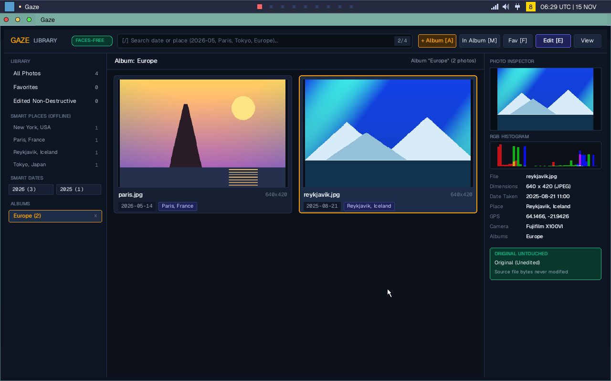
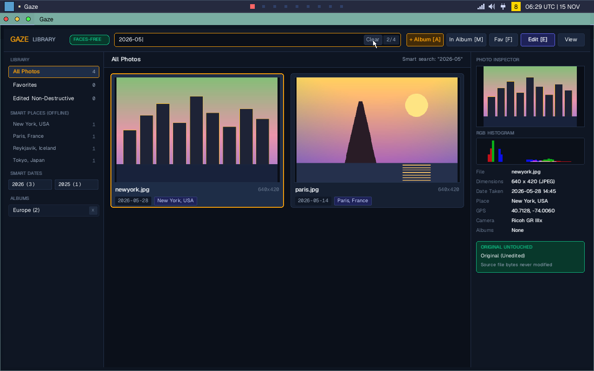
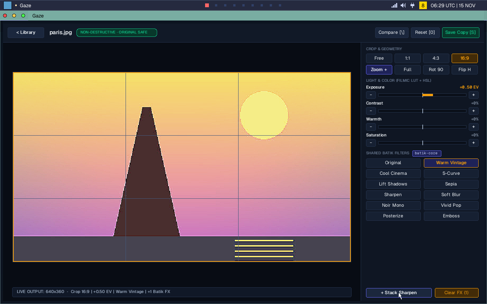

# Gaze (Image Viewer & Photo Library)

> **Identity Note**: **Gaze** (`apps/view`, `/bin/gaze`) is the native SexOS image viewer and privacy-first photo library, named under the romance theme. In Spindle, typing `gaze` or `view` opens Gaze.

**Gaze** combines a chromeless, pixel-exact image viewer with a full **Faces-Free Photo Library** (`crates/gaze-core`), user **Albums**, **Smart Search by Date & Offline-Geocoded Place**, and a **Non-Destructive Edit Studio** sharing tone curves, color grading, and stackable spatial filters directly with **Batik** (`crates/batik-core`).

> [!IMPORTANT]
> **Strictly Faces-Free Privacy Guarantee**: Gaze performs **zero** facial detection, facial landmarking, or biometric person clustering. Smart Search indexes exclusively temporal metadata (EXIF `DateTimeOriginal`, PNG creation chunks, file timestamps) and offline reverse-geocoded geographic places. Queries containing `face:` or `person:` predicates are explicitly refused with zero biometric indexing.

---

## Launching Gaze

- **Chromeless Viewer Mode** (pixel-exact single image or folder slideshow):
  ```text
  run gaze @photo.png                   # View a single image at 1:1 / fitted scale
  run gaze @/data/flash/library         # Browse a camera or picture folder
  ```
- **Photo Library Mode** (catalog, albums, smart search & non-destructive studio):
  ```text
  run gaze                              # Open Gaze Library (/data/gaze/library.gaze)
  run gaze --library @/data/pictures    # Index a granted folder into Gaze Library
  ```
- **From Flash**: Click **Open in Gaze** (`G`) in Flash's filmstrip to browse captured stills and burst sheets, then press **`L`** or **`Tab`** at any time to enter the full Library or **`E`** to open the Non-Destructive Edit Studio.
- **From Loom / Voyeur**: Double-click any image file in Loom, or press **`Super+D`** and type `gaze`.

---

## Photo Library & User Albums



In **Photo Library Mode**, Gaze presents a dark obsidian three-pane studio layout (`1280×800`) backed by a deterministic, human-readable catalog persisted in Gaze's private storage (`/data/gaze/library.gaze`):

- **Left Collections Sidebar**:
  - **Library Views**: `All Photos`, `Favorites ♥`, and `Edited ✎`.
  - **Smart Places & Dates**: One-click filter pills automatically populated from top resolved cities/countries and capture years in your library.
  - **User Albums**: Create custom albums (`+ New Album` button or **`A`**), toggle membership for the selected photo (`Add/Remove Album` button or **`M`**), filter by clicking any album row, or remove an album via **`[x]`** while keeping underlying photos untouched.
- **Center Contact Sheet**: Live aspect-fitted thumbnails reflecting active non-destructive edits in real time, annotated with capture date (`YYYY-MM-DD`), resolved place (`Paris, France`), `♥` favorite indicator, and `EDIT` badge.
- **Right Metadata Inspector**: Live luma/RGB distribution bar, pixel dimensions, EXIF/PNG capture timestamp, GPS coordinates + offline gazetteer place name, camera make/model, album memberships, and a summary of active non-destructive recipe steps.

---

## Faces-Free Smart Search by Date & Place



Press **`/`** (or click the top search bar) to filter your photo library instantaneously across multi-token `AND` queries—entirely offline with zero network calls and zero biometric scanning:

- **Date Queries**:
  - Exact year, month, or day: `2026`, `2026-05`, `2026-05-14`, or `date:2026-11`.
  - Date ranges: `2025..2026` or `2026-01..2026-06`.
  - Month names & seasons: `may`, `november`, `spring`, `summer`, `autumn`, `winter`.
- **Offline Place Queries**:
  - Embedded GPS coordinates (EXIF GPS IFD or PNG `tEXt`/`iTXt` metadata) are resolved locally against `gaze-core`'s built-in world gazetteer (~100 cities, regions, countries, and continents) with haversine distance matching—no external geocoding requests ever leave your machine.
  - Search by city, country, continent, or tag: `paris`, `france`, `tokyo`, `japan`, `reykjavik`, `europe`, `place:iceland`, or `has:gps`.
- **Collection & State Predicates**:
  - Combine with `album:Europe`, `fav` / `favorites`, or `edited` / `has:edits` (for example, `2026-05 france` or `europe edited`).

---

## Non-Destructive Edits & Shared Batik Filters



Select any photo and press **`E`** (or click **`Edit Photo`**) to enter the **Non-Destructive Edit Studio**. Every adjustment is stored as a lightweight `EditRecipe` inside `/data/gaze/library.gaze`—your original JPEG, PNG, WebP, or GIF file on disk is **never** overwritten:

1. **Crop & Geometry**:
   - One-click aspect ratios (`Free`, `1:1`, `4:3`, `16:9`), incremental inset crop (`Crop In +` / **`C`**), quarter-turn rotation (**`R`**), and horizontal flip (**`H`**), rendered with rule-of-thirds composition guides.
2. **Linear-Light Filmic Exposure & Color**:
   - **Exposure (`-2.00 EV` to `+2.00 EV`)**: Evaluated in linear light (`sRGB -> linear * 2^EV`) with smooth filmic shoulder highlight roll-off (**`[`** / **`]`**).
   - **Contrast, Warmth & Saturation**: Fine-grained `-100%` to `+100%` steppers backed by precomputed LUTs and `batik_core::adjust::HueSatAdjustment`.
3. **Shared Batik Filters & Stack (`crates/batik-core`)**:
   - Directly shares `FilterSpec`, `FilterNode`, `FilterStack`, and `CurvesPreset` with **Batik**:
     `Warm Vintage`, `Cool Cinema`, `S-Curve`, `Lift Shadows`, `Sepia`, `Sharpen`, `Soft Glow`, `Noir Mono`, `Vivid Pop`, `Posterize`, and `Emboss` (**`F`** cycles presets or click any preset pill).
   - Stack additional `batik-core` filter nodes (`+ Stack Sharpen` / `Clear Stack`), hold/toggle **`\`** (`Compare Original`) for instant before/after inspection, click **`Reset Original`** (**`0`**) to revert to the untouched master at any time, or click **`Save Copy`** (**`S`**) to export a flattened PNG derivative to `/data/gaze/exports/`.

---

## Keyboard Shortcuts

### Library & Edit Studio Controls

| Shortcut | Mode | Action |
|---|---|---|
| **`L` / `Tab`** | Viewer / Library | Switch between Chromeless Viewer and Photo Library Mode |
| **`/`** | Library | Focus Faces-Free Smart Search bar (`Esc` clears/exits search) |
| **`A`** | Library | Create a new user Album |
| **`M`** | Library | Toggle selected photo in/out of the active Album |
| **`F`** | Library | Toggle `Favorite ♥` on selected photo |
| **`E`** | Viewer / Library | Open Non-Destructive Edit Studio for selected photo |
| **`[` / `]`** | Edit Studio | Decrease / Increase Filmic Exposure (`±0.25 EV`) |
| **`C`** | Edit Studio | Cycle / tighten non-destructive Crop inset |
| **`R` / `H`** | Edit Studio | Rotate 90° clockwise / Flip horizontally |
| **`F`** | Edit Studio | Cycle shared **Batik** filter presets |
| **`\`** | Edit Studio | Toggle Before / After comparison against untouched original |
| **`0`** | Edit Studio | Reset all non-destructive edits back to original |
| **`S`** | Edit Studio | Export flattened PNG copy to `/data/gaze/exports/` |
| **`Enter` / `Esc`** | Edit / Library | Open full Viewer from Library, or return to Library from Studio |

### Chromeless Viewer Controls

| Shortcut | Action | Description |
|---|---|---|
| **`N` / `P`** (or **`Left / Right`**) | **Next / Prev Image** | Step forward or backward through pictures in the current folder. |
| **`=` / `-`** | **Zoom In / Out** | Step zoom level smoothly (`125%`, `150%`, ...). |
| **`1` / `0`** | **Actual Size / Fit** | `1` views at native `100%` 1:1 pixels (arrow keys pan); `0` fits window. |
| **`R` / `Shift+R`** | **Rotate CW / CCW** | Quarter-turn clockwise (`90°`) or counter-clockwise. |
| **`Space`** | **Slideshow** | Start or pause timed `2.5s` automatic folder slideshow. |
| **`F11`** | **Close** | Close Gaze cleanly. |

---

## Supported Image Formats

- **PNG**: Full alpha transparency, Adam7 interlacing, 1-bit to 16-bit depths, plus `tEXt`/`iTXt` date & place metadata.
- **JPEG**: Baseline and progressive photographic decoding, plus EXIF IFD (`DateTimeOriginal`, camera make/model, and GPS latitude/longitude).
- **WebP**: Lossy VP8, lossless VP8L, and multi-frame animated WebP playback.
- **GIF**: Multi-frame animated GIF playback with per-frame timing.
