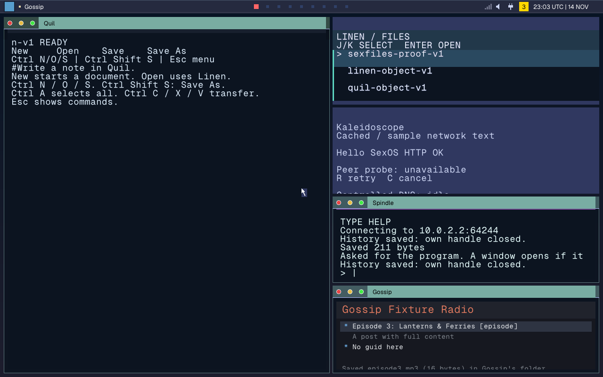

# Gossip (Feeds & Podcasts)

> **Identity Note**: **Gossip** (`apps/gossip`, `/bin/gossip`, `crates/sex-feed`) is the SexOS RSS/Atom news aggregator and podcast manager, playfully named under the project's communication and social pun themes (PR #230).

**Gossip** keeps you connected to your favorite news feeds, weblogs, and podcasts without algorithmic feeds, tracking, or invasive ads. With support for standard RSS 2.0, Atom, and OPML subscription lists, Gossip fetches new articles over **sexnet**, caches content locally for offline reading, tracks read/unread states, and downloads podcast episodes directly to disk.


*Gossip running on SexOS at 1280×800, displaying an organized feed subscription view with unread badges and article summaries.*

---

## Launching Gossip

Because Gossip communicates over the network, it must be launched with explicit network authority (`+net`):

- **Launch and fetch subscribed feeds**:
  ```text
  run +net gossip
  ```
  *(Fetches updates for all feeds saved in `feeds.txt` and presents unread items).*

- **Subscribe to a new feed by URL**:
  ```text
  run +net gossip https://news.ycombinator.com/rss
  run +net gossip https://podcast.example.org/feed.xml
  ```

- **Import subscriptions from an OPML file**:
  ```text
  run +net gossip @subscriptions.opml
  ```

- **From Voyeur**: Press **`Super+D`**, type `gossip`, and press **`Enter`**.

---

## Navigation & Reader Modes

Gossip provides a clean, four-stage hierarchical interface:
1. **Feeds View**: Lists all subscribed publications with unread item counters.
2. **Items View**: Shows reverse-chronological headlines for the active publication.
3. **Item Reader View**: Distraction-free full-text reader with article typography.
4. **Subscription Prompt**: In-line prompt for adding new feed URLs (`a`).

---

## Keyboard Controls & Navigation

### Feeds View Controls

| Shortcut | Action | Description |
|---|---|---|
| **`Up` / `Down`** | **Select Feed** | Move cursor through subscribed feed channels. |
| **`Enter`** | **Open Feed** | View headlines and articles for the selected feed. |
| **`r`** | **Refresh All** | Fetch the latest XML feeds over the network service. |
| **`a`** | **Add Subscription** | Open input bar to type a new RSS or Atom feed URL. |
| **`Delete`** | **Unsubscribe** | Remove selected feed from `feeds.txt`. |
| **`x`** | **Export OPML** | Export all active subscriptions to `subscriptions.opml` in the program's folder. |
| **`F11`** | **Close Window** | Exit Gossip. |

### Items & Reader Controls

| Shortcut | Action | Description |
|---|---|---|
| **`Up` / `Down`** | **Select Item** | Navigate through article headlines. |
| **`Enter`** | **Read Article** | Open full article text (automatically marks item as read in `read.txt`). |
| **`m`** | **Toggle Read** | Toggle read / unread indicator on the selected article. |
| **`d`** | **Download Episode** | Download attached podcast media (`<enclosure type="audio/mpeg">`) directly to disk. |
| **`Esc`** | **Back** | In Item view: return to Items list. In Items view: return to Feeds list. |
| **`Mouse Wheel`** | **Scroll Text** | Scroll smoothly through long-form article text. |

---

## Podcast Management

When an article includes an audio enclosure (podcast episode):
- An enclosure icon and duration are displayed beside the title.
- Pressing **`d`** initiates a background HTTP chunked download via **sexnet**.
- Audio files are stored locally in Gossip's data directory and can be queued for listening in **[Qupid](qupid.md)**.

---

## Storage & Network Confinement

### 1. Reliable Offline Reading
Gossip stores subscriptions in `feeds.txt`, read status hashes in `read.txt`, and caches the last fetched XML body for each publication. When disconnected from the internet, launching Gossip displays cached articles without network errors or empty screens.

### 2. OPML Interoperability
Migrating to and from SexOS is seamless:
- Import existing feed catalogs with `run +net gossip @my_feeds.opml`.
- Press **`x`** at any time to export an updated `subscriptions.opml` bundle for cross-platform backup.

### 3. Capability-Bound Security
In strict accordance with SexOS capability architecture:
- Gossip only accesses the network when explicitly launched with `+net`.
- Downloaded podcast enclosures and OPML files are confined to Gossip's private directory or to files explicitly passed with `@path`.
- No tracking cookies, third-party analytics scripts, or ambient background connections are permitted.
