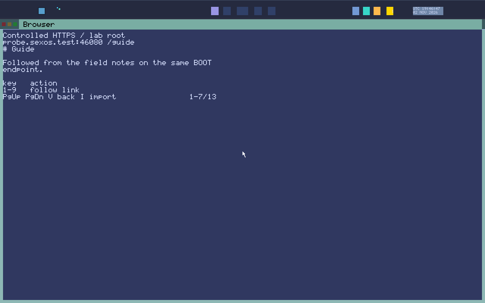

# Kaleidoscope (Web Browser)

> **Identity Note**: **Kaleidoscope** (`apps/web`, `/bin/kaleidoscope`) is the SexOS graphical web browser, replacing earlier plain-named prototypes.

**Kaleidoscope** is a high-speed, capability-confined web browser built natively in Rust. It utilizes the **sex-html** layout engine (supporting CSS flexbox, grid, tables, transforms, `@keyframes`, and `@font-face`), an isolated **QuickJS** JavaScript sandbox, HTML5 `<canvas>`, WebGL 2, WebGPU, persistent tabs, and privacy shields.


*Kaleidoscope rendering formatted web documentation, graphic illustrations, and interactive hyperlinks.*

---

## Launching Kaleidoscope

Kaleidoscope requires a network grant from **Collar** to communicate with the Internet:
```text
run +net kaleidoscope                       # Launch on welcome page
run +net kaleidoscope https://example.com   # Open a specific website
run kaleidoscope @page.html                 # Open a local HTML file without network authority
```

---

## Keyboard Navigation & Controls

| Shortcut | Action | Description |
|---|---|---|
| **`Ctrl+L`** or **`/`** | **Address Bar** | Activate address bar. Type URL and press Enter (bare domain defaults to HTTPS). |
| **`Enter`** | **Open Link / Submit** | Follow selected link or submit active form field. |
| **`Right / Left`** | **Select Next / Prev Link** | Cycle focus across interactive page elements and hyperlinks. |
| **`Up / Down`** | **Scroll Page** | Scroll content up or down smoothly. |
| **`Space`** | **Page Down** | Scroll down one full viewport height. |
| **`Backspace`** | **Go Back** | Navigate to previous page in session history. |
| **`Alt+Right`** | **Go Forward** | Navigate forward in session history. |
| **`Ctrl+T`** | **New Tab** | Open a new browser tab. |
| **`Ctrl+W`** | **Close Tab** | Close the currently focused tab. |
| **`Ctrl+Tab`** | **Next Tab** | Cycle to the next open tab. |
| **`Ctrl+F`** | **Find in Page** | Open page text search bar with real-time match highlights. |
| **`Ctrl+=` / `Ctrl+-`** | **Zoom In / Out** | Scale page content up or down. |
| **`Ctrl+0`** | **Reset Zoom** | Restore page scaling to 100%. |
| **`Esc`** | **Dismiss / Stop** | Dismiss address bar / find bar or stop page load. |

---

## Key Features

### 1. Embedded QuickJS & Canvas 2D
JavaScript executes inside a sandboxed WebAssembly QuickJS organ. Scripts can manipulate DOM elements, handle mouse and keyboard events, fire timers, and render hardware-accelerated 2D/3D graphics on `<canvas>` surfaces.

### 2. Privacy & Ad Shields
Kaleidoscope incorporates built-in tracker and advertisement blocking (workstream N). Network requests matching known tracker lists are dropped before initiating socket connections, protecting your privacy and speeding up page load times.

### 3. Built-in Applications & Games
Kaleidoscope includes built-in standalone web applications accessible via `about:` URLs:
- `about:welcome`: The SexOS browser portal and search interface.
- `about:solitaire`: Classic card game.
- `about:chess`: 2D chess engine.
- `about:chess3d`: 3D chess rendered with WebGL.
- `about:maze`: Interactive 3D labyrinth navigation.
- `about:pinball`: Physics-based pinball simulator.

You can launch any built-in game directly from Spindle:
```text
run solitaire
run chess
run maze
```
