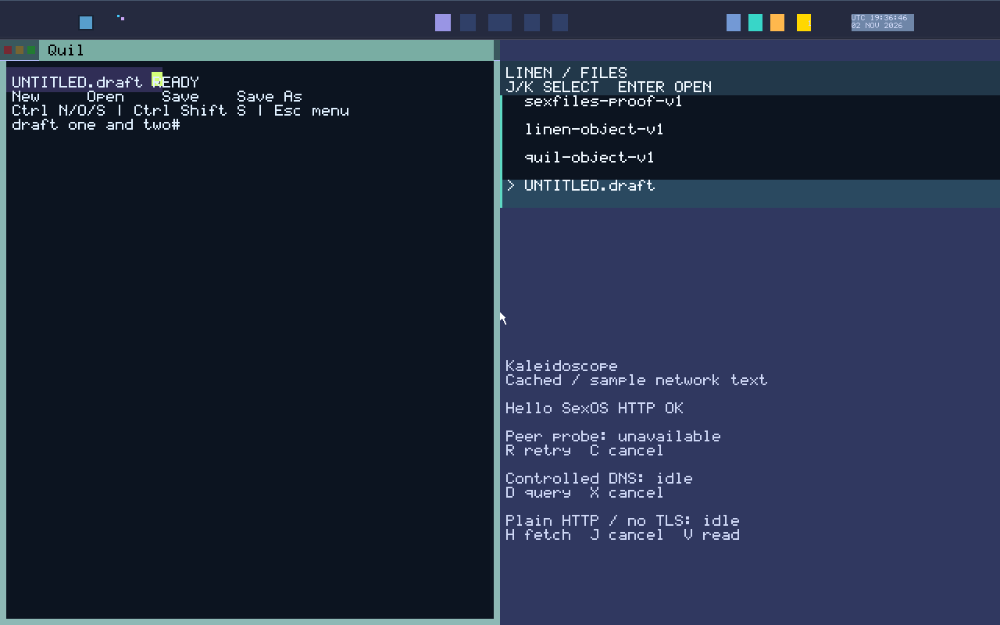

# Quil (Code Workstation)

**Quil** (`servers/quil`, `apps/quil`) is the primary developer code workstation and programming editor for SexOS. Named after heavy, protective quilted fabric, Quil is engineered for software development, configuration editing, and syntax-aware text manipulation.


*Quil code editor displaying syntax-highlighted source buffers, active cursor positioning, and state recovery.*

---

## Launching Quil

- **From Spindle**:
  ```text
  run quil                    # Open empty workstation buffer
  run quil @src/main.rs       # Open specific source file with custody grant
  ```
- **From Voyeur**: Press **`Super+D`**, type `quil`, and press **`Enter`**.

---

## Keyboard Shortcuts & Editing Controls

| Shortcut | Action | Description |
|---|---|---|
| **`Arrow Keys`** | **Navigate** | Move cursor character-by-character or line-by-line. |
| **`Ctrl+Left / Right`** | **Word Jump** | Move cursor word-by-word. |
| **`Home / End`** | **Line Boundary** | Jump to beginning or end of the current line. |
| **`PgUp / PgDn`** | **Page Scroll** | Scroll buffer by one page height. |
| **`Ctrl+S`** | **Save** | Commit buffer changes to persistent storage via **sexfiles**. |
| **`Ctrl+Z`** | **Undo** | Step backward in the document undo history tree. |
| **`Ctrl+Y`** | **Redo** | Replay undone edits. |
| **`Ctrl+F`** | **Find** | Open find search bar to locate substrings in the buffer. |
| **`Ctrl+H`** | **Replace** | Open search-and-replace prompt. |
| **`Ctrl+G`** | **Go to Line** | Prompt for line number and jump cursor immediately. |
| **`Ctrl+I`** | **Buffer Info** | Display detailed buffer metrics (line count, character length, memory status). |
| **`Ctrl+C / X / V`** | **Copy / Cut / Paste** | Interoperate with the system clipboard. |
| **`Ctrl+Q`** | **Close** | Close buffer; prompts to save if unsaved modifications exist. |

---

## Key Features

### 1. High-Speed Syntax Highlighting
Quil incorporates fast, regex-free lexical analysis engines that provide real-time syntax coloring for:
- **Rust** (`.rs`)
- **C / C++** (`.c`, `.h`, `.cpp`)
- **Python** (`.py`)
- **JavaScript / TypeScript** (`.js`, `.ts`)
- **HTML / CSS** (`.html`, `.css`)
- **TOML / JSON** (`.toml`, `.json`)
- **Markdown** (`.md`)

### 2. Linen Document Exchange & Autosave Recovery
Quil synchronizes active editing sessions with **Linen** (`servers/linen`). If a system power outage or hardware fault occurs while editing, Quil maintains an atomic draft journal:
- On reboot, Quil detects uncommitted buffer journals and safely displays `[DRAFT KEPT]`.
- Press **`Ctrl+R`** to restore the unsaved session exactly where you left off.

### 3. Quil vs. Jot: Choosing the Right Tool
| Feature | Quil (Workstation) | Jot (Notepad) |
|---|---|---|
| **Primary Use** | Code, configuration, software projects | Quick notes, memos, scratch text |
| **Syntax Coloring** | Full language lexers | Plain text formatting |
| **Buffer Architecture** | Chunked rope buffer for large files | Fast contiguous memory buffer |
| **Search Engine** | Regex and find/replace | Quick substring search |
