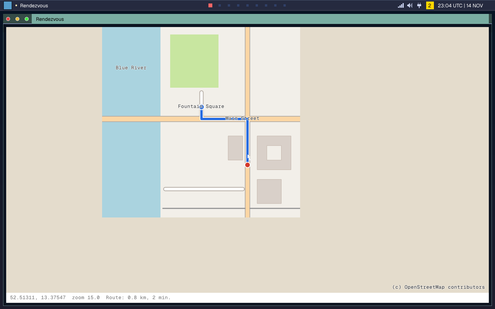

# Rendezvous (Maps & Navigation)

> **Identity Note**: **Rendezvous** (`apps/rendezvous`, `/bin/rendezvous`, `crates/sex-map`) is the SexOS geospatial map viewer, location search, and routing engine, named under the romance theme ("where you meet", PR #239).

**Rendezvous** delivers private, offline-capable mapping and spatial navigation directly to SexOS. Powered by `sex-map`'s vector tile decoder and anti-aliased geometry renderer, Rendezvous downloads OpenStreetMap vector and raster tiles over **sexnet**, performs instant place searches, calculates driving routes with turn-by-turn geometry, and caches entire geographic regions locally for offline journeying.


*Rendezvous running on SexOS at 1280×800, displaying vector tiles with rendered waterways, roadways, buildings, and calculated driving route.*

---

## Launching Rendezvous

Rendezvous requires explicit network authority (`+net`) to fetch remote map tiles and routing data:

- **Launch with default location**:
  ```text
  run +net rendezvous
  ```
  *(Loads map starting from cached coordinates or default city center).*

- **Launch centered on specific coordinates**:
  ```text
  run +net rendezvous 52.5170,13.3704,15
  ```
  *(Format: `LATITUDE,LONGITUDE[,ZOOM]`).*

- **Specify a custom tile server**:
  ```text
  run +net rendezvous https://tile.openstreetmap.org 37.7749,-122.4194,14
  ```

- **From Voyeur**: Press **`Super+D`**, type `rendezvous`, and press **`Enter`**.

---

## Supported Spatial Capabilities

| Feature | Engine / Protocol | Capabilities |
|---|---|---|
| **Vector Tiles** | Mapbox Vector Tile (`.mvt`) | Fast vector decoding with multi-layer styling: waterways (`#AAD3DF`), major roads (`#FCD6A4`), buildings (`#D9D0C9`), and geographic text labels. |
| **Raster Fallback** | PNG / WebP Tile Layers | 256×256 raster map tile fallback when vector tiles are unavailable. |
| **Place Search** | Nominatim Search Protocol | Instant search queries for addresses, transit stations, landmarks, and city squares. |
| **Route Generation** | OSRM Routing Engine | Multi-waypoint driving routes rendered directly over vector paths (`#266BE0`). |
| **Offline Caching** | Local Region Store | Pre-caches zoom levels 13–14 for designated regions to allow 100% offline navigation. |

---

## Keyboard Controls & Navigation

| Shortcut | Action | Description |
|---|---|---|
| **`Arrow Keys`** | **Pan Viewport** | Pan map North, South, East, or West. |
| **`+`** / **`-`** | **Zoom In / Out** | Step zoom level in or out (also accessible via `Page Up` / `Page Down`). |
| **`Home`** | **Return to Origin** | Reset camera to the initial launch coordinates and zoom. |
| **`/`** | **Search Places** | Open location search prompt (e.g., type `/station` or `/fountain` and press `Enter`). |
| **`Enter`** | **Select Result** | Center map on the highlighted search match and drop a waypoint marker. |
| **`r`** | **Calculate Route** | Calculate and draw driving route between saved search markers (or from map center). |
| **`o`** | **Keep Region Offline** | Download all tiles in the visible region (zooms 13–14) and cache them in the app organ. |
| **`Esc`** | **Clear / Dismiss** | Dismiss search prompt, clear route overlay, or remove waypoints. |
| **`F11`** | **Close Window** | Exit Rendezvous and release graphic surfaces. |

---

## Mouse & Touch Controls

- **Click & Drag**: Pan smoothly across map terrain in any direction.
- **Scroll Wheel**: Smoothly zoom in and out around the cursor position.
- **Click Result**: Click any search suggestion from the search drop-down to immediately pan and focus on that location.

---

## Architecture & Offline Freedom

### 1. Vector Map Pipeline
Unlike web-based map wrappers, Rendezvous runs a native, zero-copy vector pipeline:
- Protocol buffer geometry packets are decoded directly in user space.
- Lines, polygons, water fills, and road networks are tessellated and drawn with anti-aliasing directly to the **Silk** surface.
- Labels are shaped and rendered locally using `sex-font` without server-side bitmap rasterization.

### 2. Zero-Telemetry Privacy
Standard map providers track locations and search queries. In SexOS:
- Rendezvous operates without user accounts, device identifiers, or GPS telemetry reporting.
- All routing queries are direct API requests to the configured endpoint without intermediary analytics.
- Offline regions saved with **`o`** allow complete disconnected operation with zero network packets transmitted.
