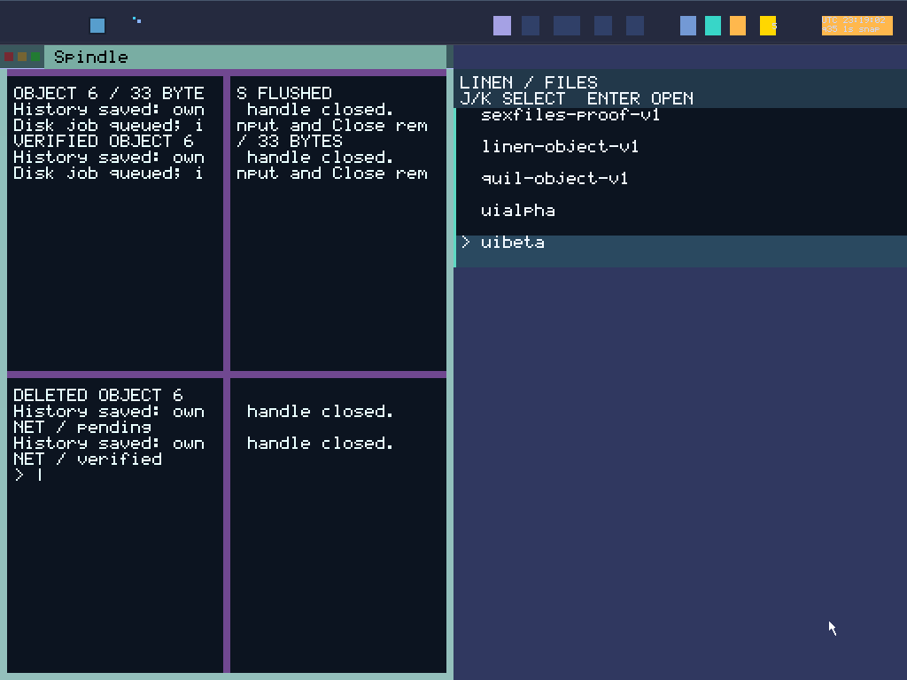

# Spindle (Terminal & Command Surface)

**Spindle** (`apps/spindle`) is the command surface and terminal interface everything in SexOS is spun under. Spindle acts as your shell, system diagnostics cockpit, and program launcher. Spindle sessions run inside **Yarn** (`YarnSession`), ensuring persistent state, history, and scrollback.


*Spindle command surface with tiled output panes, system telemetry, and command feedback.*

---

## Launching Spindle

- **Global Shortcut**: Press **`Super+Enter`** from anywhere on the Silk desktop to spawn a new Spindle window.
- **Toggle Visibility**: Press **`Scroll Lock`** to quickly toggle the terminal overlay in and out of view.

---

## Terminal Tabs & Split Panes

Spindle supports recursive split panes and tabs (workstream P):
- **`Ctrl+Shift+T`**: Open a new terminal tab.
- **`Ctrl+Shift+E`**: Split the current pane horizontally (side-by-side).
- **`Ctrl+Shift+O`**: Split the current pane vertically (one above another).
- **`Ctrl+Shift+Arrows`**: Shift keyboard focus between active split panes.
- **`Ctrl+Shift+Z`**: Toggle zoom on the focused pane.
- **`Ctrl+Shift+W`**: Close the active pane.
- **`Ctrl+PgUp / Ctrl+PgDn`**: Switch between terminal tabs.

---

## Essential Commands

Type **`help`** in Spindle for the full list of available commands.

### File Operations
SexOS files are stored in **sexfiles** and managed by **BDSM**:
```text
ls              # List directory contents
cd <path>       # Change directory
pwd             # Print working directory
mkdir <name>    # Create a new directory
rm <file>       # Remove a file
mv <src> <dst>  # Move or rename a file
cat <file>      # Output file contents
touch <file>    # Create an empty file
write <f> <txt> # Overwrite file with text
append <f> <tx> # Append text to file
df              # Display disk space and storage volume statistics
```

### Program Execution & Collar Grants
Programs in SexOS do not run with ambient privileges. Spindle lets you explicitly define grants at launch:
```text
run jot                   # Run Jot notepad with private sandbox (/data/jot)
run +net kaleidoscope     # Run Kaleidoscope browser with network grant
run +pkg sexshop          # Run package manager with store authority
run vellum @/doc.pdf      # Give Vellum access to exactly /doc.pdf
edit /doc.txt             # Shortcut: opens /doc.txt in Jot with grant
fetch https://site/p /bin # Download a remote binary directly into /bin
```

### Background Program Orchestration
Spindle can supervise thousands of background programs simultaneously:
```text
spawn hello 100           # Spawn 100 concurrent copies of the hello program
records                   # Display count of active background programs
stopall                   # Gracefully end all background runs
stopall force             # Forcibly terminate all background programs immediately
```

### Hardware, Audio & Network Controls
```text
volume                    # Show current audio volume
volume +10                # Increase master volume by 10%
volume mute               # Mute master audio output
beep 440 200 80           # Play 440 Hz test tone for 200 ms at 80% volume
wifi scan                 # Scan for nearby 802.11 Wi-Fi networks
wifi join "MyNet" "pass"  # Connect to encrypted Wi-Fi network
net-probe                 # Test network connectivity to fixed peers
net-status                # Display real-time sexnet network interface status
capture shot.png          # Capture entire Silk desktop to a PNG file
```

### Built-in Exact Calculation (Abacus Engine)
Spindle includes an integrated exact math evaluator:
```text
calc 2 + 2 * 10           # Evaluates expressions with standard operator precedence
calc x = 42               # Store a named variable (up to 8 variables)
calc x * 2                # Use stored variable
calc 255 in hex           # Convert decimal to hexadecimal (0xff)
calc 0b1010 in oct        # Convert binary to octal
calc sqrt(144) + ln(2.718)# Scientific functions: sqrt, abs, ln, exp, sin, cos, tan
```

### System Diagnostics & Audit
```text
status                    # Keyboard control center overview
daily                     # Daily-driver hardware boot readiness summary
blockers                  # Inspect known system limitations
keys                      # Keyboard proven path summary
pd                        # List active hardware protection domains (PKU)
servers                   # List running system server organs
crashes                   # Inspect crash records from Foreplay boot logs
history                   # Show command history
history clear             # Clear and persist command history
```
