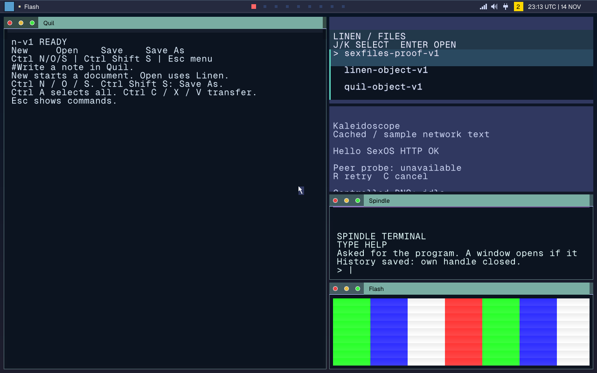

# Splicy (Video Editor & Media Export)

> **Identity Note**: **Splicy** (`crates/sex-splice`, `crates/sex-media/src/export`, `apps/play`, `apps/flash`) is the SexOS non-linear video editor and media export engine. Its canonical name draws from the physical craft of cutting and splicing film reels, following the project's playful pun theme (Andreas's pick, PR #232).

**Splicy** brings modern, non-linear video editing, precision timeline trims, AI-assisted transcript cutting, and multi-format video rendering to SexOS. Designed with an immutable non-destructive core where source footage is never modified, Splicy provides frame-accurate cuts, multi-track audio mixing, OpenTimelineIO interchange, and accelerated video encoding to WebM (VP9/Opus) and MP4 (H.264/AAC and AV1/Opus).

*Splicy video capture, playback, and export running in SexOS at 1280×800, displaying real-time timeline rendering and video playback.*

---

## The Splicy Ecosystem

Splicy's video pipeline spans three tightly integrated components:

1. **Splicy Core (`crates/sex-splice`)**: The timeline engine managing tracks, clip ranges, trim operations, edit suggestions, and version history.
2. **Media Export & Codecs (`crates/sex-media/src/export`)**: The hardware-accelerated encoding bridge powering WebM and MP4 multiplexing and compression.
3. **Companions (`apps/play` & `apps/flash`)**:
   - **Play (`run play @video.mp4`)**: Conconfined media player running sandboxed FFmpeg decoders to play back video and audio with zero crash risk to the desktop.
   - **Flash (`run +net flash`)**: Live USB UVC webcam capture utility with real-time viewfinder display and direct-to-disk WebM (VP9 + Opus) video recording.

---

## Supported File Formats & Codecs

| Category | Format / Container | Video Codec | Audio Codec | Description |
|---|---|---|---|---|
| **WebM Export** | `.webm` | VP9 | Opus | Royalty-free, highly compressed modern web and streaming format. |
| **Universal MP4** | `.mp4` | H.264 (AVC) | AAC | Maximum compatibility across legacy devices, browsers, and mobile hardware. |
| **Next-Gen MP4** | `.mp4` | AV1 | Opus | State-of-the-art compression efficiency with high-fidelity Opus sound. |
| **Timeline Interchange**| `.otio` | N/A | N/A | OpenTimelineIO structured schema for importing and exporting edit decision lists. |

---

## Non-Linear Editing Operations

Splicy features professional trim modes that keep video and multi-track audio synchronized:

| Trim Mode | Operation | Behavioral Effect on Timeline |
|---|---|---|
| **Ripple Trim** | In / Out Cut | Trims the head or tail of a clip and automatically ripples subsequent clips forward or backward so no gap remains. |
| **Roll Trim** | Boundary Shift | Moves the edit point between two adjacent clips simultaneously, extending one while shortening the other. |
| **Slip Trim** | Content Slide | Changes the in and out points of the source footage within a clip while keeping its position and duration on the timeline fixed. |
| **Slide Trim** | Position Shift | Moves a clip along the timeline while adjusting the adjacent clips to accommodate the shift. |

---

## Unique Splicy Innovations

### 1. Integer Microsecond Precision
Unlike legacy video editors that measure time using floating-point seconds, Splicy represents all timeline points and media spans in integer microseconds (`type Micros = i64`, where 1 second = 1,000,000 µs). This guarantees:
- Zero accumulated floating-point rounding errors across long projects.
- Bit-identical golden output comparisons across test runs and renders.
- Exact audio-to-video lip-sync alignment at every frame rate (24, 30, 60, or 120 fps).

### 2. Editing by Transcript
Splicy integrates natural language transcript tokens directly with timeline ranges:
- Search spoken dialogue in the transcript and delete words or sentences.
- When dialogue is deleted from the text transcript, Splicy executes corresponding ripple cuts across all tied video and audio tracks automatically.

### 3. Assistant Suggestions & Version History
Changes made by collaborators or automated assistants are staged as non-destructive suggestions:
- Review suggested cuts, speed adjustments, and transitions visually.
- Accept or reject individual suggestions with one click.
- Undo and redo any trim action using the persistent version history tree.

### 4. Zero-Ambient-Authority Confinement
Media decoders and encoders are historically prone to memory-safety vulnerabilities:
- In SexOS, Splicy, Play, and Flash execute inside isolated PKU protection domains.
- A corrupted or malicious video file cannot exploit kernel memory or access system secrets.
- Screen sleeping is automatically inhibited while media is actively playing (`[shell.idle] inhibited=media`), preventing display sleep during previews.
