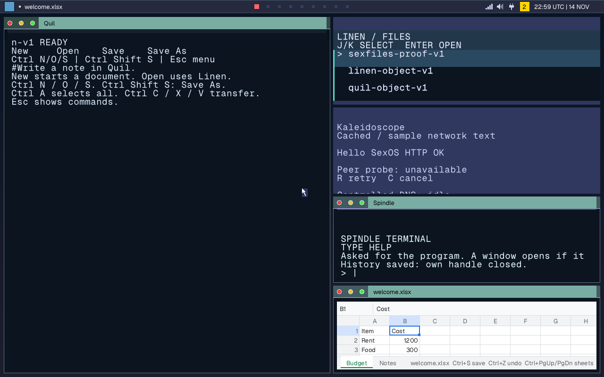

# Spreadeagle (Spreadsheets)

> **Identity Note**: **Spreadeagle** (`apps/spreadeagle`, `/bin/spreadeagle`, `crates/sex-office`, `crates/spreadeagle`) is the SexOS spreadsheet calculation engine and multi-sheet workbook suite. Its canonical name honors the project's romance and tongue-in-cheek naming heritage (Andreas's pick, PR #219).

**Spreadeagle** brings professional grid calculation, formula evaluation, and multi-sheet financial modeling to SexOS. Powered by an adaptation of the deterministic GridCraft engine running directly in user space, Spreadeagle provides instant formula recalculation, comprehensive cell formatting, robust undo/redo trees, and full round-trip compatibility with industry-standard spreadsheet file formats.


*Spreadeagle running on the Silk desktop at 1280×800, displaying a multi-sheet budget workbook with real-time formula evaluation.*

---

## Launching Spreadeagle

Spreadeagle operates under strictly zero ambient authority via **Collar**:

- **Open the default welcome workbook**:
  ```text
  run spreadeagle
  ```
  *(Creates and opens `welcome.xlsx` with sample Budget and Notes sheets if no file is specified).*

- **Open an existing spreadsheet with capability grant**:
  ```text
  run spreadeagle @budget.xlsx
  run spreadeagle @q3_financials.csv
  ```

- **From Voyeur**: Press **`Super+D`**, type `spreadeagle`, and press **`Enter`**.
- **From Loom**: Highlight any `.xlsx`, `.xls`, `.csv`, or `.tsv` file in **[Loom](loom.md)** and press **`Enter`** to launch Spreadeagle with an unforgeable single-file custody grant.

---

## Supported File Formats

| Format | Extension | Capabilities |
|---|---|---|
| **Office Open XML** | `.xlsx` | Full multi-sheet workbooks, cell formatting, formulas, styles, and cached calculation chains. |
| **Legacy Excel** | `.xls` | Binary workbook import and conversion. |
| **Comma-Separated Values** | `.csv` | Plain text tabular data import and export. |
| **Tab-Separated Values** | `.tsv` | Plain text tab-delimited sheets. |

---

## Keyboard Controls & Navigation

| Shortcut | Action | Description |
|---|---|---|
| **`Arrow Keys`** | **Navigate Grid** | Move selection cursor spatially between cells across rows and columns. |
| **`Tab`** | **Next Column** | Move cursor to the cell directly to the right (`A1` → `B1`). |
| **`Page Up` / `Page Down`** | **Scroll View** | Jump viewport up or down by one screen height. |
| **`Ctrl+Home`** | **Origin** | Instantly return active cursor to cell `A1`. |
| **`Typing (0-9, A-Z, =)`** | **Input / Replace** | Start typing text, numeric values, or formulas (e.g., `=SUM(B2:B4)`). |
| **`Enter`** | **Edit / Commit** | Enter edit mode for the active cell; when editing, commit changes and advance to the cell below. |
| **`Esc`** | **Cancel Edit** | Discard pending keystrokes in edit mode and restore original cell value. |
| **`Delete`** | **Clear Contents** | Clear contents of the selected cell while preserving cell formatting. |
| **`Ctrl+Z`** | **Undo** | Revert the last cell edit, deletion, or format modification. |
| **`Ctrl+Y`** | **Redo** | Reapply the previously undone workbook mutation. |
| **`Ctrl+Page Down`** | **Next Sheet** | Switch to the next worksheet tab in the workbook (e.g., from *Budget* to *Notes*). |
| **`Ctrl+Page Up`** | **Previous Sheet** | Switch to the preceding worksheet tab in the workbook. |
| **`Ctrl+S`** | **Save Workbook** | Serialize all sheets and formulas atomically to persistent storage via **sexfiles**. |
| **`F11`** | **Close Window** | Exit Spreadeagle and release all surface resources to **Silk**. |

---

## Key Capabilities

### 1. Deterministic Calculation Engine
Spreadeagle's calculation core computes formula trees deterministically:
- **Mathematical Operators**: Arithmetic expressions with standard precedence (`+`, `-`, `*`, `/`, `^`, parentheses).
- **Aggregate Functions**: Built-in functions including `SUM`, `AVERAGE`, `MIN`, `MAX`, and `COUNT`.
- **Dynamic Dependency Tracking**: Editing a referenced cell (such as changing rent in `B2` from `1200` to `40`) immediately recalculates dependent sums (`B5 =SUM(B2:B4)`) and annual projections (`B6 =B5*12`).

### 2. Multi-Sheet Workbooks
Workbooks can maintain multiple isolated or cross-referenced sheets:
- Switch tabs with **`Ctrl+Page Up`** / **`Ctrl+Page Down`** or by clicking tabs with the mouse.
- Reference cells across sheets seamlessly within formulas.

### 3. Capability Sandbox Confinement
Like all native SexOS productivity tools, Spreadeagle executes in a confined ring 3 protection domain isolated by CPU Memory Protection Keys (PKU):
- It holds no ambient disk read or write capabilities.
- Storage operations pass through unforgeable **Collar** single-file custody tokens.
- Network access is denied by default; financial models and sensitive spreadsheets cannot leak telemetry or contact external networks.
