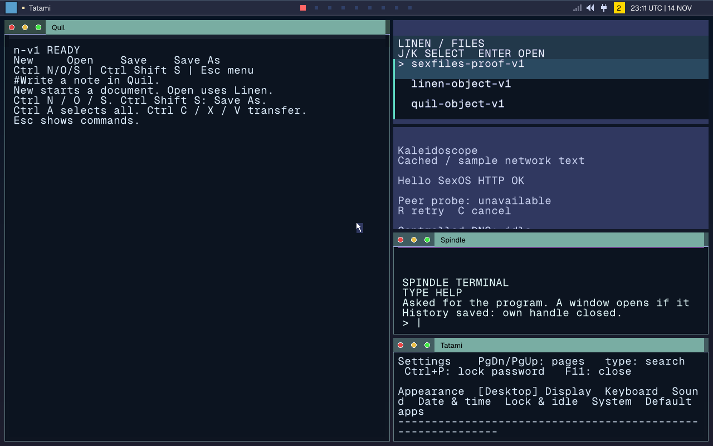

# Tatami (Settings Center)

> **Identity Note**: **Tatami** (`apps/settings`, `/bin/tatami`, `crates/tatami`, `crates/sex-config`) is the SexOS centralized preferences and system configuration manager, named after traditional woven mats in adherence to the fabric naming theme. In Spindle, typing `tatami` or `settings` opens Tatami. For in-depth lock screen and security documentation, see **[Settings & Lock Screen](../settings-and-lock-screen.md)**.

**Tatami** provides a unified graphical control panel for managing display parameters, keyboard typematic rates, night light color temperature, sound devices, civil time zones, network interfaces, appearance themes, screen lock security, and capability grants. All configuration changes persist automatically across reboots in `/system/settings.toml`.


*Tatami running on the Silk desktop at 1280×800, providing searchable system configuration panels and live value modifiers.*

---

## Launching Tatami

- **From Spindle**:
  ```text
  run tatami
  run settings
  ```
- **From Voyeur**: Press **`Super+D`**, type `tatami` or `settings`, and press **`Enter`**.

---

## Keyboard Controls & Navigation

| Shortcut | Action | Description |
|---|---|---|
| **`Page Up` / `Page Down`** | **Navigate Pages** | Cycle through configuration categories (Desktop, Keyboard, Sound, Time Zone, Idle, Display, Network, Privacy). |
| **`Up` / `Down`** | **Select Setting** | Move selection cursor up and down through the active page's settings. |
| **`Left` / `Right`** | **Adjust Value** | Modify the selected setting value (e.g. increase repeat delay, switch time zone, cycle wallpaper). Changes take effect instantly. |
| **`Typing text`** | **Search Settings** | Instantly filter all available settings across all sections by keyword (e.g., `zone`, `delay`, `night`, `dim`). |
| **`Ctrl+P`** | **Set Lock Password** | Open the password setup dialog to configure or update the desktop lock screen password. |
| **`Esc`** | **Clear Search / Back** | Clear the active search filter or return to top-level view. |
| **`F11`** | **Close Window** | Exit Tatami. |

---

## Configuration Panels

Tatami organizes settings into intuitive, searchable categories:

### 1. Desktop & Appearance
- **Wallpaper Selection**: Choose from high-resolution bundled desktop backgrounds (such as *Dusk* or *Silk*) or cycle instantly with **`Super+B`**.
- **Color Themes**: Select dark mode, light mode, high contrast, and custom system accent highlights.
- **Font Sizing**: Globally scale UI typography across all SexOS applications.

### 2. Display & Screen
- **Resolution & Scaling**: Select display modes (1280×800, 1920×1080, 2560×1440, 4K) and interface scaling factors.
- **Refresh Rates**: Configure hardware scanout cadence.
- **Night Light**: Adjust color temperature warming (Off, Level 1, Level 2, Level 3) to reduce blue light during evening hours. Toggle anytime with **`Super+Shift+N`**.

### 3. Keyboard & Input
- **Layouts**: Switch active typing keymaps (US English, Dvorak, Colemak, Neo, Workman).
- **Typematic Repeat Rates**: Fine-tune repeat delay (`delay`, default 400 ms) and repeat interval (`interval`, default 40 ms / 25 Hz).
- **Caps Lock Behavior**: Toggle Caps Lock as an additional Control key (`caps_as_ctrl`) for comfortable terminal and editor operation.

### 4. Sound & Audio
- **Master Volume**: Set overall hardware output level or mute (also adjustable anywhere with multimedia keys).
- **Per-Application Mixers**: Regulate audio levels independently for individual running programs (e.g., lower **[Qupid](qupid.md)** while keeping **[Flirt](flirt.md)** voice calls clear).

### 5. Time & Region
- **Civil Time Zone**: Select system time zone (e.g., `Europe/London`, `America/New_York`, `Asia/Tokyo`). The SilkBar status clock updates dynamically.

### 6. Idle, Sleep & Lock Screen
- **Idle Screen Dimming**: Configure idle inactivity timer (`dim`) before the screen automatically dims to conserve power.
- **Lock Screen Security**: Configure password protection for manual locks (**`Super+Esc`**) and idle timeouts. For complete details, see **[Settings & Lock Screen](../settings-and-lock-screen.md)**.

### 7. Network & Connections
- **Wi-Fi Management**: Scan for 802.11 wireless access points, inspect signal strength, and connect with WPA2/WPA3 authentication. Passwords are saved directly to the **Shibari** volatile vault.
- **Ethernet**: Manage IP configuration (DHCP or static addressing), subnet routing, and DNS servers.

### 8. Privacy & Capability Grants (Collar)
- **Active Grants**: Inspect every program on your machine and see what resources it can access (Network, Filesystem, Package Store, Sound).
- **Access Logs**: Review exactly when each application last exercised its capability tokens.
- **One-Click Revocation**: Instantly revoke any application grant. When revoked, **Collar** invalidates the underlying capability token immediately across the entire single address space.

### 9. System Updates & A/B Slots
- View currently active boot slot (Slot A or Slot B).
- Check for cryptographically signed system updates.
- Test or permanently roll back to the previous stable system slot.

### 10. About & Hardware Census
Displays verified hardware specifications:
- CPU model, core topology, and PKU feature verification.
- Total system RAM and active organ memory allocations.
- Storage volumes (NVMe, AHCI) managed by **[Corset](corset.md)** and **BDSM**.
- SexOS kernel version, ABI hashes, and build commit signatures.
