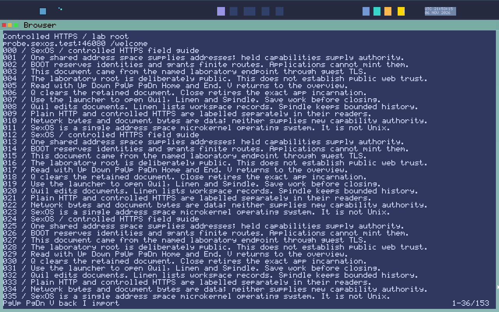

# Vellum (PDF Reader)

> **Identity Note**: **Vellum** (`apps/pdf`, `/bin/vellum`) is the native SexOS PDF document reader, named after fine parchment in keeping with the material theme.

**Vellum** is a document viewer engineered for viewing technical papers, e-books, and documentation. Powered by a high-speed rasterization engine, Vellum provides instant document loading, text search with highlighted matches, table of contents navigation, and presentation modes.


*Vellum displaying technical documentation with crisp typography, outline navigation, and clean page scaling.*

---

## Launching Vellum

- **From Spindle**:
  ```text
  run vellum @manual.pdf        # Open a local PDF document with an explicit custody grant
  ```
- **From Loom**: Double-click any `.pdf` file or select it and press **`Enter`**.
- **From Voyeur**: Press **`Super+D`**, type `vellum`, and select a recent document.

---

## Keyboard Shortcuts & Navigation

| Shortcut | Action | Description |
|---|---|---|
| **`Up / Down`** | **Smooth Scroll** | Scroll document content up or down. |
| **`PgUp / PgDn`** | **Page Step** | Jump backward or forward by one full page. |
| **`Left / Right`** | **Page Flip** | Move to the immediate previous or next page. |
| **`Home / End`** | **Document Extents**| Jump directly to the first or last page of the document. |
| **`Ctrl+=` / `Ctrl+-`** | **Zoom In / Out** | Magnify or reduce document scale. |
| **`Ctrl+0`** | **Fit to Width** | Scale page so margins cleanly fit the window width. |
| **`Ctrl+9`** | **Fit to Page** | Scale page so the entire page height is visible. |
| **`Ctrl+F`** | **Find** | Search for text across all pages with occurrence highlights. |
| **`Ctrl+O`** | **Outline** | Toggle table of contents and document bookmark sidebar. |
| **`F`** | **Presentation** | Toggle distraction-free full-screen presentation mode. |
| **`Q` / `Esc`** | **Quit** | Close document and exit Vellum. |

---

## Key Features

### 1. Sandboxed Document Isolation
PDF files frequently contain complex embedded scripts, fonts, and streams. In SexOS, Vellum runs in an isolated protection domain holding custody of **only** the opened file. It cannot inspect your other documents or communicate over the network.

### 2. Outline & Search Indexing
Vellum parses document outlines and embedded bookmarks instantly, allowing you to jump across chapters and sections via the sidebar (`Ctrl+O`).
