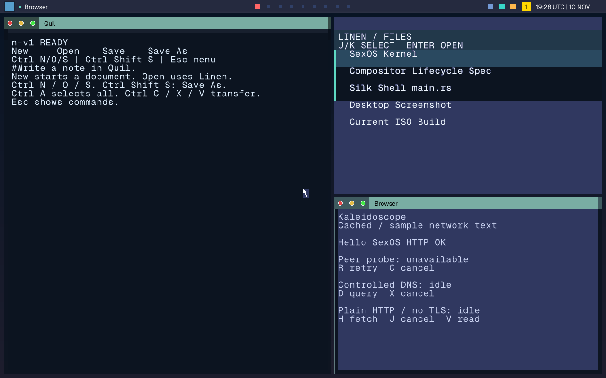
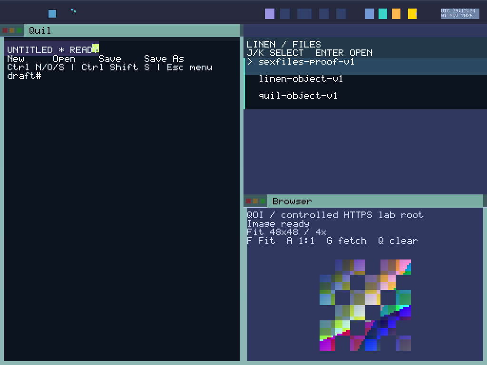

# Silk Desktop & Navigation

The SexOS desktop experience is orchestrated by **Silk**, a high-performance single-address-space window manager and display compositor. Silk combines dynamic automatic tiling, a global status panel (**SilkBar**), multi-workspace management (**Atlas**), and modal keyboard chords inspired by modern tiling window managers (Hyprland, river, and KDE Plasma).


*Silk managing multiple tiled windows with live thumbnails, responsive split frames, and SilkBar integration.*

---

## The Silk Desktop Interface

### SilkBar
The top panel on your screen is **SilkBar** (`servers/silkbar`). It provides ambient system telemetry rendered directly by `sexdisplay`:
- **Workspace Indicator**: Highlights active workspace (1 through 9) managed by Atlas.
- **Active Window Title**: Displays the focused application organ and document name.
- **Civil Clock & Date**: Real-time monotonic and civil clock, formatted in local time, UTC, or SexTime.
- **Volume & Media**: Current master audio level and active stream indicator.
- **Network Status**: Ethernet link or active Wi-Fi connection with signal strength.
- **Battery & Power**: Charge percentage, power profile, and charging status on portable hardware.
- **Notification Bell**: Displays unread notification counts from **Bell** (`Super+N`).

### Atlas Workspaces
**Atlas** manages virtual workspaces 1 through 9. Workspaces are dynamic and lightweight:
- Each workspace maintains its own independent tiling layout state and window order.
- Switching workspaces (`Super+1` .. `Super+9`) instantly flips visible surface planes with zero context switch latency.
- Windows can be seamlessly moved between workspaces using `Super+Shift+1` .. `Super+Shift+9`.

---

## Window Tiling Layouts

Silk organizes application windows using mathematical geometry without window overlapping by default. Press **`Super+Space`** to cycle between the available layouts:

```
┌──────────────┬──────────────┐  ┌──────────────┬──────────────┐  ┌─────────────────────────────┐
│              │    Stack     │  │              │    Pane 2    │  │                             │
│              │   Window 2   │  │   Pane 1     ├──────┬───────┤  │                             │
│    Master    ├──────────────┤  │              │Pane 3│Pane 4 │  │           Monocle           │
│   Window 1   │    Stack     │  │              │      │       │  │       (Focused Frame)       │
│              │   Window 3   │  │              │      │       │  │                             │
└──────────────┴──────────────┘  └──────────────┴──────┴───────┘  └─────────────────────────────┘
          MasterStack                         Dwindle                         Monocle
```

1. **MasterStack (Default)**:
   - Divides the screen into a prominent **Master** column on the left and a stacked column of secondary windows on the right.
   - Adjust the width of the master column dynamically with **`Super+]`** (grow) and **`Super+[`** (shrink).
2. **Dwindle**:
   - Each successive window halves the remaining geometry of the preceding window in a recursive spiral (Hyprland style). Ideal for ultrawide and 4K displays.
3. **Monocle**:
   - Maximizes the focused window across the entire work area while preserving the workspace tiling hierarchy. Toggle directly anytime with **`Super+M`**.
4. **Grid**:
   - Arranges all windows in balanced, equal rows and columns.

### Floating Mode
Windows that require free positioning (e.g., calculators, palettes, dialogues) can be detached from the tiling grid:
- Press **`Super+Shift+V`** or **`Super+Shift+Space`** to toggle floating mode on the active window.
- Drag the title bar to move a floating window, or drag edges and corners to resize.

### Scratchpad
Silk provides a drop-down floating utility stash called the **Scratchpad**:
- **`Super+S`**: Toggle the scratchpad window in and out of view.
- **`Super+Shift+S`**: Send the currently focused window directly into the scratchpad stash.

---

## Keyboard Navigation & Chords Reference

Silk captures the **Super** key (Windows/Command key) exclusively for desktop management. Applications never intercept raw Super chords:

### Workspace & Window Focus Chords
| Key Combination | Action | Description |
|---|---|---|
| `Super` (tap) or `Super+D` | **Voyeur Launcher** | Summon the instant application launcher & search palette. |
| `` ` `` (backtick) | **Command Palette** | Alternative fast shortcut for command search. |
| `Super+Enter` | **Spindle Terminal** | Spawn a new Spindle shell terminal window. |
| `Super+1` .. `Super+9` | **Switch Workspace** | Jump immediately to workspace 1–9. |
| `Super+Shift+1` .. `Super+Shift+9` | **Move Window** | Move the active window to designated workspace. |
| `Super+Tab` / `Super+Ctrl+Right` | **Next Workspace** | Switch to the next sequential workspace. |
| `Super+Shift+Tab` / `Super+Ctrl+Left` | **Prev Workspace** | Switch to the previous sequential workspace. |
| `Super+H / J / K / L` or `Super+Arrows` | **Directional Focus** | Navigate focus spatially Left, Down, Up, or Right. |
| `Super+Shift+H/J/K/L` or `Shift+Arrows` | **Swap Window** | Exchange screen position with the adjacent tiled window. |
| `Super+Q` | **Close Window** | Gracefully close the active window. |
| `Super+F` | **Fullscreen** | Expand the focused window across the entire physical display. |
| `Super+Shift+V` / `Super+Shift+Space` | **Toggle Floating** | Switch between tiling and floating window mode. |
| `Super+Space` | **Cycle Layout** | Cycle through MasterStack → Dwindle → Monocle → Grid. |
| `Super+M` | **Toggle Monocle** | Toggle full-screen monocle presentation on the current workspace. |
| `Super+]` / `Super+[` | **Resize Master** | Expand or contract master column ratio. |
| `Super+S` | **Scratchpad** | Toggle visibility of the scratchpad floating window. |
| `Super+Shift+S` | **To Scratchpad** | Send the active window to the scratchpad. |
| `Super+W` | **Atlas Overview** | Open interactive full-workspace overview with live cards. |
| `Super+V` | **Clipboard History** | Step backward through previous clipboard entries. |

### System & Environment Chords
| Key Combination | Action | Description |
|---|---|---|
| `Super+Escape` | **Lock Screen** | Immediately engage the session lock screen. |
| `Super+N` | **Bell Drawer** | Open the notification center history pane. |
| `Super+Shift+N` | **Night Light** | Cycle screen color temperature (Off → Low → Medium → High). |
| `Super+B` | **Wallpaper** | Cycle through built-in high-definition desktop wallpapers. |
| `Super+Ctrl+Space` | **Keyboard Layout** | Switch active keymap layout (US, Dvorak, Colemak, Neo). |
| `Alt+Tab` | **Window Switcher** | Open fast card switcher showing live thumbnail previews. |
| `Alt+=` / `Alt+-` | **Zoom Text** | Increase or decrease text scaling in the focused window. |
| `Alt+0` | **Reset Zoom** | Restore text scaling to default 100%. |
| `F11` | **Emergency Close** | Request window termination; force-kills unresponsive runs after 5s. |
| `Scroll Lock` | **Toggle Spindle** | Show or hide the Spindle command surface. |

---

## Interactive Screenshots

Silk features a built-in hardware screenshot subsystem wired directly to `sexdisplay` and `sexfiles`:


*Direct framebuffer capture produced by the Silk screenshot engine.*

1. **Interactive Screen Selection (`Print`)**:
   - Press **`Print`** (PrintScreen). Silk dims the desktop and shows an interactive crosshair hint.
   - **Pick a Window**: Click any window to capture exactly that frame.
   - **Pick a Region**: Click and drag a selection rectangle.
   - **Full Screen**: Press **`Enter`** to capture the entire display.
   - **Cancel**: Press **`Escape`** to dismiss without saving.
2. **Instant Full Screenshot (`Shift+Print`)**:
   - Press **`Shift+Print`** to instantly snapshot the entire screen.
   - The screenshot is losslessly encoded as a PNG file and written to root storage as `/Screenshot-N.png`.
3. **CLI Desktop Capture**:
   - Within Spindle, run:
     ```text
     capture my-desktop.png
     ```

---

## Drag and Drop

Silk implements zero-copy drag-and-drop (`sex_pdx::dnd`):
- Click and drag an item from **[Loom](apps/loom.md)** (file manager) or any compatible application.
- When dragged over another program's window (such as **[Jot](apps/jot.md)** or **[Kaleidoscope](apps/kaleidoscope.md)**), Silk negotiates an unforgeable capability grant (`OP_GIVE` / `fs::OFFER`) with **sexfiles**.
- The receiving application gains custody of exactly the dropped item without gaining access to any other parent or sibling files.
