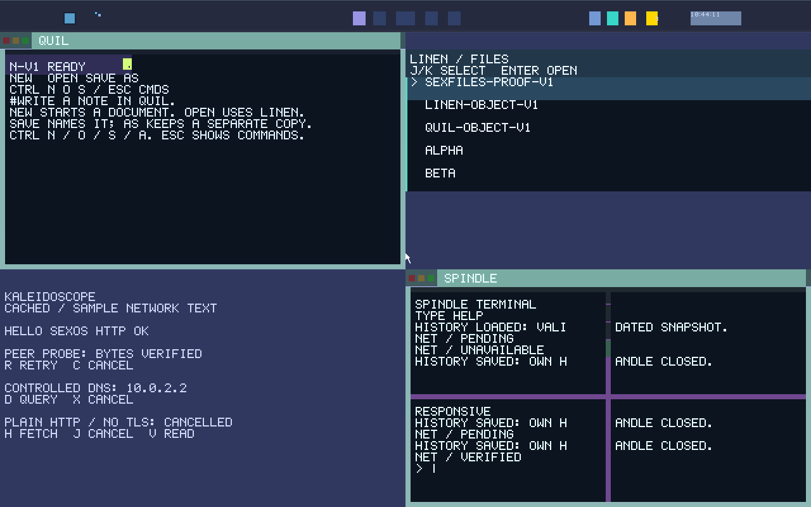

# Installation, Boot & Updates

SexOS is designed to boot natively on bare-metal x86-64 hardware or inside virtual machines. It features a modern UEFI bootloader (Limine), early-boot hardware discovery (**Foreplay**), non-destructive disk installation, and atomic dual-slot (A/B) system updates.


*Early Spindle session displaying system verification, boot facts, and storage readiness.*

---

## Hardware Requirements

To run SexOS with full hardware memory isolation:
- **Processor**: 64-bit x86 processor with **Memory Protection Keys for Userspace (PKU)**.
  - *Intel*: 10th Gen Core (Ice Lake), 11th Gen (Tiger Lake), 12th Gen (Alder Lake), 13th/14th Gen (Raptor Lake), or Xeon Scalable.
  - *AMD*: Zen 3 / Zen 4 / Zen 5 architectures with PKU support.
- **Firmware**: UEFI 64-bit (CSM / Legacy BIOS disabled).
- **Memory**: 2 GB RAM minimum (4 GB or more recommended).
- **Storage**: NVMe SSD, SATA AHCI drive, or USB 3.0 mass storage.
- **Display**: Standard VESA / UEFI GOP or VirtIO GPU at 1024×768 or 1280×800 or higher.

---

## Booting the Live ISO

1. Download the latest official release image: `sexos-v1.0.0.iso`.
2. Write the ISO to a USB flash drive using standard tools (such as `dd` or balenaEtcher):
   ```bash
   sudo dd if=sexos-v1.0.0.iso of=/dev/sdX bs=4M status=progress oflag=sync
   ```
3. Boot the target machine, select your UEFI USB device, and Limine will launch the SexOS kernel.
4. **Foreplay** (the early boot stage) initializes the hardware catalog, starts **sexdrive** and **sexnet**, warms the organ cache, and launches the **Silk** desktop environment.

---

## Installing to Disk

SexOS can install directly to NVMe or SATA drives without wiping your existing operating systems.

### 1. Safety Dry Run
Launch **[Spindle](apps/spindle.md)** (`Super+Enter`) and run:
```text
install
```
Without parameters, `install` performs a non-destructive dry run:
- Detects existing disk partition tables (GPT).
- Discovers existing operating systems (Windows, Linux, macOS).
- Formats a proposed partition plan to install SexOS beside other systems.

### 2. Executing Installation
To apply the plan and install SexOS:
```text
install go              # Installs SexOS beside existing operating systems
install go 64           # Reserves a dedicated 64 GiB partition for SexOS
install go 64 /custom.img  # Writes a specific fetched system image
```
When installation finishes:
1. SexOS writes the system into the primary boot slot.
2. An EFI boot entry named `SexOS` is registered in the NVMe/SATA UEFI NVRAM.
3. Remove the USB flash drive and restart your computer.

---

## Atomic Dual-Slot (A/B) System Updates

SexOS utilizes an atomic A/B system partition scheme to prevent unbootable updates:
- Slot A and Slot B alternate between active system state and update staging.
- System updates are cryptographically signed packages.

### Applying an Update
In Spindle, type:
```text
update
```
Or specify a custom update mirror:
```text
update https://releases.sexos.dev/nightly/update.bin
```

### The Update Lifecycle
1. **Fetch & Verification**: Spindle downloads the update package and validates its cryptographic signature against trusted public keys.
2. **Standby Staging**: The payload is written into the inactive partition slot. Your running system is completely untouched.
3. **Trial Boot**: On next restart, UEFI boots into the newly updated slot on trial.
4. **Health Verification**: If **Foreplay** and **Silk** boot cleanly and pass hardware liveness checks, the slot is marked permanently active.
5. **Automatic Rollback**: If the new slot fails to achieve quiescent desktop readiness within 30 seconds, the bootloader automatically reverts to the previous working slot.

---

## Crash Records & Diagnostic Recovery

SexOS records panic traces, driver faults, and hardware exceptions in durable NVMe crash logs:
- To inspect system recovery logs from Spindle:
  ```text
  crashes
  ```
- To view protection domain status and active servers:
  ```text
  pd
  servers
  ```
- If a server crashes during runtime (e.g., `sexfiles` or `sexnet`), the kernel restarts the organ in place without rebooting the computer.
