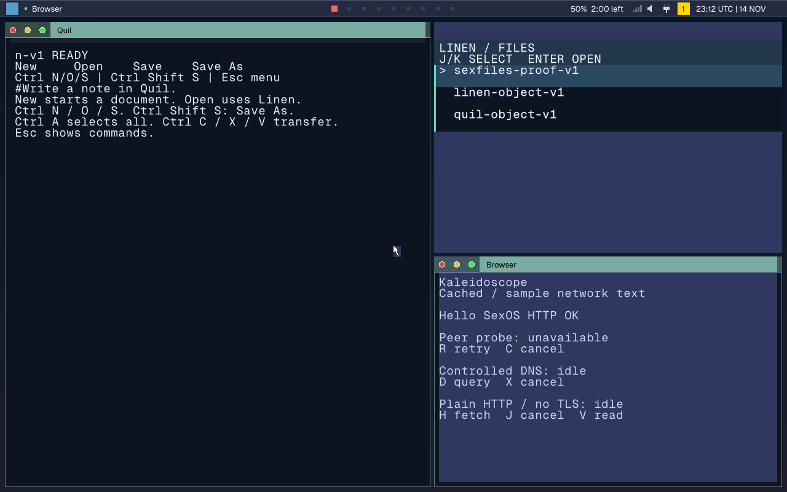

# Laptop Power & Mobile Hardware

> **Identity & Architecture**: Mobile hardware, power telemetry, and ACPI execution are managed by **`sexacpi`** (`servers/sexacpi`) running a sandboxed AML interpreter in user space, paired with the **`sex-laptop`** crate (`crates/sex-laptop`) and **Silk** desktop power hooks.

SexOS provides first-class support for modern laptops, ultrabooks, and convertible PCs. By evaluating ACPI DSDT and SSDT tables inside an isolated user-space organ, SexOS delivers real-time battery diagnostics, adaptive power profiles, smooth hardware backlight stepping, touchpad gesture and palm rejection processing, lid-close sleep transitions, thermal trip protection, and intelligent idle sleep inhibition.


*Silk desktop running on laptop hardware at 1280×800, highlighting the SilkBar battery gauge ("50%  2:00 left"), power profiles, and thermal telemetry.*

---

## Battery Telemetry & AC Management

SexOS queries the ACPI Embedded Controller (EC) and evaluates Battery System Status (`_BST`) and Battery Information Extended (`_BIX`):

- **SilkBar Battery Indicator**: The top status panel displays live percentage, charging status, and time-to-empty / time-to-full estimates (e.g., `50%  2:00 left`).
- **Health & Wear Tracking**: SexOS compares current maximum capacity against design capacity to compute battery wear percentage (`health=96%`).
- **Power Source Switching**: Unplugging or plugging the AC adapter triggers instant notification events (`ac=0` / `ac=1`), adjusting display brightness and CPU energy performance preferences automatically.

---

## Power Profiles & Energy Management

SexOS supports dynamic Energy Performance Preference (EPP) profiles:

| Profile | EPP Register | Target Behavior |
|---|---|---|
| **Power Saver** | `0xC0` | Minimizes CPU frequency transitions, caps background thread bandwidth, and dims panel backlight to maximize battery endurance. |
| **Balanced** | `0x80` | Default profile; delivers snappy desktop responsiveness while entering deep C-states during typing pauses. |
| **Performance** | `0x00` | Sustains maximum turbo boost clocks and prioritizes high frame-rate rendering for 3D modeling and compilation workloads. |

### Selecting Power Profiles
- **From Voyeur Palette**: Press **`Super+D`**, type `PowerSaver`, `Balanced`, or `Performance`, and press **`Enter`**.
- **From Tatami**: Adjust the power profile under the **Idle & Energy** section.

---

## Hardware Display Backlight

Display panel brightness is regulated through ACPI brightness level tables (`_BCL`, `_BCM`, `_BQC`):
- **Brightness Keys**: Pressing hardware brightness keys (e.g. `Fn+F5` / `Fn+F6`) dispatches firmware notify events (`0x86`) directly to `sexacpi`, stepping brightness up or down without kernel intervention.
- **Voyeur Commands**: Type `BrightnessUp` or `BrightnessDown` in the command palette.
- **Ambient Adaptation**: Transitioning to battery power automatically dials back brightness by configurable step offsets.

---

## Touchpad Gestures & Palm Rejection

Touchpads connected via I2C-HID (`_SB.PCI0.I2C1.TPD0`) are parsed and calibrated by `sex-laptop` and `sexinput`:
- **Multi-Touch Gestures**: Two-finger scrolling across documents, web pages, and spreadsheets; three-finger horizontal swipes to switch workspaces in **Atlas**.
- **Hardware Palm Rejection**: Contact area geometry and touch pressure thresholds differentiate deliberate finger navigation from resting palms, eliminating accidental cursor jumps while typing.

---

## Lid Switch & Low-Power Idle Sleep (LPS0)

Closing or opening your laptop lid is handled cleanly:
1. **Lid Close Event (`_LID open=0`)**:
   - `sexacpi` informs **Silk** that the lid has closed.
   - Filesystem buffers are synced atomically.
   - The system transitions into suspend-to-idle via Intel Low Power S0 Idle (`_SB.PEPD` / LPS0), darkening the display panel and putting CPU package states into deep low-power residency.
2. **Lid Open Event (`_LID open=1`)**:
   - The panel wakes instantly; hardware scanout resumes with zero cold-boot latency.
   - The **[Lock Screen](settings-and-lock-screen.md)** is raised if password protection is enabled.

---

## Media Playback Sleep Inhibitor

To prevent annoying screen dimming or sleep transitions while watching videos:
- When video or audio playback is active in **[Qupid](apps/qupid.md)** or **[Play](apps/splicy.md)**, Silk registers an active media inhibitor:
  ```text
  [shell.idle] inhibited=media
  ```
- While inhibited, idle display dimming and suspend-to-idle timeouts are deferred. Once media stops or pauses, normal idle timers resume automatically.

---

## Power Button & Clean S5 Shutdown

- **Graceful Power Dialog**: Tapping the hardware power button does **not** cut power abruptly. Instead, it signals the desktop compositor to summon the system power dialog with options to *Shut Down*, *Restart*, or *Cancel*.
- **Thermal Critical Trip Protection**: If hardware thermal sensors exceed critical trip thresholds (`temp_dk >= crit_dk`), `sexacpi` initiates an emergency, ordered system shutdown (`[acpi.power.critical]`), flushing all dirty **sexfiles** pages to NVMe before commanding ACPI S5 power-off.
