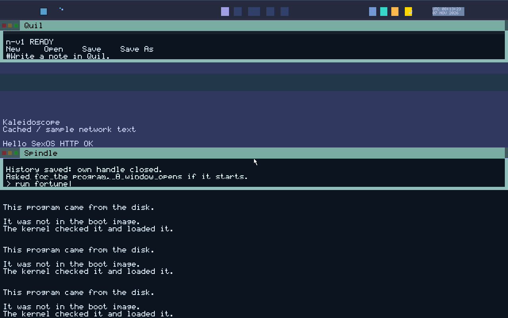

# Security, Capabilities & Collar

SexOS discards the decades-old UNIX security model of user IDs, superuser (`root`), file permissions, and ambient filesystem access. Instead, SexOS enforces **capability-based confinement** implemented via x86-64 hardware Memory Protection Keys (PKU), unforgeable capability tokens, and the **Collar** authority broker.


*Programs in SexOS running in isolated protection domains, confined strictly to their explicit grants.*

---

## The SexOS Confinement Philosophy

In traditional operating systems, any program you run inherits all of your user account permissions: a text editor can read your private SSH keys, a calculator can connect to arbitrary remote servers, and a media player can scan your entire home directory.

In SexOS:
- **No Ambient Authority**: A program starts with access to **nothing** outside its own private sandbox directory (`/data/<app-name>`).
- **No Superuser / Root**: There is no privileged `root` user that can bypass access controls.
- **Hardware-Enforced Organs (PKU)**: Each running program and server runs in its own memory domain. Memory access violations are caught immediately by hardware page protection registers (PKRU) without entering ring 0.
- **Zero-Copy Typed IPC (PDX)**: Communication between domains occurs over capability-checked PDX channels. Pointers cannot be leaked or forged across protection domains.

---

## The Security Architecture

### Collar: Authority & Grants Broker
**Collar** is the security arbiter of SexOS. Collar mediates all interactions between applications, hardware resources, and persistent storage:
1. **Launch Grants**:
   - `run <app>`: Grants only private local storage (`/data/<app>`).
   - `run +net <app>`: Explicitly grants the right to open network sockets via **sexnet**.
   - `run +pkg <app>`: Explicitly grants package management authority via **sexshop**.
   - `run <app> @/path/to/file`: Hands over custody of exactly that single file.
2. **Interactive Pickers**:
   - When an application requests a file through an "Open" or "Save" dialogue, **Loom** presents the picker.
   - When you select a file, Collar mints an unforgeable capability token for only that file and delivers it to the application.
3. **Drag and Drop (`fs::OFFER`)**:
   - Dragging a file across windows causes Silk to issue `OP_GIVE`. Collar grants access only to the dropped object upon release.
4. **Grant Revocation**:
   - Closing an application or revoking permissions in **[Tatami](apps/tatami.md)** immediately invalidates capability tokens across the entire single address space.

### Shibari: Volatile Secret Keeper
**Shibari** is the cryptographic key and secret keeper of SexOS:
- Secrets (disk encryption master keys, TLS private keys, Wi-Fi passwords, and password vault keys) reside exclusively in memory pages owned by Shibari.
- No other protection domain can map or read these pages.
- SexOS has no swap partitions: pages are zeroed in RAM immediately upon release and are **never** written to persistent disk media.

### BDSM: Block Device Storage Manager
**BDSM** sits between hardware storage drivers (**sexdrive**) and the filesystem (**sexfiles**):
- **Partition Isolation**: Strictly isolates system partitions, user volumes, and boot slots.
- **At-Rest Encryption**: Direct volume encryption utilizing AES-XTS with keys held in Shibari.
- **Write Policy & Disk Lenses**: Protects raw disk sectors from unauthorized modification.

### LUBE: Lightweight Unified Binary Executor
**LUBE** is the program loader (`servers/sex-ld`):
- Enforces strict `W^X` (Write XOR Execute) memory policies.
- Validates ELF headers and verifies that binaries do not contain forbidden instructions (such as `WRPKRU` or raw kernel rings).
- Shuffles layout randomized base addresses for protection domain organs.

### Choke: Network Bandwidth Limiter
**Choke** enables per-program network bandwidth governance directly through Spindle:
```text
choke kaleidoscope 50mb     # Limit Kaleidoscope to 50 Mbps throughput
choke qupid 10mb            # Limit media streaming rate
```

### SafeWord: Emergency Intervention
If an untrusted or buggy program enters an infinite loop or consumes excessive resources:
- **`F11`**: Requests immediate graceful closure; if unresponsive after 5 seconds, Silk forcibly terminates the organ.
- **SafeWord Chord**: Built-in emergency keyboard sequence that forcibly tears down the active protection domain and reclaims all allocated frames without kernel panic.

---

## Inspecting Capabilities with Mesh

To inspect the live capability graph and see which programs hold which rights:
- Launch **[Mesh](apps/mesh.md)** from the launcher or Spindle (`run mesh`).
- Mesh renders a real-time topology of active protection domains, CPU quotas, memory footprints, and capability grants mediated by Collar.

To review and manage persistent application permissions:
- Open **[Tatami](apps/tatami.md)** and navigate to the **Privacy & Grants** panel.
- Here you can audit when each application last exercised its file or network grants and revoke any grant with a single click.
