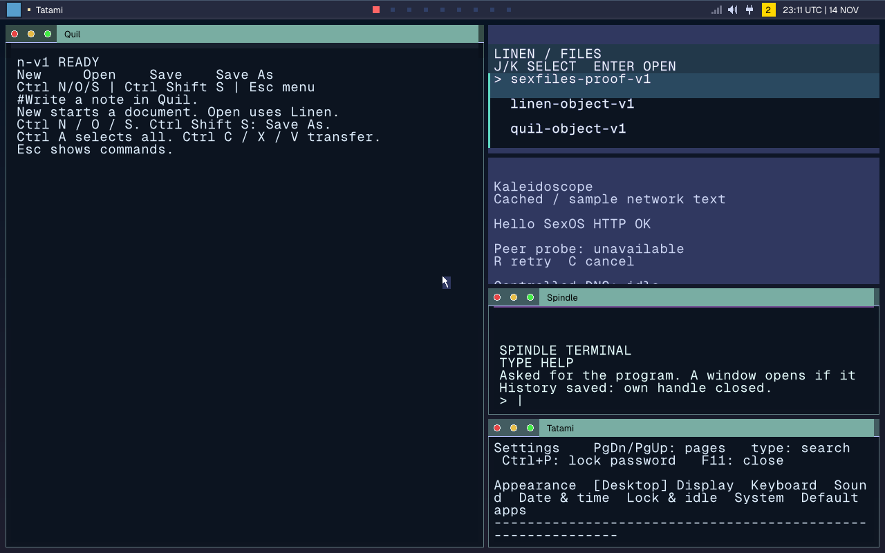
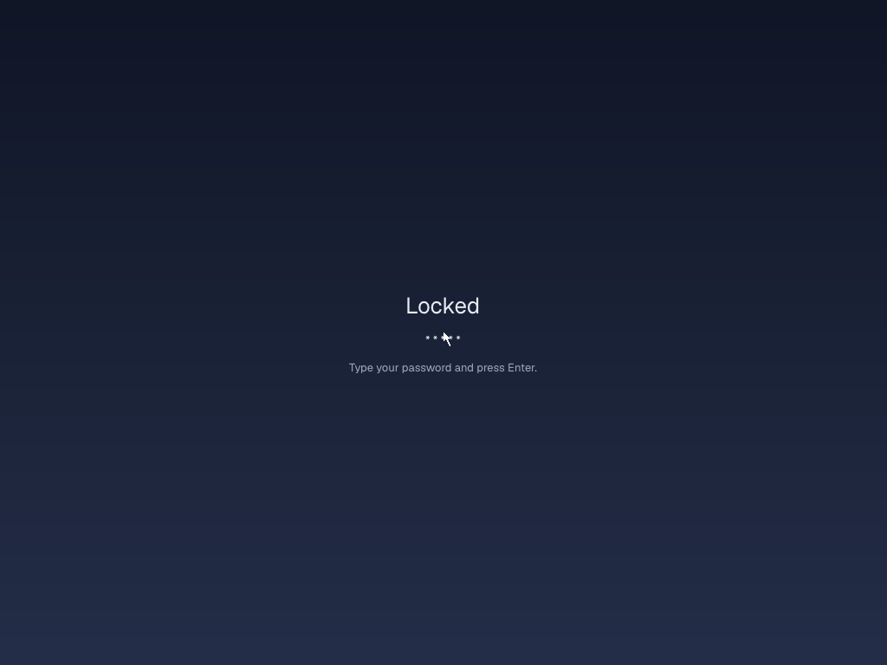

# Settings & Lock Screen

> **System Architecture**: Configuration in SexOS is managed by **`sex-config`** and persisted across boots by **sexfiles** in `/system/settings.toml`. Graphical preferences are presented by **Tatami** (`apps/settings`, `/bin/tatami`). The desktop lock screen and idle power management are implemented natively in the **Silk** compositor (`servers/silk-shell`).

---

## The Tatami Settings Center

**Tatami** provides a unified control center for personalizing your desktop, configuring hardware peripherals, adjusting typematic keyboard parameters, and setting screen lock security.


*Tatami running on the Silk desktop at 1280×800, displaying system configuration panels, live search, and value modifiers.*

### Launching Tatami
- **From Spindle**:
  ```text
  run tatami
  run settings
  ```
- **From Voyeur**: Press **`Super+D`**, type `settings` or `tatami`, and press **`Enter`**.

---

## Configuration Pages & Fast Search

Tatami groups settings into structured pages. In addition to manual page browsing, typing any query instantly filters settings across all categories:

| Setting / Search Keyword | Section | Default Value | Description |
|---|---|---|---|
| **`wallpaper`** | Desktop / Appearance | `0` (*Default Silk*) | Switch between bundled high-resolution desktop wallpapers (e.g. *Dusk*, *Silk*). |
| **`night`** | Display / Eye Care | `0` (*Off*) | Adjust color temperature warming (Levels: Off, 1, 2, 3) to reduce blue light. |
| **`zone`** | Time & Region | `UTC` | Set the active civil time zone (e.g. `Europe/London`, `America/New_York`). |
| **`delay`** | Keyboard & Input | `400 ms` | Typematic key repeat delay before repeated character generation starts. |
| **`interval`** | Keyboard & Input | `40 ms` (25 Hz) | Typematic repetition interval between repeated key events. |
| **`caps_as_ctrl`** | Keyboard & Input | `0` (*Disabled*) | Remap Caps Lock to act as a second Control key for terminal ergonomic comfort. |
| **`volume`** | Sound & Mixer | `100%` | Master hardware output volume level. |
| **`dim`** | Idle & Energy | `5 min` | Idle inactivity duration before display brightness automatically dims. |
| **`sleep`** | Laptop & Battery | `15 min` | Inactivity duration before system suspends to idle state (LPS0). |

### Keyboard Navigation in Tatami
- **`Page Up` / `Page Down`**: Navigate through settings pages.
- **`Up` / `Down`**: Move selection cursor through visible settings items.
- **`Left` / `Right`**: Decrease or increase the active setting value (immediately committed to persistent storage).
- **`Typing text`**: Filter all settings by keyword (e.g., typing `delay` highlights repeat delay).
- **`Ctrl+P`**: Open password setup dialog to set or update the desktop lock screen password.
- **`Esc`**: Clear active search filter or return to top-level category.
- **`F11`**: Close Settings window.

---

## The Silk Lock Screen

The SexOS lock screen secures your workspace when stepping away from the machine.


*The Silk lock screen at 1280×800, protecting open workspaces, preventing unauthorized keystroke injection, and prompting for password authentication.*

### Locking Your Screen
- **Instant Manual Lock**: Press **`Super+Esc`** anywhere on the desktop.
- **Idle Timeout**: If configured in Tatami, the screen automatically dims after the quiet period and locks.

### Unlocking Workflow
1. **Fresh Installation (No Password Set)**:
   - When no password has been configured, press **`Enter`** on the lock screen to unlock the desktop immediately.
2. **Password Configured**:
   - Type your password. The screen displays masked bullet glyphs matching typed length.
   - Press **`Enter`** to submit.
   - **Verification**: If correct, the lock overlay lifts instantly and returns focus to your active workspace.
   - **Refusal**: If incorrect, an authentication failure indicator is displayed, typed characters are cleared, and the screen remains locked.

### Lock Screen Security Guarantees
- **Total Input Isolation**: While locked, all mouse clicks and keyboard shortcuts (including terminal chords, window manager actions, and hotkeys) are intercepted and held by the compositor. Keystrokes cannot reach background applications.
- **Zero-Storage Password Protection**: Lock screen authentication hashes are verified via memory-hard Argon2id derivations held in **Shibari** volatile pages. Passwords are never written to plain-text logs or temporary swap space.
- **Media Playback Exemption (Sleep Inhibitor)**: While playing videos in **[Qupid](apps/qupid.md)** or **[Play](apps/splicy.md)**, Silk activates an idle inhibitor (`[shell.idle] inhibited=media`), ensuring your display will not dim or lock during movie playback.
